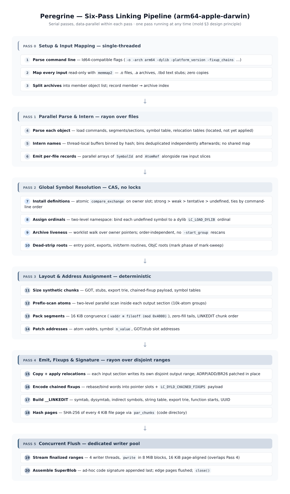
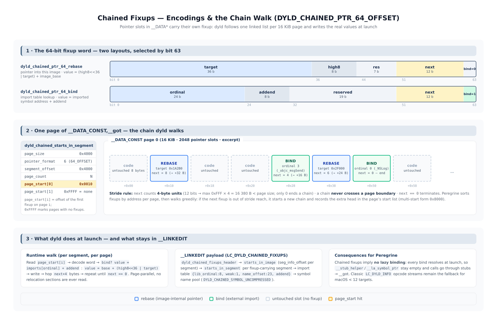
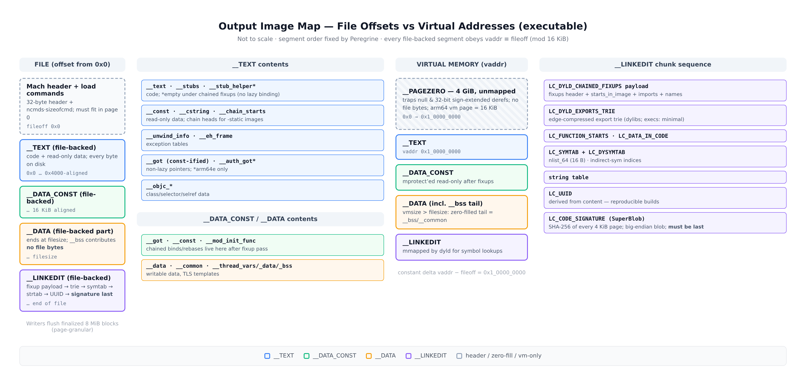
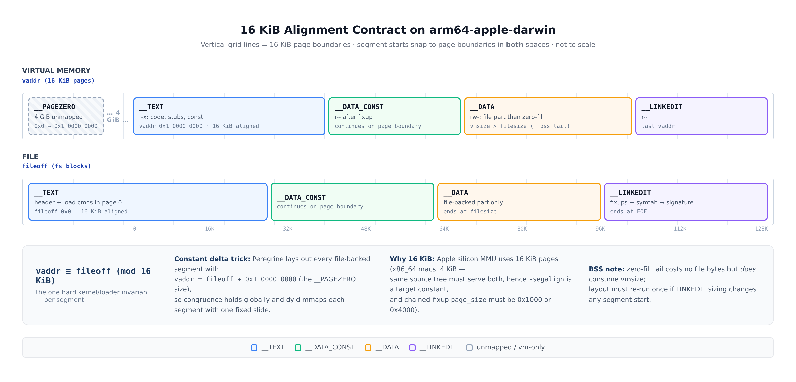

# Peregrine — Technical Design Document

**An ultra-fast Mach-O linker for arm64-apple-darwin, written in Rust, cross-linking from Linux**

| | |
|---|---|
| **Codename** | Peregrine (binary: `pgr`) |
| **Target** | arm64-apple-darwin executables, dylibs, bundles (macOS 12+ default path) |
| **Host** | Linux (primary development sandbox); macOS (deployment as an `ld` replacement) |
| **Status** | Implemented through M9 GA: tiers 2a/2b (import anchors, propagation), tier 2 (segment relayout), the GA hardening pass (shrink rung, randomized edit gate), tier 2c + the resolve's record-side wiring (v5), the resident fusion wire rung, the audited fusion rung (wire v4 — the daemon serves `-incremental-verify`), and the §7.2 output-residency rung (wire v5 — the session-resident output buffer: served images become resident state, a patched relink's reply is the changed-tile stream, the client hash-gates its replay); M10 rides the same seams at both ends — rung 1 stops Passes 1–2 short for the `-r` relocatable output (`pgr_core::link_reloc`, `pgr_emit::build_object_image`, the object contract in the verifier), rung 2 makes the fixup-encoding gate per-platform (`chained_fixups_min_minos`, the `-platform_version` surface, the verifier's declared-platform gate) — and rung 3 lands the consumer seam: `pgr_core::platform::FixupEncoding` names the encoding decision before the link runs (slice 1), `pgr --print-fixup-encoding` / `pgr_driver::fixup_encoding_report` put it on the driver surface and the verifier's `fixups_floor` gate reads the same canonical table (`pgr_format::consts::chained_fixups_floor` — one table, four readers since M16 — the layout, the seam, the verifier gate and the `pgr_core::init_offsets` decision; slice 2) — rung 4 opens the arm64e word family on both sides of the image: slice 1 the read side (`ChainWordArm64e`, the fixtures' pointer-format knob, the verifier's walk), slice 2 the unauth producer (`plan_fixups_with_format`, the `-fixup_chains_format` surface, the v6 wire tail byte), slice 3 the authenticated producer (`FixupAuth` policies, the 32-bit runtime offset, the auth bind's addend-split exception with the anchor appending) — §15 is the M10 design record; README "Status" and docs/BENCHMARKS.md carry the shipped state |
| **Date** | 2026-11-09 |
| **Companion diagrams** | `assets/pipeline.png`, `assets/output-map.png`, `assets/alignment.png`, `assets/fixup-chain.png` |

---

## Table of Contents

1. [Executive Summary and Design Goals](#1-executive-summary-and-design-goals)
2. [Prior Art Audit: mold, wild, zld, object](#2-prior-art-audit-mold-wild-zld-object)
3. [Target Platform Contract: Mach-O on arm64-apple-darwin](#3-target-platform-contract-mach-o-on-arm64-apple-darwin)
4. [System Architecture and Pipeline Overview](#4-system-architecture-and-pipeline-overview)
5. [Pipeline Pass Specifications](#5-pipeline-pass-specifications)
6. [Core Rust Data Structures and Hot Paths](#6-core-rust-data-structures-and-hot-paths)
7. [Chained Fixups Generation](#7-chained-fixups-generation)
8. [16 KiB Alignment and the Output Layout Engine](#8-16-kib-alignment-and-the-output-layout-engine)
9. [Ad-Hoc Code Signing Pass](#9-ad-hoc-code-signing-pass)
10. [Concurrency, Memory and Allocator Strategy](#10-concurrency-memory-and-allocator-strategy)
11. [Validation on Linux: the Self-Parse Verifier](#11-validation-on-linux-the-self-parse-verifier)
12. [Roadmap M0–M5](#12-roadmap-m0m5)
13. [Risk Register](#13-risk-register)
14. [References](#14-references)
15. [Addendum — M10 design record](#15-addendum--m10-design-record)

---

## 1. Executive Summary and Design Goals

Peregrine is a from-scratch, massively parallel static linker that consumes arm64 Mach-O relocatable objects (`.o`), static archives (`.a`) and text-based dylib stubs (`.tbd`), and emits valid, code-signed Mach-O images for Apple Silicon. It is developed and tested on Linux and intended to run anywhere — including on macOS hosts as a drop-in `ld` replacement where command-line compatibility is required.

The design is deliberately built on **audited prior art rather than folklore**. The single most consequential finding of the audit is that the linker landscape has shifted under our feet: mold — the fastest ELF linker — has been rewritten in Rust and has **merged a full Mach-O backend** (`rui314/mold-macho` → `macho/` in mainline mold), which links "working, correctly code-signed executables, dylibs and bundles for arm64 and x86-64 macOS" ([mold-macho README](https://github.com/rui314/mold-macho)). Peregrine therefore does not need to re-derive the parallel linking playbook; it needs to *re-implement it cleanly in idiomatic Rust with a modern Mach-O feature set*, borrowing verified algorithms from the mold paper ([arXiv:2608.23228](https://arxiv.org/abs/2608.23228)) and correcting the one piece of ELF folklore that does not survive the port to macOS — `mmap`-ing the output file (see §2.1.3).

**Design goals, in priority order:**

1. **Correct, valid output.** Every emitted image must pass Peregrine's own read-side verifier (§11), `llvm-otool`/`llvm-nm` cross-inspection on Linux, and — on macOS hardware, eventually — `codesign -v` and dyld. Correctness gates ship in M0, before the fast paths.
2. **Determinism.** Identical inputs, flags and version produce bit-identical output. Every parallel phase is either commutative by construction or followed by a canonicalization sort (mold §4.11).
3. **Speed at the link step.** Serial passes, data-parallel within each pass; no `Mutex<HashMap>` anywhere in the hot path; zero-copy input parsing; allocation-light metadata. The reference point is mold's measured 2.4–16.1× over lld and up to 112× over GNU ld on ELF ([paper, §7.2](https://arxiv.org/html/2608.23228v1)); our target is to beat `ld-classic` (current Apple ld) and `ld-prime` (the new Rust ld) by ≥5× on large debug builds, and to stay within striking distance of mold's own Mach-O backend.
4. **Apple Silicon native.** 16 KiB segment page alignment, 4 GiB `__PAGEZERO`, `LC_DYLD_CHAINED_FIXUPS` as the default fixup encoding, ad-hoc code signing, and two-level namespace symbol binding are *structural* properties of the layout engine, not command-line afterthoughts.

**Explicit non-goals (v1):** arm64e (authenticated pointers) — schema supported, encoding deferred; bitcode/LTO object lowering (pass-through only); deterministic cross-run parallel *scheduling* beyond what output determinism requires.

**Headline architectural decisions** (each defended in the section noted):

- Serial pass pipeline, parallel-for within passes; rayon work-stealing as the only compute thread pool (§4, §10).
- Symbol identity = `u32` `SymbolId`; names interned to `u32` `StringId`s via *hash-binned thread-local buffers deduplicated per bin* — no shared concurrent map at all (mold §4.1; §6.1).
- Global resolution by single-word `compare_exchange` on a packed `(precedence-rank, file, symbol)` key — lock-free, deterministic, tie-broken by command-line order (§6.2).
- Metadata in arenas referenced by 32-bit indices, never 64-bit pointers (mold §6.1; §6.1 here).
- Output built in **one anonymous in-memory buffer** with disjoint-range parallel writes, flushed by a 4-thread `pwrite` pool — *not* an mmap of the output file, because on macOS a vnode that has ever had a writable shared mapping fails ad-hoc code-signature validation at exec time (mold `macho/output_file.rs`; §5, §10).
- Chained fixups (`DYLD_CHAINED_PTR_64_OFFSET`) generated in a dedicated emit sub-pass with a stride-bounded greedy chain packer per 16 KiB page (§7).

---

## 2. Prior Art Audit: mold, wild, zld, object

### 2.1 mold (rui314/mold) — and its Mach-O backend

**Status.** mold is no longer "just" a C++ ELF linker. The repository is now titled *"mold: A Modern Linker in Rust 🦀"* ([github.com/rui314/mold](https://github.com/rui314/mold)), and the separate [`rui314/mold-macho`](https://github.com/rui314/mold-macho) effort — a Rust Mach-O backend accepting ld64's command line — has been merged into the main repo under `macho/` ("*This project has been merged into the main mold repository. Development continues there.*"). The `macho/` tree contains `arm64.rs`, `x86_64.rs`, `dead_strip.rs`, `icf.rs`, `tapi.rs`, `objc.rs`, `thunks.rs`, `lto.rs`, `dwarf.rs` and a `chunks/` directory with one module per `__LINKEDIT` construct (`chained_fixups.rs`, `chain_starts.rs`, `code_signature.rs`, `export_trie.rs`, `got.rs`, `stubs.rs`, `symtab.rs`, `indirect_symtab.rs`, `function_starts.rs`, `data_in_code.rs`, `unwind_info.rs`, …) — i.e., the full load-command surface Peregrine must also cover. Its README claims: *"C, C++, Objective-C, Swift and Rust programs link and run, including real-world projects (ripgrep builds and passes its full test suite; the C++ mold tree with vendored tbb/zstd/zlib builds at -O3; the linker links itself)"*.

This changes Peregrine's positioning from "build the missing thing" to "build a competitive, clean-room Rust implementation with first-class Linux-first validation" — and gives us an existence proof for every platform claim in this document.

**The paper.** *"mold: A Massively Parallel Linker"* (Rui Ueyama, [arXiv:2608.23228v1](https://arxiv.org/html/2608.23228v1), Aug 2026) documents the architecture with per-pass parallelization details. Headline results: *"2.4–16.1× faster than the state-of-the-art lld linker, and up to 112× faster than the traditional GNU ld"*; a TensorFlow debug build (24 GiB of objects → 9.9 GiB output) links in seconds where lld takes 52 s on a 64-core machine.

#### 2.1.1 What the paper proves (borrow all of it)

| Technique | Paper ref | Reused in |
|---|---|---|
| Serial passes, parallel-for within each pass; reject task-parallel dependency-graph design (gold's model measured *negligible or negative* speedup) | §3 | §4, §5 |
| Parse *everything* upfront in parallel — including every archive member — so resolution is one parallel pass afterwards | §4.1 | Pass 0/1 |
| Interning without a shared map: *"names are binned by hash into thread-local buffers during parsing, and each bin is deduplicated independently afterwards, with no shared concurrent data structure"* | §4.1 | §6.1 |
| Symbol resolution by atomic compare-and-swap on an owner field, with a documented precedence table and command-line-order tie-break | §4.2, Table 2 | §6.2 |
| Archive inclusion via liveness walk over owner pointers — order-insensitive, no `-start-group` rescans | §4.2 | Pass 2 |
| GOT/stub-need flags set with monotonic relaxed atomic ORs, no locks | §4.4 | Pass 2/4 |
| Layout as a *two-level parallel prefix scan* over groups of ~10,000 input sections per output section | §4.7 | §5 Pass 3, §6.4 |
| Output generation: every input section writes its own disjoint region of the output, applying relocations in place | §4.10 | Pass 4 |
| Determinism: commutative operations or a canonicalizing sort after every nondeterministic step | §4.11 | §4 policy |
| `fallocate` block preallocation (copy pass 3.5× faster), `madvise(MADV_HUGEPAGE)` on the output mapping (3.1×) | §5.1, §5.2 | Linux fast paths, see §2.1.3 |
| mimalloc worth 1.3×; a hand-rolled bump allocator measured **slower** than mimalloc (1.00 s vs 0.89 s) | §5.3 | §10 allocator choice |
| Overwrite-in-place output reuse; two-process fork to hide teardown | §5.4, §5.5 | Optional, M5 |
| 32-bit arena offsets instead of pointers halve cross-reference metadata size | §6.1 | §6.1 |

#### 2.1.2 What the folklore says vs what the code does now

The popular summary of mold's design is *"two-pass linking: mmap the output file up front, then push data into it concurrently"*. The 2026 paper describes something better. There is **no second read of the input files** (everything is parsed once, eagerly, in parallel); the *"two passes"* that remain are over in-memory metadata — size/layout first, emit second — and on Linux the output is written through a shared mapping. Both halves of the folklore are now qualified:

1. **"Pre-allocate and mmap the output"** is true on Linux (with `fallocate` + `MADV_HUGEPAGE`, paper §5.1–5.2). It is **not** what mold's Mach-O backend does, for a documented, macOS-specific reason — next paragraph.
2. **"No intermediary allocations"** remains the law for section data (bytes flow input-mmap → output buffer, relocations patched in place).

#### 2.1.3 The macOS output-file trap (critical, non-obvious)

mold's `macho/output_file.rs` opens with the most valuable comment in this whole audit (quoted nearly verbatim):

> *"Unlike mold for ELF, the output is built in an anonymous buffer and written with pwrite, not through a shared mapping of the file. That is deliberate: on macOS, a vnode that has ever had a writable shared mapping fails ad-hoc code-signature validation at exec time — the binary is killed with SIGKILL even though codesign reports it valid on disk, msync changes nothing, and rename()ing a mapped-written temp file over the destination does not help because the taint follows the vnode."*

It continues: `clonefile()` of a mapped-written temp file yields a fresh vnode that executes, but every way of making the pages visible is a synchronous per-page push about half as fast as `pwrite`'s clustered writes; and LLVM's `FileOutputBuffer` falls back to in-memory buffers for executables on Darwin for the same reason. The implementation details are directly transferable:

- **4 writer threads** (`WRITERS = 4`), because *"the writers mostly sit in the kernel … four measured best on the debug clang and nushell links"*;
- **8 MiB blocks** (`BLOCK = 8 << 20`) queued on a channel so writers share the tail;
- **16 KiB page-granular writes** (`PAGE = 1 << 14`) — *"Two pwrites to different bytes of one page must not run at once: when neither covers the whole page, the kernel may zero-fill the part of a newly cached page its write doesn't cover"*; partial first/last pages are deferred to `finish()` (`edges`);
- finalized ranges are queued *while* the signature, symbol table and page hashes are still being produced on other cores — the write overlaps the last passes.

**Decision.** Peregrine uses the anonymous-buffer + `pwrite`-pool design as its *only* output path. It is mandatory on macOS hosts and harmless on Linux (where we could mmap, but one code path preserves determinism and testability). The input side keeps `memmap2` read-only mappings everywhere — that part of the folklore survives untouched.

#### 2.1.4 Chained-fixups engineering detail worth stealing

`macho/chunks/chained_fixups.rs` is the best public documentation of the semantics after Apple's own headers:

- *"The macOS linker uses [chained fixups] by default for recent deployment targets, such as macOS 12 and later; the older form is LC_DYLD_INFO's opcode streams."*
- *"An image with chained fixups binds every symbol at load time; there is no lazy binding"* — which is why mold's Mach-O tree keeps `stub_helper.rs`/`lazy_ptrs.rs` only for the legacy path.
- Fixup model: a `Vec<Fixup>` sorted by address; an import table built in *first-use order* (`imports: Vec<(SymbolId, addend)>`, `ImportOrdinals = HashMap<(SymbolId, u64), usize>`) — deterministic because the fixups are address-sorted.
- The 12-bit `next` field *"counts 4-byte strides"*; chains terminate at page boundaries; `-segalign` must be `0x1000` or `0x4000` (the code errors otherwise); an x86-64 image with an unaligned pointer falls back to classic dyld info — a case arm64 never hits because all pointer slots are 8-byte aligned.
- `macho/chunks/chain_starts.rs` implements `__TEXT,__chain_starts` — chain heads for `-static` images that have no dyld to read the `LC_DYLD_CHAINED_FIXUPS` payload.

#### 2.1.5 Code-signing engineering detail worth stealing

`macho/chunks/code_signature.rs` gives the exact ad-hoc recipe (full algorithm in §9): the signature is the last chunk; a SuperBlob with one (or two) code directories; SHA-256 page hashes over **4 KiB** pages (`page_hashes` computed with rayon `par_chunks`); `directory_size = 88 + ident.len() + 1 + nblocks * 32`; SuperBlob size `12 + 8 + Σ directories`, padded to 8; all signature structures **big-endian**; a SHA-1 second directory only for loaders that predate SHA-256 support (macOS < 10.11.4, iOS/tvOS < 11, `-static`); the UUID is derived from the page hashes (deterministic); the identifier comes from the install-name leaf / `-final_output` / output-path leaf.

### 2.2 wild (wild-linker/wild)

**Status.** wild is *"a very fast linker for Linux and WebAssembly"* — ELF only (x86-64, AArch64, riscv64gc, LoongArch64, PPC64LE, wasm32). There is no Mach-O support and no indication of plans for it, so wild contributes **architecture and testing culture**, not format handling.

**What its `DESIGN.md` documents** ([DESIGN.md](https://github.com/wild-linker/wild/blob/main/DESIGN.md)):

- Phase discipline, each phase borrowing immutably from the previous: `args` → `input_data` (*"Open input files with mmap and split archives into their separate objects"*) → `string_merging` → `symbol_db` (*"Build a hashmap from symbol names to symbol IDs"*) → `resolution` → `layout` (*"Traverse graph of relocations … Allocate addresses for sections, symbols, program segments"*) → `elf_writer` (*"Copy input sections to the output file, applying relocations as we go"*).
- Threading model: *"The thread pool is owned by the rayon library. Where possible, we use functions like rayon's par_iter … Failing that, we use par_bridge … In a couple of cases however, we have graph algorithms that don't fit neatly into rayon's model. In those cases, we spawn one rayon scoped task per thread and then do job control ourselves."* — exactly the pattern Peregrine needs for the archive-liveness worklist and the dead-strip mark phase.
- Testing: *"It … links them with Wild and compares the resulting binaries using our own custom diff tool, linker-diff. Provided that succeeds, it then executes all the linked programs."* wild's `linker-diff` — semantic diffing of two linkers' outputs rather than byte-diffing — is the right shape for Peregrine's differential testing against `ld64`/`ld-prime` fixtures and against `lld`'s Mach-O port on Linux (§11).

**Borrow:** phase-borrowing discipline; rayon usage patterns (`par_iter` / `par_bridge` / scoped tasks); a `linker-diff`-style semantic comparator; `--time` phase instrumentation.

**Discard:** everything ELF (program headers, `.dynamic`, DT_* tags, GNU property notes, the ELF TLS model), and wild's HashMap-per-name symbol DB — the hash-binned interning of mold scales better and is deterministic by construction.

### 2.3 zld (michaeleisel/zld)

**Status.** *"This project is a fork of the Apple linker, `ld`. It is a drop-in replacement"* — C/Objective-C rather than Zig as commonly believed. The README claims *"at least 40% faster"* (with the instruction to run it twice to warm caches), states it is *"only intended for debug builds"*, and credits *"Parallelizing in various places (the parsing of libraries, writing the output file, sorting, etc.)"*. The repository was **archived on Feb 15, 2023** and is read-only; the README now says *"zld is now archived, consider using lld instead"*. Two more data points: *"Without a few optimizations around hashing, it would produce byte-for-byte the same executables as the open-source one"* — proof that ld64's pipeline was serial enough to be dominated by hashing and parsing, i.e. exactly the passes a from-scratch parallel linker wins on — and documented breakage on `arm64_32`/Catalyst.

**Borrow:** the existence proof that parallelizing ld64 parsing/writing/sorting yields large wins on real app-sized links; the cautionary tale (a fork of a huge codebase dies when Apple moves on — clean-slate with a small, owned format surface is the sustainable path).

**Discard:** everything else — dead codebase, and the patch-ld64 strategy is orthogonal to a from-scratch design.

### 2.4 gimli-rs/object

**Status.** `object` provides unified read and write access to object formats. Mach-O support is gated by the `macho` cargo feature (enabled by both `read` and `write` — verified in `Cargo.toml`), and since the `mach` dependency was retired, the raw Mach-O structures are **vendored inside the crate** (`object::macho`; the writer sources `use crate::macho`) as endian-aware `#[repr(C)]` types.

**Read side** (`object::read::macho`): `MachOFile` gives segments, sections, symbols and relocations with proper endianness handling and validation; the `Segment`/`Section` traits abstract `LC_SEGMENT`/`LC_SEGMENT_64`. This is production-quality, property-tested code — ideal as an **independent second parser** inside Peregrine's verifier (§11), so that "Peregrine wrote it" and "Peregrine can read it" are validated by *different* code paths, with LLVM tools as a third opinion.

**Write side** (`src/write/macho/`): the module doc says it all — *"Provides `Encoder` for low level writing of Mach-O files. This is also used to provide Mach-O support for `write::Object`."* Auditing `encoder.rs`/`object.rs`: it writes `LC_SEGMENT_64`/`LC_SEGMENT`, `LC_SYMTAB`, `LC_DYSYMTAB` and `LC_BUILD_VERSION`. It has **no** `LC_MAIN`, `LC_UUID`, `LC_LOAD_DYLIB`, `LC_DYLD_CHAINED_FIXUPS`, `LC_DYLD_EXPORTS_TRIE`, `LC_FUNCTION_STARTS`, `LC_DATA_IN_CODE` or `LC_CODE_SIGNATURE` support; builds everything into allocating `Vec`s on a single thread; and its relocation model is generic rather than arm64-pipeline-shaped.

**Verdict (dependency decision table):**

| Stage | Use object crate? | Why |
|---|---|---|
| Input parse (hot path) | **No** | Zero-copy casts of `#[repr(C)]` structs via `bytemuck`, with our own minimal validation, beat a general-purpose reader; we need only ~10 struct types |
| Emit (hot path) | **No** | Not linker-grade: no fixups/trie/signature/UUID/MAIN; single-threaded Vec model would bottleneck Pass 4 |
| Raw struct/constants | **Partially** | `object::macho` constants (`LC_*`, `CPU_TYPE_*`, reloc enums) are battle-tested; import them or mirror in `pgr-format` with compile-time assertions |
| Verifier (cold path) | **Yes** | Independent read path + cross-check target — its strictness is a feature here |

### 2.5 Borrow / discard matrix

| Prior art | Borrow | Discard |
|---|---|---|
| mold (ELF) | Pass structure; CAS resolution + precedence table; hash-bin interning; two-level prefix-scan layout; disjoint-range emit; determinism policy; fallocate/hugepage (Linux); mimalloc; 32-bit arena offsets; two-process exit | ELF sections/program headers/dynamic tags; COMDAT groups (Mach-O has none); **output mmap** (macOS vnode taint) |
| mold-macho | `pwrite` writer pool (4 threads, 8 MiB blocks, 16 KiB pages, edge pages); chained-fixup payload layout; import-first-use ordering; `__chain_starts`; ad-hoc signature recipe; dead-strip/ICF/tapi/ObjC scope list | Its chunk-virtual dispatch — Peregrine keeps segments as flat data (`Vec<ChunkSlot>`) for layout math |
| wild | Phase-borrowing API shape; rayon `par_bridge`/scoped-task fallbacks; `linker-diff` semantic testing; `--time` instrumentation | ELF writer/symbols; hashmap-based symbol DB |
| zld | Cautionary existence proof | The codebase (archived) and the patch-ld64 strategy |
| object | Verifier read path; LC/reloc constants | Write path for linking (baseline serialization only) |
| LLVM `MachO.h` | Ground truth for `dyld_chained_*` bit layouts and format enums (§7) | — |
| ld64 behavior | Command-line surface; segment packing defaults; `-adhoc` default on arm64 | The codebase |

---
## 3. Target Platform Contract: Mach-O on arm64-apple-darwin

This section fixes the *format contract* Peregrine must satisfy. Everything here is normative for the layout engine; references go to the primary sources (LLVM's `MachO.h`, Apple's ABI documentation tradition, and observed ld64 behavior).

### 3.1 File model

A Mach-O image is a sequence of pages: at offset 0 the `mach_header_64` (32 bytes: magic `0xFEEDFACF`, cputype `CPU_TYPE_ARM64 = 0x0100000C`, cpusubtype, filetype `MH_EXECUTE`/`MH_DYLIB`/`MH_BUNDLE`/`MH_OBJECT`, ncmds, sizeofcmds, flags, reserved), immediately followed by `ncmds` load commands, all inside **page 0**. Everything else is reached through load commands; there is no section header table.

### 3.2 Load commands Peregrine emits (executable case)

| Load command | Contents | Emitted by |
|---|---|---|
| `LC_SEGMENT_64` ×5 | `__PAGEZERO` (vm only), `__TEXT`, `__DATA_CONST`, `__DATA`, `__LINKEDIT` | Layout engine (§8) |
| `LC_BUILD_VERSION` | platform `PLATFORM_MACOS`, minos, sdk | Driver from flags |
| `LC_MAIN` | `entryoff` — offset of entry from `__TEXT` vmaddr | Synthetics |
| `LC_LOAD_DYLIB` ×n | install names, in **ordinal order** — the two-level-namespace index base | Driver |
| `LC_SYMTAB` | `nlist_64[]` + string table | Linkedit pass |
| `LC_DYSYMTAB` | mostly legacy zeros; `indirectsymoff`/`nindirectsyms` for `__stubs`/`__got` slots | Linkedit pass |
| `LC_DYLD_CHAINED_FIXUPS` | `dataoff/datareloff` into `__LINKEDIT` → fixup payload (§7) | Fixups pass |
| `LC_DYLD_EXPORTS_TRIE` | export trie (dylibs: full; execs: minimal) | Linkedit pass |
| `LC_FUNCTION_STARTS` | function start table (for unwinding/profiling) | Linkedit pass |
| `LC_DATA_IN_CODE` | data-in-code entries from the inputs' `LC_DATA_IN_CODE` payloads (the M30 carriage) | Linkedit pass |
| `LC_UUID` | UUID — derived from content for reproducibility (§9) | Linkedit pass |
| `LC_CODE_SIGNATURE` | SuperBlob, **last bytes of the file** (§9) | Signing pass |

Legacy fallback: for deployment targets below macOS 12 (or `-no_fixup_chains`), `LC_DYLD_INFO(_ONLY)` opcode streams (rebase/bind/lazy-bind/weak-bind) replace chained fixups; mold keeps this path in `rebase_info.rs`/`bind_info.rs`/`lazy_bind_info.rs`, and Peregrine's roadmap defers it to M5.

### 3.3 Symbol model

- **`nlist_64`** (16 bytes): `n_strx: u32` (string-table offset), `n_type: u8`, `n_sect: u8`, `n_desc: u16`, `n_value: u64`. Defined external symbols are `N_SECT | N_EXT` with the defining section index; undefined are `N_UNDF | N_EXT` with `n_value = 0`; **tentative/common** symbols are `N_UNDF | N_EXT` with `n_value ≠ 0` (size) and alignment in `n_desc` (`GET_COMM_ALIGN`).
- **`n_desc` bits**: library ordinal (bits 0–7, two-level namespace — see below); `REFERENCE_FLAG_*` (bits 0–3 as flag overlay); `N_WEAK_REF`, `N_WEAK_DEF`, `N_SYMBOL_RESOLVER`, `N_ALT_ENTRY`, `N_COLD_FUNC`, and on arm64 `N_ARM_THUMB_DEF` (never set on arm64).
- **Two-level namespace.** macOS is two-level by default: each undefined symbol records *which dylib* it comes from via its `n_desc` library ordinal (1-based index into the `LC_LOAD_DYLIB` list). Special ordinals: `0` = this image, `0xFF = -1` = main executable, `0xFE = -2` = flat lookup, `0xFD = -3` = weak lookup. The resolver must therefore track `(dylib, name)` pairs, not just names — this is the biggest semantic difference from ELF linking and a common source of subtle bugs (risk R4).
- **Indirect symbols.** `LC_DYSYMTAB.indirectsymoff` indexes the symbol table for pointer/stub slots: every entry of `__stubs`, `__got`, `__la_symbol_ptr` gets a `u32` symbol index (with `INDIRECT_SYMBOL_LOCAL`/`ABS` sentinels where applicable) so debuggers and dyld map slot → symbol.
- **Export trie.** Dylibs must export their API through an edge-compressed prefix trie (`LC_DYLD_EXPORTS_TRIE`); node children are stored sorted by their first byte. Executables export little — modern ld64 still emits a minimal trie (typically the `__mh_execute_header` symbol) — Peregrine matches observed ld64 behavior and verifies against fixtures (M2 gate).

### 3.4 Synthetic sections and stubs (arm64)

| Section | Type | Content (arm64) |
|---|---|---|
| `__TEXT,__stubs` | `S_SYMBOL_STUBS` (12 B/slot) | `adrp x16, slot@page; ldr x16, [x16, slot@pageoff]; br x16` — jumps through the GOT |
| `__TEXT,__stub_helper` | — | Empty under chained fixups (no lazy binding); populated only in legacy mode |
| `__DATA_CONST,__got` | `S_NON_LAZY_SYMBOL_POINTERS` | 8-byte slots; become chained binds/rebases (§7) |
| `__DATA,__la_symbol_ptr` | `S_LAZY_SYMBOL_POINTERS` | Only in legacy dyld-info mode |
| `__DATA,__thread_vars` | `S_THREAD_LOCAL_VARIABLES` | TLV descriptors; accesses go through `tlv_bootstrap` |
| `__TEXT,__chain_starts` | — | Only for `-static` images (§2.1.4) |

The GOT-ness of a reference is decided by the *relocation type* in the input object (`ARM64_RELOC_GOT_LOAD_PAGE21/PAGEOFF12` demand a GOT slot; `ARM64_RELOC_PAGE21/PAGEOFF12` bind directly; `ARM64_RELOC_POINTER_TO_GOT` is a pointer whose value is a GOT address). Slot-need flags are computed in the relocation-scan phase with monotonic atomics (mold §4.4 pattern).

### 3.5 Relocation types the emit pipeline must apply

From arm64 objects (clang `-c` output):

- `ARM64_RELOC_UNSIGNED` — 64-bit absolute in data sections. **Two distinct fates:** standalone → becomes a chained fixup (rebase or bind), the slot is *not* given its final value at link time; paired with `ARM64_RELOC_SUBTRACTOR` → static `A − B + addend`, applied at link time (this is how `__SIZE_TYPE__`-style relative pointers in `__const` work).
- `ARM64_RELOC_PAGE21` / `PAGEOFF12` — ADRP / ADD-LDR-STRT-INT immediate patches.
- `ARM64_RELOC_GOT_LOAD_PAGE21` / `GOT_LOAD_PAGEOFF12` — as above but the target is the symbol's GOT slot.
- `ARM64_RELOC_BRANCH26` — B/BL immediate; range-checked at layout (±128 MiB; arm64 call sites may need veneers/thunks — mold's Mach-O tree has `thunks.rs`; Peregrine defers full range-extension batching to M5, since most app links stay within range and overflow is reported, not silently mis-linked).
- `ARM64_RELOC_SUBTRACTOR` + `UNSIGNED` pair; `ARM64_RELOC_ADDEND` (paired, carries the addend for page relocs on Mach-O).
- `ARM64_RELOC_TLV_LOAD_PAGE21/PAGEOFF12` — TLS descriptors through `__tlv_bootstrap`.
- `ARM64_RELOC_POINTER_TO_GOT`.

### 3.6 Platform invariants Peregrine hard-codes

1. **16 KiB page size** for segment layout on arm64 (4 KiB on x86_64 macOS): every segment's `vmaddr` and `fileoff` are 16 KiB aligned, and `vmaddr ≡ fileoff (mod 0x4000)`. lld's driver comment is a good citation of the hardware fact: Apple's ARM64 devices *"use a page size of 16K"*, and of the history (ld64's `-pagezero_size` handling even contains a 4K-then-16K rounding quirk that lld deliberately did not copy).
2. **`__PAGEZERO` = 4 GiB** on 64-bit images: `vmaddr 0x0 → 0x1_0000_0000` unmapped; the executable's `__TEXT` starts at `0x1_0000_0000`. `__PAGEZERO` has no file bytes.
3. **Chained fixups for macOS ≥ 12** (`-fixup_chains` is ld64's default there); pointer formats `DYLD_CHAINED_PTR_64_OFFSET = 6` (Peregrine's choice — targets are image-base-relative offsets) with `DYLD_CHAINED_PTR_64 = 2` kept for compat; payload per LLVM `MachO.h` (§7).
4. **Ad-hoc code signature is mandatory on arm64**: *"ARM64 macOS requires that a program have an ad hoc signature, otherwise the system will immediately reject it"* ([lld D96164](https://reviews.llvm.org/D96164)); Apple's own framing: *"the linker adds an ad hoc code signature to Apple silicon images"* (Apple Developer Forums). The linker embeds the signature — it is part of the file format now, not a post-processing step.
5. **Code-signature page hashing uses 4 KiB pages** regardless of the 16 KiB VM pages — the CodeDirectory's `pageSize` field is log₂(4096) = 12 (see mold `code_signature.rs` and the codesigning literature). Do not conflate the two page sizes; §9 keeps them strictly separated.
6. **`__DATA_CONST`** carries GOT + read-only-after-relocation data; dyld fixes it up read-write then re-protects read-only.
7. **UUID determinism**: Peregrine derives `LC_UUID` from content (page hashes) rather than a random source — reproducible builds for free (§9).

### 3.7 dyld's consumption model (what validity *means*)

At launch, dyld: maps segments (honoring 16 KiB congruence), reads `LC_DYLD_CHAINED_FIXUPS` payload, then for each fixup-carrying segment walks `dyld_chained_starts_in_image → dyld_chained_starts_in_segment → page_start[]` chains, rewriting each pointer slot (rebase: `base + (high8<<36 | target)`; bind: `imports[ordinal] + addend`), and finally applies import-table-driven lazy/weak semantics. The kernel independently verifies the code signature page-by-page *as pages are paged in*. "Valid output" therefore decomposes into exactly the assertions Peregrine's verifier checks (§11): load-command well-formedness, segment congruence, chain-walk closure (every chain ends; every fixup reachable exactly once), page-hash coverage, and symbol-table consistency.

---
## 4. System Architecture and Pipeline Overview

### 4.1 The shape of the system

Peregrine is a six-pass, **serial-pass / parallel-within-pass** pipeline. Passes never overlap (except the deliberate Pass 4 ↔ Pass 5 write overlap); within a pass, work is expressed as rayon `par_iter` over homogeneous arrays — atoms, symbols, fixups, pages. This is the mold paper's §3 design principle, kept because it is what makes invariants stateable: *"at any point in execution, exactly one pass is running"*.



**Crate layout (cargo workspace):**

| Crate | Contents | Threading |
|---|---|---|
| `pgr-driver` | CLI (ld64-compatible surface), option parsing, driver loop | single |
| `pgr-format` | `#[repr(C)]` Mach-O structs, bytemuck casts, LC/reloc constants, validation | pure |
| `pgr-core` | interner, symbol table, atom model, resolution, layout, fixups, linkedit | rayon |
| `pgr-emit` | output buffer, section copy + reloc apply, writer pool, code signature | rayon + writer threads |
| `pgr-verify` | read-back verifier + `linker-diff`-style comparator (§11) | single |

### 4.2 Memory model

- **Inputs**: each file is `memmap2::Mmap` (read-only) held alive for the entire link inside an `InputArena`. All cross-references into input bytes are `(file_index, byte_range)` — no pointers, so parsing is trivially `Send` and the lifetime problem ("slices borrow the arena") is contained in one structure, mirroring wild's `input_data` phase and mold's eager-parse decision.
- **Metadata**: per-pass arenas (`bumpalo`) of POD records; all inter-record references are `u32` indices (mold paper §6.1: *"Objects such as input files, symbols, and sections … refer to one another using 32-bit offsets within the arena instead of 64-bit pointers. This halves the storage required for each cross-reference"*). Arenas are reset between passes; nothing from Pass 1 survives into Pass 2 except the curated parallel tables.
- **Output**: one anonymous allocation of exactly the final size (known after Pass 3), written by disjoint ranges; flushed by the `pwrite` pool (§5 Pass 5, §10).

### 4.3 Determinism policy

Every parallel phase obeys one of two patterns (mold §4.11):

1. **Commutative by construction** — CAS-owner resolution (the key encodes precedence and tie-break, so the *winner* is schedule-independent), monotonic atomic-OR flags (GOT-need), atomic counters for import dedup.
2. **Canonicalize after** — anything schedule-dependent (bin-local `StringId`s, archive-liveness order, fixup ordering within a tie) is followed by a sort on total-ordered keys or a prefix-sum renumbering. No hash-map iteration order ever reaches the output; ahash is seeded with fixed constants, never runtime entropy.

The end-to-end test `pgr link twice → byte-identical` runs in CI at every milestone.

### 4.4 Pass table (normative summary)

| Pass | Name | Input | Output | Parallel grain |
|---|---|---|---|---|
| 0 | Setup & mapping | argv | mapped inputs, archive members, `.tbd` list | single-threaded |
| 1 | Parse & intern | mmap'd inputs | per-file symbol/section/reloc tables + global `StringId`s | file |
| 2 | Resolve | symbol tables | owner per name; ordinals; liveness; GOT-need flags | symbol / file |
| 3 | Layout | live atoms | chunk addresses, segment packing, load-command plan | output section (two-level scan) |
| 4 | Emit | everything above | bytes in the output buffer incl. fixups, linkedit, page hashes | output section / page |
| 5 | Flush | finalized ranges | file on disk, signature closed | 4 writer threads |

---

## 5. Pipeline Pass Specifications

### Pass 0 — Setup & Input Mapping (single-threaded, target: < 10 ms for 1 000 inputs)

Responsibilities: parse argv into an ld64-compatible `Options` (flags actually used by real builds: `-o -arch -platform_version -dylib -install_name -rpath -L -l -framework -filelist -order_file -segalign -fixup_chains/-no_fixup_chains -adhoc/-no_adhoc -dead_strip -headerpad …`); `open` + `mmap` every input; walk archives (`!.` member index or streaming scan) into member descriptors; parse `.tbd` files (tapi v3/v4 JSON) into "virtual dylibs" providing exported names and install names. An archive member gets `(archive_file_index, member_offset)` identity; direct `.o` files get sequential file indices in command-line order — this order *is* the deterministic tie-break for resolution.

Failure modes surfaced early (cheap before parallelism): missing file, non-Mach-O magic, fat binaries (`FAT_MAGIC` — slice the arm64 slice, record the offset), unsupported cputype.

### Pass 1 — Parallel Parse & Intern (rayon over files)

Per file, producing per-file arenas (never shared, never locked):

1. Load commands → segments/sections with `(segment_name, section_name, addr, size, p2align, flags, offset)`.
2. Symbol table → `Vec<LocalSymbol>`: `{ name_bytes: Range<u32>, n_type, n_sect, n_desc, n_value, relocs_referencing: AtomicU32 }`. Undefined/tentative distinction decoded once here.
3. Relocation tables: `scattered` on arm64 is rejected (not generated by modern clang); non-scattered relocs are decoded into `Vec<Reloc>` with `(kind, offset, symbol_or_section, addend-pairing)` — *located here, applied in Pass 4*.
4. Name interning, mold §4.1 style. Phase A (inside the same rayon loop): each file pushes `(hash64(name_bytes), file_index, sym_index)` into thread-local bins (`hash64 = ahash(fixed seed)`, bin = `hash64 >> (64 - BIN_BITS)`). Phase B: **per bin, one thread** sorts by `(hash, len, bytes)`, walks runs of equal names, assigns a block of global `StringId`s, and patches each ref to its global id. Phase C: prefix-sum the per-bin unique counts into the final contiguous `StringId` space; write back a per-file *remap table* so `LocalSymbol.name → StringId` resolution stays O(1) forever. There is no shared map at any point — no contention, no resizing, no nondeterministic iteration (contrast: dashmap/`lazy_static` interner designs; also mold §4.3's finding that even oneTBB's concurrent map lost to a bespoke one).

**Why per-bin and not one global `DashMap`?** Three reasons: (a) mold measured general concurrent maps losing badly on this exact workload (§4.3); (b) DashMap iteration order is scheduling-dependent — a canonicalizing sort would be needed anyway, so the sort might as well *be* the dedup; (c) phase-B work is embarrassingly parallel across bins and touches memory exactly once.

### Pass 2 — Global Symbol Resolution (CAS; rayon over symbols)

1. **Definitions install.** For each defined symbol, one CAS on a packed key (§6.2). Mach-O precedence (adapting mold's Table 2, validated against ld64 semantics):
   - rank 1: strong `N_SECT|N_EXT` in a command-line `.o`
   - rank 2: weak definition (`N_WEAK_DEF`) in a command-line `.o`
   - rank 3: strong definition in an archive member
   - rank 4: weak definition in an archive member
   - rank 5: tentative/common (`N_UNDF` with `n_value ≠ 0`) — ld64 semantics: a real definition beats a common; two commons coalesce to max size/align (handled in a commutative merge on the winner's record)
   - rank 6: dylib export (from `.tbd`/dylib symbol tables)
   - rank 7: undefined
   Ties within a rank: lower file index wins (command-line order) — encoded in the key, so the CAS alone decides. Duplicate strongs = hard error; duplicate dylib exports across different dylibs = per two-level rules, *not* an error unless the reference is ambiguous — Peregrine errors only on flat-namespace ambiguity.
2. **Two-level ordinals.** For each undefined name: find the dylib that provides it (in `LC_LOAD_DYLIB` order); assign its dylib ordinal. `-flat_namespace` downgrades every bind to ordinal `0xFE` and enables rank-6 ambiguity (supported, warned).
3. **Archive liveness.** Worklist: command-line objects are live; for each live file, for each undefined symbol, follow the owner link to (possibly) an archive member → mark live → repeat. Implemented as mold's parallel-for-with-feeder or wild's one-task-per-thread handoff; termination is monotone (live set only grows), so the result is order-independent.
4. **Dead-strip roots & GOT-need flags.** Roots: entry point, exported symbols (dylibs), `__mod_init_func`/`__mod_term_func`, TLV descriptors, ObjC roots, `-u` forced symbols. Mark phase = mold §4.5 feeder pattern over relocation edges (only under `-dead_strip`; otherwise all live atoms participate). GOT-need flags: monotonic `fetch_or` on the referenced symbol's flag word (mold §4.4) — no locks, commutative.

### Pass 3 — Layout & Address Assignment (rayon two-level scan)

1. **Synthetic sizing** (single-threaded, cheap): GOT slots (8 B each), stubs (12 B/slot), stub-free lazy section = 0 under chained fixups, export trie (built in Pass 4 but *sized* here by the same walk — trie building is deterministic), chained-fixup payload (upper bound: `fixups_estimate = Σ pointer-slot relocs`, refined below), symbol/string tables (exact counts from Pass 2), `LC_FUNCTION_STARTS`, `LC_DATA_IN_CODE`, UUID, signature (§9 gives the exact formula as a function of the signature's own file offset — resolved in step 3's fixed point).
2. **Atom placement inside output sections.** Output sections are keyed by `(segment, section_name)` with a fixed canonical order inside each segment (`__TEXT`: `__text, __stubs, __const, __cstring, __unwind_info, …`; `__DATA_CONST`: `__got, __const, …`; `__DATA`: `__data, __bss, …`). Live input sections are bucketed into ISD-style groups of ~10 000 atoms per output section; then the mold §4.7 three-step scan: (a) parallel per-group size/align accumulation, (b) serial scan over groups (hundreds, not millions) assigning group bases, (c) parallel per-atom offset assignment. Each input section keeps its own alignment; padding bytes are zero-filled by the buffer's initial state.
3. **Segment packing (16 KiB) and the load-command fixed point.** Segments consume their sections in canonical order with per-segment page-aligned starts (§8 for the exact packing rules, `vaddr = fileoff + 0x1_0000_0000` constant-delta scheme). `__LINKEDIT` chunk order is fixed (§8 diagram); the signature's size is a function of the offset it lands at (`nblocks = ceil(sig_off / 4096)`), so the packer computes sig_off, sig_size, file_end, and verifies `header + load commands ≤ 16 KiB` (bumping `-headerpad` handling if not). If any `__LINKEDIT` size estimate changed *because* of an address change (only the fixup payload can, via multi-start overflow), one re-run of step 2–3 re-packs — the loop provably converges because payload size bounds are monotone (mold's `finish_chain_starts` does the same "did it still fit?" re-check).
4. **Address patching.** Parallel over files: set each `n_value`, GOT slot address, stub target, `entryoff`.

### Pass 4 — Emit, Fixups & Signature (rayon over disjoint ranges)

The output buffer is allocated exactly once (`Vec<u8>` with capacity = file size, mimalloc-backed; §10). Then, in parallel over output sections:

- **Copy + apply.** `copy_from_slice` from the input mmap into the section's disjoint output range, then apply relocations *in place* — ADRP/ADD/LDR/BR26 immediate patching, SUBTRACTOR pairs, `POINTER_TO_GOT`, TLV. `ARM64_RELOC_UNSIGNED` standalone slots are **skipped here** — they will be overwritten with chain encodings by the fixups sub-pass (§7); the slot bytes are pre-zeroed. Rationale (mold §4.10): *"each input section copies its data to the output buffer and applies its relocations in place. This is naturally parallelizable because each input section writes to a disjoint region of the output."*
- **Chain encoding** (§7): per fixup-carrying output section, walk its fixups page by page, encode `dyld_chained_ptr_64_rebase/bind` words into the slots, emit `page_start[]` tables and the import table into the fixup payload chunk.
- **`__LINKEDIT` builders**: symtab (sorted: locals, globals, undefs in the ld64-compatible order), dysymtab, string table, export trie, function starts, data-in-code, UUID.
- **Page hashes**: SHA-256 over 4 KiB file pages, `par_chunks(4096)` — independent, perfectly parallel (§9).

As each section finishes, its file range is **queued to Pass 5** — emit and flush overlap (mold-macho's design).

### Pass 5 — Concurrent Flush (4 writer threads)

Exactly mold-macho's `OutputFile`: an mpsc channel of `(offset, len)` ranges; 4 threads `pwrite` 8 MiB blocks; page-granular trimming (16 KiB) with partial edge pages held back until `finish()`; after the last range (the signature) is queued, `close()` joins writers and writes the edges. On macOS, the destination file is created fresh (the old file is removed first — a fresh vnode avoids stale-signature state per the §2.1.3 comment); on Linux the same sequence is harmless. If a writer errors, the channel closes and `finish()` reports the first `io::Error` — no partial file is ever renamed into place.

---
## 6. Core Rust Data Structures and Hot Paths

### 6.1 Identity types and the string interner

All identities are `u32`s. This is a deliberate, measured trade (mold §6.1): halving every cross-reference doubles the metadata that fits in cache, and no realistic link exceeds 2³² symbols/atoms/files. Index types are newtypes so the compiler separates file/section/symbol/string spaces.

```rust
// pgr-core/src/ids.rs
#[derive(Clone, Copy, PartialEq, Eq, Hash, PartialOrd, Ord)]
pub struct FileId(pub u32);        // command-line order == deterministic tie-break
#[derive(Clone, Copy, PartialEq, Eq, Hash)]
pub struct StringId(pub u32);      // interned name; 0 is reserved for "<anon>"
#[derive(Clone, Copy, PartialEq, Eq, Hash)]
pub struct SymbolId(pub u32);      // index into the global symbol table
#[derive(Clone, Copy, PartialEq, Eq)]
pub struct AtomId(pub u32);        // input section (file-local identity packed inside)

/// Interner over mmap'd input bytes. No heap strings are ever created:
/// a StringId resolves to (FileId, Range<u32>) and dereferences into the
/// InputArena's mmaps. Dedup happened in Pass 1; lookups are therefore
/// O(1) via the remap tables and require NO hash lookup at all.
pub struct Interner {
    /// Per-file: local symbol index -> global StringId (written in Pass 1 phase C).
    per_file: Vec<Box<[StringId]>>,
    /// Global name -> (file, byte range) for canonical bytes (== first occurrence).
    canon: Vec<(FileId, Range<u32>)>,
}

impl Interner {
    /// Hot path: canonical bytes for a name — one index load, one slice.
    #[inline]
    pub fn bytes<'a>(&self, arena: &'a InputArena, id: StringId) -> &'a [u8] {
        let (f, r) = &self.canon[id.0 as usize];
        arena.file(*f).bytes(&r.clone())
    }
}
```

**Hot path sketch — Pass 1, phase B (per-bin dedup, one thread per bin):**

```rust
/// One hash bin: all (hash, file, sym) refs whose hash shares the top BIN_BITS bits.
pub fn dedup_bin(bin: &mut Vec<NameRef>, arena: &InputArena, strings: &mut Vec<(FileId, Range<u32>)>) {
    // Total-ordered sort: equal names become adjacent; ties are impossible on equal bytes.
    bin.sort_unstable_by_key(|n| (n.hash, n.len(), arena.file(n.file).bytes(n.range).as_ptr() as usize));
    let mut i = 0;
    while i < bin.len() {
        let bytes = arena.file(bin[i].file).bytes(bin[i].range);
        let id = StringId((strings.len()) as u32);
        strings.push((bin[i].file, bin[i].range.clone()));
        while i < bin.len() && arena.file(bin[i].file).bytes(bin[i].range) == bytes {
            bin[i].global = id;            // patch ref in place: local -> global id
            i += 1;
        }
    }
}
```

The `(hash, …)` sort key means the memcmp only ever runs between same-hash candidates; the inner scan is cache-warm. This is mold §4.1 transcribed into Rust with one addition: because bins are numbered deterministically and phase C renumbers by bin order, the final `StringId` space is independent of scheduling.

### 6.2 Symbol table: structure-of-arrays with atomic owner slots

```rust
// pgr-core/src/symbols.rs

/// Packed resolution key. Lower wins. Encodes precedence + tie-break so a
/// single CAS decides everything (no second read, no re-compare).
///   bits 63..60 : rank (0 = strongest, 7 = weakest)      — §5 Pass 2 table
///   bits 59..32 : FileId (command-line order)
///   bits 31..0  : local symbol index within that file
pub type ResolveKey = u64;

pub const KEY_EMPTY: ResolveKey = u64::MAX;

#[repr(transparent)]
pub struct OwnerSlot(AtomicU64);

pub struct SymbolTable {
    pub names:    Vec<StringId>,          // SoA: cold fields packed together
    pub owners:   Vec<OwnerSlot>,         // the ONLY hot atomics in the linker
    pub extra:    Vec<SymbolExtra>,       // written by winners only, read after the rayon join
    pub flags:    Vec<AtomicU32>,         // GOT-need / stub-need / dead-strip marks: monotonic OR
}

#[derive(Clone, Copy, Default)]
pub struct SymbolExtra {
    pub def_file: FileId,
    pub def_sym:  u32,            // local symbol index in def_file
    pub kind:     SymKind,        // Defined{sect, weak} | Tentative{size,align} | Undefined | DylibExport
    pub ordinal:  u16,            // two-level namespace ordinal for binds
    pub got_slot: u32,            // assigned in Pass 3 if flags said "needs GOT"
}
```

**Hot path sketch — lock-free definition install:**

```rust
impl SymbolTable {
    /// One CAS per symbol per definition. Contended only on duplicate
    /// definitions (templates, headers) — and even then the CAS is a single
    /// cache line, no locks, no allocation, no waiting: losers return
    /// immediately. Monotonicity (keys only decrease) makes Relaxed
    /// sufficient for the read; the rayon join between Pass 1 and Pass 2
    /// gives the happens-before for the winner's `SymbolExtra` write.
    #[inline]
    pub fn install(&self, id: SymbolId, key: ResolveKey) -> bool {
        let slot = &self.owners[id.0 as usize].0;
        let mut cur = slot.load(Ordering::Relaxed);
        loop {
            if cur <= key { return false; }             // an equal-or-better def already won
            match slot.compare_exchange_weak(cur, key, Ordering::Relaxed, Ordering::Relaxed) {
                Ok(_)   => return true,                  // we own this symbol now
                Err(c)  => cur = c,                      // lost race; retry once re-reading
            }
        }
    }
}
```

Why this beats the obvious alternatives:

- **`Mutex<HashMap<Name, Def>>`** — the classic mistake: one lock serializes the entire resolve phase; at 16+ cores the link *regresses* as threads pile on the lock. Eliminated by construction.
- **`DashMap<String, ...>`** — per-shard locks still contend on hot names (think `_objc_msgSend` referenced by 400 000 call sites), and iteration order is nondeterministic, forcing a canonicalizing sort anyway. The hash-binned interner (§6.1) replaces it *and* makes the sort free.
- **Two-phase local-maps-then-merge** (the "split-phase" idea in the brief) — viable, but mold's CAS-owner is strictly better here: it resolves *and* records the winner in one atomic word, and archive liveness then walks owner links directly (§5 Pass 2). mold's own validation of the approach (whole-Gentoo build, §4.2) is the strongest available evidence.

**GOT-need flag (mold §4.4 pattern):**

```rust
const NEEDS_GOT: u32 = 1 << 0;
const NEEDS_STUB: u32 = 1 << 1;

#[inline]
pub fn mark_got(flags: &[AtomicU32], id: SymbolId) {
    flags[id.0 as usize].fetch_or(NEEDS_GOT, Ordering::Relaxed); // monotonic ⇒ commutative ⇒ lock-free
}
```

### 6.3 Atom and input-file model

```rust
// pgr-core/src/input.rs
pub struct InputArena { files: Vec<InputFile>, }   // owns the Mmaps for the whole link

pub struct InputFile {
    pub id: FileId,
    pub mmap: memmap2::Mmap,                 // read-only; alive until the link ends
    pub kind: FileKind,                      // Object | ArchiveMember{archive: FileId, off: u64} | TextStub
    pub sections: Vec<SectionRec>,           // parsed in Pass 1
    pub symbols: Box<[LocalSymbol]>,
    pub relocs:  Vec<Reloc>,                 // decoded, unapplied
    pub name_ids: Box<[StringId]>,           // local sym -> global StringId
}

pub struct SectionRec {
    pub seg:  [u8; 16],                      // "__TEXT\0…"
    pub sect: [u8; 16],                      // "__text\0…"
    pub addr: u64, pub size: u64,
    pub p2align: u32,
    pub flags: u32,
    pub data: Range<u64>,                    // byte range into self.mmap — zero-copy
    pub reloc_start: u32, pub reloc_count: u32,
}
```

Raw structures come from `pgr-format` — hand-written, little-endian-only (arm64 macOS is always LE), validated once at parse:

```rust
// pgr-format/src/nlist.rs
#[derive(Clone, Copy, bytemuck::Pod, bytemuck::Zeroable)]
#[repr(C)]
pub struct Nlist64 {
    pub n_strx:  u32,
    pub n_type:  u8,
    pub n_sect:  u8,
    pub n_desc:  u16,
    pub n_value: u64,
}
const _: () = assert!(core::mem::size_of::<Nlist64>() == 16);

impl Nlist64 {
    pub fn is_weak_def(&self)  -> bool { self.n_desc & N_WEAK_DEF != 0 }
    pub fn is_external(&self)  -> bool { self.n_type & N_EXT != 0 }
    pub fn is_defined(&self)   -> bool { self.n_type & N_TYPE == N_SECT }
    pub fn is_tentative(&self) -> bool {
        self.n_type & N_TYPE == N_UNDF && self.n_value != 0
    }
    pub fn lib_ordinal(&self) -> u16 { self.n_desc & 0xFF }   // two-level namespace
}
```

A parse is therefore: map → `bytes[..32]` cast to `MachHeader64` (validate magic/cputype) → walk load commands with a checked cursor → for `LC_SEGMENT_64` cast the trailing `Section64` array (`bytemuck::cast_slice`, size-checked) → cast the symbol table (`Nlist64` slice) → record relocation table ranges. **No allocation per field, no per-field endian helper calls in the hot loop, one validation pass per file.**

### 6.4 Layout engine types

```rust
// pgr-core/src/layout.rs
pub struct Layout {
    pub segments: [SegmentLayout; 4],     // TEXT, DATA_CONST, DATA, LINKEDIT (PAGEZERO is constant)
    pub sections: Vec<ChunkSlot>,         // flat, file-order; indexable by OutputSectionId
    pub header:   HeaderPlan,             // ncmds, sizeofcmds, headerpad check
}

pub struct SegmentLayout {
    pub name: SegName,
    pub vmaddr: u64, pub vmsize: u64,
    pub fileoff: u64, pub filesize: u64,  // filesize < vmsize ⇒ zero-fill tail (__bss)
    pub initprot: Prot, pub maxprot: Prot,
}

#[derive(Clone, Copy)]
pub struct ChunkSlot {
    pub os: OutputSectionId,
    pub seg: SegId,
    pub file_range: Range<u64>,           // zero-length for pure-vm sections
    pub vm_range:  Range<u64>,
    pub p2align: u32,
}
```

**Hot path sketch — the two-level prefix scan (mold §4.7):**

```rust
/// Assign output offsets to every atom of one output section.
/// G = atoms split into groups of ~10_000 (mold's constant).
fn assign_offsets(section: &mut OutputSection) {
    // (a) parallel: per-group total size + max alignment
    section.groups.par_iter_mut().for_each(|g| g.accumulate());
    // (b) serial over ~hundreds of groups: pad each group's base to its alignment
    let mut cursor = section.base_offset;
    for g in &mut section.groups {
        cursor = align_to(cursor, g.max_align);
        g.base = cursor;
        cursor += g.size;
    }
    section.size = cursor - section.base_offset;
    // (c) parallel: per-atom offsets inside each group (embarrassingly parallel)
    section.groups.par_iter_mut().for_each(|g| g.place_atoms());
}
```

### 6.5 Fixup record and output buffer

```rust
// pgr-core/src/fixups.rs
#[derive(Clone, Copy, PartialEq)]
pub enum FixupKind {
    /// image-internal pointer: value = base + (high8<<36 | target)
    Rebase { target_vaddr: u64 },
    /// external import: value = imports[ordinal].addr + addend
    Bind { sym: SymbolId, addend: i64, weak: bool },
}

#[derive(Clone, Copy)]
pub struct Fixup {
    pub addr: u64,          // output vaddr of the 8-byte pointer slot (8-aligned)
    pub kind: FixupKind,
    pub lib:  u16,          // two-level ordinal source (for bind ordering)
}

/// output buffer: one allocation, disjoint-range parallel writes
pub struct OutputBuffer {
    buf: Vec<u8>,                     // mimalloc-backed, capacity == final file size
    queued: crossbeam::channel::Sender<(usize, usize)>,   // to Pass 5 writers
}

impl OutputBuffer {
    /// Emits disjoint &mut slices for parallel section writes (mold-macho's
    /// split_ranges pattern): sections are non-overlapping by construction,
    /// so the borrows never alias — proven by the sorted-range assert.
    pub fn disjoint_ranges(&mut self, ranges: &[Range<u64>]) -> Vec<&mut [u8]> { /* … */ }

    /// Called the moment a section's bytes are final: hands the (page-aligned)
    /// range to the writer pool while this thread continues with the next section.
    #[inline]
    pub fn queue_flush(&self, off: usize, len: usize) { /* page-trim + 8 MiB chop + send */ }
}
```

The writer pool itself (Pass 5) is a faithful port of mold-macho's `OutputFile` semantics — 4 threads, 8 MiB blocks, 16 KiB page trimming, edge-page bookkeeping — because those constants were measured against the exact kernel behavior we will encounter on macOS (§2.1.3); re-deriving them would be re-running mold's performance work for free, and worse.

---
## 7. Chained Fixups Generation

This is the pass where a Mach-O linker most differs from its ELF cousins, and where correctness bugs are immediately fatal (dyld kills the image). The specification below follows LLVM's `MachO.h` structs verbatim (bit-exact ground truth), cross-checked against mold's `chained_fixups.rs` and the dyld walk description in [xpnsec's Mach-O loader write-up](https://blog.xpnsec.com/building-a-mach-o-memory-loader-part-1/).



### 7.1 Why chains exist

Traditional Mach-O tells dyld *where* the fixups are via relocation-style tables (`LC_DYLD_INFO` opcode streams). Chained fixups instead embed the fixup *in the pointer slot itself*: instead of the pointer's (unknown-yet) value, the slot holds a 64-bit word encoding "what to write" plus "where the next fixup in this page is". dyld walks one linked list per page and never reads a separate table. Benefits: 16-byte-per-fixup metadata collapses to zero extra file size, page-local walking parallelizes at load time, and dyld can `mprotect` `__DATA_CONST` far more efficiently.

Consequence ld64 accepted and mold documents: **"An image with chained fixups binds every symbol at load time; there is no lazy binding."** `__stub_helper` and `__la_symbol_ptr` stay empty; calls go through `__stubs` → `__got`. Peregrine inherits this.

### 7.2 The payload (all offsets are relative to the `LC_DYLD_CHAINED_FIXUPS` blob)

```
dyld_chained_fixups_header {          // 28 bytes
  fixups_version: u32 = 0,
  starts_offset:  u32,                // → dyld_chained_starts_in_image
  imports_offset: u32,                // → import table
  symbols_offset: u32,                // → symbol name pool
  imports_count:  u32,
  imports_format: u32 = DYLD_CHAINED_IMPORT_ADDEND (2),
  symbols_format: u32 = DYLD_CHAINED_SYMBOL_UNCOMPRESSED (0),
}
dyld_chained_starts_in_image { u32 seg_count; u32 seg_info_offset[seg_count]; }   // per segment
dyld_chained_starts_in_segment {      // one per fixup-carrying segment
  u32 size; u16 page_size /*0x4000*/; u16 pointer_format /*6 = 64_OFFSET*/;
  u64 segment_offset;                 // vm offset from __TEXT
  u32 max_valid_pointer /*0 for 64-bit*/;
  u16 page_count; u16 page_start[page_count];   // 0xFFFF = no fixups on this page
}
dyld_chained_import_addend { u32 lib_ordinal:8; u32 weak_import:1; u32 name_offset:23; i32 addend; }
```

The slot encodings (bit-exact, from `llvm/BinaryFormat/MachO.h`):

| Field | `dyld_chained_ptr_64_rebase` | `dyld_chained_ptr_64_bind` |
|---|---|---|
| payload | `target: 36` + `high8: 8` (⇒ 44-bit offset, image-base-relative under `64_OFFSET`) | `ordinal: 24` + `addend: 8` (0–255) |
| reserved | `7 bits` | `19 bits` |
| `next` | `12 bits` — distance to next fixup **in 4-byte units** | same |
| `bind` | bit 63 = 0 | bit 63 = 1 |

Two format choices locked here: Peregrine emits **`DYLD_CHAINED_PTR_64_OFFSET (6)`**, so `target` is an offset from the image base and dyld computes `value = base + (high8<<36 | target)` — base-relative targets are exactly what the resolver already has (vaddrs), and this is the format modern ld64 emits for executables. And the **`page_size` field is the segment page size (16 KiB on arm64)** — the `0x1000 | 0x4000` restriction mold enforces (`"chained fixups need a -segalign of 0x1000 or 0x4000"`).

### 7.3 The classification pass

Input: every live `ARM64_RELOC_UNSIGNED` (and pointer-shaped section data such as `__got` slots built synthetically). For each pointer slot at output vaddr `A` referencing symbol `S`:

- **Internal** (`S` defined in this image, i.e. `owner` is a live atom): `Rebase { target_vaddr = value_of(S) + addend }`. Final slot word: `(target & 0xF_FFFF_FFFF) | ((target >> 36) << 36) | (next << 51)` — `high8` = bits 36–43 of the target, which is why the encoding supports images up to 16 TiB with the 36+8 split (64 GiB per 36-bit field, extended by 8 high bits).
- **External** (`S` undefined → dylib import): `Bind { ordinal = import_table.add(S, addend, weak, lib_ordinal) }`. The import table is built in **first-use order over address-sorted fixups** (mold's model), which is deterministic by construction; `name_offset` indexes the shared name pool, `lib_ordinal` the 8-bit two-level ordinal (with `0 = this image`, `0xFF/0xFE/0xFD` for the special cases).
- **Paired SUBTRACTOR** slots never reach here — they are static and applied in Pass 4.
- **Weak binds** (`weak_import: 1`) preserve `N_WEAK_REF` semantics; dyld's coalescing then decides at runtime.

### 7.4 Chain packing (the stride-bounded greedy linker)

Constraints, all hard: slots are 8-byte aligned; `next` counts 4-byte units with 12 bits ⇒ max forward distance `0xFFF × 4 = 16 380` bytes (mold's constant: `MAX_CHAIN_STRIDE = 0xfff * 4`; only `next = 0` is reserved); `next = 0` terminates a chain; **a chain never crosses a page boundary**; a page may host multiple chains (the `page_start[]` multi-start form: entry `0x8000 | idx` indexes an overflow pool terminated by `0x8000 | LAST`).

```rust
pub const MAX_STRIDE: u32 = 0xFFF;                 // 12-bit next, 4-byte units; only 0 ends a chain
const MAX_STRIDE_BYTES: u64 = MAX_STRIDE as u64 * 4;   // 0xFFF * 4 = 16 380 < 16 KiB page

/// One page's fixups, sorted by page_off. Returns the page's chain heads.
fn pack_page(fx: &mut [Fixup], page_off: impl Fn(&Fixup) -> u32) -> Vec<u16> {
    debug_assert!(fx.is_sorted_by_key(|f| page_off(f)));
    let mut heads = Vec::new();
    let mut i = 0;
    while i < fx.len() {
        heads.push(page_off(&fx[i]) as u16);        // new chain head
        let mut j = i;
        while j + 1 < fx.len() {
            let gap = (page_off(&fx[j + 1]) - page_off(&fx[j])) as u64;
            if gap < 4 || gap > MAX_STRIDE_BYTES { break; }   // must start a fresh chain
            j += 1;
        }
        for k in i..j { fx[k].next = ((page_off(&fx[k + 1]) - page_off(&fx[k])) / 4) as u32; }
        fx[j].next = 0;                              // terminate
        i = j + 1;
    }
    heads
}
```

Because heads are discovered in ascending address order and the multi-start overflow list is deterministic, the whole payload is schedule-independent (determinism policy §4.3). Sizing: `starts_in_segment.size = 28 + page_count·2 + overflow·2`, and page_count itself depends only on the segment's fixup span — known before packing, so the Pass 3 estimate is exact except for the rare multi-start overflow, whose growth triggers the single bounded layout re-run (§5 Pass 3, step 3).

Parallelism: segments are independent; within a segment, pages are independent once the per-section fixup list is address-sorted (a single global sort of ≤ a few million records, rayon-friendly). Encoding touches each output page exactly once, in Pass 4's disjoint-range regime.

### 7.5 Static images and the verifier's chain walk

For `-static` links there is no dyld; the chain heads move into `__TEXT,__chain_starts` (mold's `chain_starts.rs`): pointer format, chain count, then each head as an image offset — a format Peregrine mirrors for its own loader test-kit. Independent of that, `pgr-verify` *simulates dyld*: walk every `page_start`, decode every word, compute the values, and check closure — every chain terminates, no slot is visited twice, every rebase target lands in a mapped segment, every ordinal is inside `imports_count` (§11).

---

## 8. 16 KiB Alignment and the Output Layout Engine





### 8.1 The packing rules

1. **Page constant.** `PAGE = 0x4000` on arm64 (`0x1000` on x86_64 — same source tree, target constant; also the chained-fixups `page_size`).
2. **Segment starts** in both address spaces are page-aligned: `vmaddr % PAGE == 0 && fileoff % PAGE == 0`.
3. **The congruence invariant** — the one rule the kernel/dyld actually enforce per segment: `vmaddr ≡ fileoff (mod PAGE)`. It exists so the kernel can mmap a file range at a matching VM offset without double-mapping a partial page.
4. **Constant delta (Peregrine's scheme, matching observed ld64 output).** Every file-backed segment gets `vmaddr = fileoff + 0x1_0000_0000` (the `__PAGEZERO` size). This makes rule 3 hold globally by induction — each segment's start is the previous one's page-aligned end in *both* spaces, and the two ends differ by the same 4 GiB constant — and gives dyld a single slide for the whole image.
5. **Zero-fill tails.** `__DATA` may end with `__bss`/`__common`: `vmsize > filesize`, the tail has no file bytes and is zero-filled by the kernel. Layout keeps zero-fill sections last inside the segment; their `saddr` arithmetic still respects each section's alignment.
6. **`__PAGEZERO`** is vm-only: `vmaddr 0`, `vmsize 0x1_0000_0000`, `filesize 0`, `fileoff 0`, prots 0.
7. **Header budget.** Header + all load commands must fit in page 0 (they sit at the front of `__TEXT`, fileoff 0). Typical command set ≈ 1.5–3 KiB; Peregrine computes `sizeofcmds` exactly and errors *before writing* if it would cross the page (with `-headerpad` honored for signature-install-time re-signing, which never grows commands).

### 8.2 `__LINKEDIT` chunk sequence (fixed order)

`chained fixups payload → export trie → function starts → data-in-code → symtab → dysymtab → string table → UUID → code signature (last)`. Rationale: ld64-compatible ordering keeps `otool`-based diffing and third-party tooling happy; the signature must be last because its `codeLimit` covers every byte before it (§9). Each chunk's file offset is 8-byte aligned (signature 16-byte).

### 8.3 Interaction with the filesystem (Pass 5 revisited)

The same 16 KiB constant governs the *writer*: mold-macho flushes whole 16 KiB pages because concurrent partial-page `pwrite`s on the same page can race the kernel's page-cache zero-fill. Peregrine therefore: (a) chunks queued ranges to page boundaries, (b) tracks partial edge pages in a small `Mutex<Vec<(off,len)>>` — the only mutex in the pipeline, taken once per section flush (hundreds of times), never in a hot loop — and (c) writes edges in `finish()` after all writers join. On Linux, Peregrine additionally uses `fallocate` on the output file before flushing (paper §5.2: copy pass 3.5× faster; the syscall costs ~5 ms for 2.5 GiB).

### 8.4 Determinism of layout

All ordering inputs to packing are total-ordered: canonical output-section order (§5 Pass 3), atom order within groups (input order within a file, file order across files; `-order_file` applies a stable sort by the order file's rank), synthetic chunk sizes computed from sorted inputs. Nothing in the packing reads a hash table iteration order or a thread completion order.

---

## 9. Ad-Hoc Code Signing Pass

**Why the linker signs.** On Apple silicon, unsigned code is killed at exec: *"ARM64 macOS requires that a program have an ad hoc signature, otherwise the system will immediately reject it"* ([LLVM D96164](https://reviews.llvm.org/D96164)). Since macOS 11-ish era, the linker embeds an ad-hoc signature itself — *"the linker adds an ad hoc code signature to Apple silicon images"* (Apple Developer Forums) — making the signature part of the file format. An ad-hoc signature has no identity/certificate: it is a **CodeDirectory of page hashes**, verifiable locally (`codesign -v`, and by the kernel paging code in). Distribution re-signs with a Developer ID; that tooling (`codesign --force --sign -` or real identity) expects a structurally valid SuperBlob to replace.

**Structure** (all big-endian — the only big-endian structures in the file):

```
SuperBlob (CSMAGIC_EMBEDDED_SIGNATURE = 0xFADE0CC0) {
  u32 magic; u32 length;
  u32 count = 1..2;
  BlobIndex { u32 type = CSSLOT_CODEDIRECTORY(0); u32 offset; }   // + CSSLOT_ALTERNATE_CODEDIRECTORY for SHA-1
  [CodeDirectory]…                    // concatenated after the index
}
CodeDirectory v0x20400 {
  u32 magic = CSMAGIC_CODEDIRECTORY(0xFADE0C02); u32 length; u32 version = 0x20400;
  u32 flags = CS_ADHOC(2); u32 hashOffset; u32 identOffset;
  u32 nSpecialSlots = 0 (ad-hoc); u32 nCodeSlots;
  u32 codeLimit = byte offset of the signature (everything before it is signed);
  u8  hashSize = 32 (SHA-256); u8 hashType = CS_HASHTYPE_SHA256(2);
  u8  pageSize = 12 (log2(4096) — the CODE page size, NOT the 16 KiB VM page);
  u8  spare2; u32 scatterOffset(0); u32 teamOffset(0); u32 spare3; u64 codeLimit64;
  u64 execSegBase = 0; u64 execSegLimit = __TEXT vmsize;
  u64 execSegFlags = MH_EXECUTABLE? CS_EXECSEG_MAIN_BINARY : 0;
  … identifier (NUL-terminated) … … page hashes (nCodeSlots × 32 B) …
}
```

mold's size arithmetic matches this exactly (`directory_size = 88 + ident.len() + 1 + nblocks·hash_size`; superblob `12 + 8 + Σ dirs`, padded to 8) — a useful independent cross-check of the constant sizes.

**Algorithm (Pass 4 tail):**

1. Layout places the signature last: `sig_off = align_to(prev_linkedit_end, 16)`; `nblocks = ceil(sig_off / 4096)`; directory/superblob sizes follow deterministically (identifier = install-name leaf / `-final_output` / output-path leaf, mold's rule). No fixed-point iteration: pages *before* the signature are what get hashed (`codeLimit = sig_off`).
2. `page_hashes`: SHA-256 over every 4 KiB page of `buf[0..sig_off]` via rayon `par_chunks(4096)` — perfectly parallel, independent, ~pure kernel work (mold hashes 2.5 GiB in 23 ms with BLAKE3; SHA-256 at ~2 GB/s/core is fine for our sizes).
3. Assemble the SuperBlob big-endian into the tail; the UUID chunk (earlier in `__LINKEDIT`) is derived **from the page hashes** (first 16 bytes of SHA-256 over the directory bytes, mold's rule) — reproducible builds get a stable UUID.
4. A SHA-1 alternate directory is emitted only for loaders that predate SHA-256 support (macOS < 10.11.4, iOS/tvOS < 11, `-static`) — off by default for our macOS 12+ target, flag-gated.
5. The signature's file range is the last range queued to Pass 5; `close()` waits for it, then writes the edge pages.

**Determinism check:** everything above is a pure function of content — no timestamps, no randomness. `codesign -d -v` on a macOS host would report `Linker-signed` (the flag Apple's tooling sets for linker-embedded ad-hoc signatures); on Linux, `pgr-verify` recomputes all hashes and compares (§11).

---
## 10. Concurrency, Memory and Allocator Strategy

### 10.1 Thread architecture

| Pool | Count | Runs | Why not rayon |
|---|---|---|---|
| rayon (work-stealing) | `available_parallelism` | all pass-parallel work | — (this *is* the rayon use case: homogeneous, short, CPU-bound tasks) |
| writer threads | 4 | Pass 5 `pwrite` loop | dedicated I/O threads overlap with Pass 4 on rayon cores; a rayon task would steal CPU from the hashing that feeds them |
| main | 1 | Pass 0, serial scan steps, joins | — |

This mirrors wild (rayon everywhere, scoped tasks for the graph worklist) and mold-macho (4 writer threads measured best). No async runtime anywhere — linkers are CPU-shape problems, not IO-shape problems.

### 10.2 Synchronization inventory (the whole linker)

1. **`OwnerSlot: AtomicU64` per symbol** — one CAS per definition (§6.2). The only *contented* atomic.
2. **`AtomicU32` flag words per symbol** — monotonic `fetch_or`, never contended in a bad way (commutative).
3. **rayon joins** between passes — the global happens-before edges; winner-side `SymbolExtra` writes need no extra fences.
4. **`Mutex<Vec<(off, len)>>`** for writer edge pages — taken once per section flush (hundreds), never in a hot loop.
5. **`mpsc`/crossbeam channel** Pass 4 → Pass 5 — bounded (backpressure keeps memory flat).

Nothing else. No `RwLock`, no `Mutex<HashMap>`, no `OnceCell` in hot paths. This inventory is small enough to review in one sitting — which is the point.

### 10.3 False-sharing and cache discipline

- The resolve hot loop touches only `owners` (one 8-byte atomic per symbol, sequentially indexed) — one stream, hardware-prefetchable.
- Per-thread accumulators in Pass 1 live in thread-local `Vec`s (heap, huge pages on Linux) — no shared cacheline ping-pong by construction.
- SoA tables keep hot fields (`owners`, `flags`) cold fields (`names`, `extra`) separated (§6.2), so the CAS pass streams 8 B/symbol instead of 32 B/symbol.
- `madvise(MADV_HUGEPAGE)` on the input mmaps and (Linux experiments) on the output allocation — paper §5.1 measured 3.1× on the copy pass; on Linux we take it, on macOS the `pwrite` path sidesteps page-fault costs entirely.

### 10.4 Allocator

`mimalloc` as the global allocator (`mimalloc` crate, secure mode off). Paper §5.3: glibc malloc → mimalloc is worth 1.3× (1.15 s → 0.89 s on Firefox debug); jemalloc 1.03 s, tcmalloc 1.09 s. Notably, mold tried a hand-rolled bump allocator and it was **slower** (1.00 s) — so Peregrine does not roll its own global allocator; it uses `bumpalo` arenas only for pass-scoped metadata where freeing in bulk is semantically convenient (§4.2), which is a different job.

### 10.5 Memory budget (1 GiB output, debug-scale link)

| Region | Estimate |
|---|---|
| Input mmaps | file-backed, shared — not RSS beyond touched pages |
| Pass 1 arenas (symbols, sections, relocs) | ≈ 1.5× output metadata; freed at pass end |
| Symbol table (SoA, 32-bit ids) | ≈ 48 B × n_syms + 16 B × n_defs |
| Output buffer | exactly file size (single allocation) |
| Page hashes | 32 B × ceil(sig_off/4096) ≈ 8 MiB for 1 GiB |
| Peak | ≈ 2.2–2.5× output size — comparable to mold's ratio |

---

## 11. Validation on Linux: the Self-Parse Verifier

**The constraint.** No dyld, no AMFI, no `codesign` on Linux. We cannot *run* the output; we can — and must — prove it would load. (Runtime validation on macOS runners is the eventual endgame and is explicitly out of the v1 CI loop; everything below is designed to make that handover boring.)

**The three independent opinions.** For every test image, `pgr-verify` computes its answer three ways and diffs:

1. **`pgr-format` reader** — the same raw-struct crate Pass 1 uses (dogfooding; a bug here breaks both sides, which is why opinions 2 and 3 exist).
2. **`object::read::macho`** — the gimli crate parses the image completely independently (segments, sections, symbols, relocations). Any disagreement between (1) and (2) is a Peregrine bug by definition.
3. **LLVM tools on Linux** (`llvm-otool -l`, `llvm-nm`, `llvm-objdump -d`) — scripted smoke checks for load commands and disassembly; these are the same tools maintainers will reach for manually.

**Verifier assertions (normative):**

- **Structural**: magic/cputype/filetype; `ncmds`/`sizeofcmds` match the byte stream exactly; every load command parses; no load command overlaps another; commands + header ≤ 16 KiB.
- **Segment contract**: all five segments present in canonical order; `vmaddr/fileoff` 16 KiB aligned; `vmaddr ≡ fileoff (mod 0x4000)`; constant delta `0x1_0000_0000` for all file-backed segments; `__PAGEZERO` vmsize = 4 GiB, prots 0; `__DATA` vmsize ≥ filesize with the zero-fill tail accounted.
- **Chained-fixup closure (the dyld simulation)** — walk `LC_DYLD_CHAINED_FIXUPS`: header offsets land inside the blob; `starts_in_image.seg_info_offset` covers exactly the fixup-carrying segments; per segment, every `page_start` is either `0xFFFF` or a valid chain; walking each chain terminates (`next` never runs past the page), visits each fixup exactly once (no two chains share a slot; hash the visited slot set), every rebase target `high8<<36 | target` lands inside a mapped segment, every bind ordinal < `imports_count`, every `name_offset` dereferences to a NUL-terminated string; then **recompute**: applying the simulated walk to a shadow buffer must produce exactly the pointer values Peregrine intended (rebase value = base + target44; bind value = expected import address + addend).
- **Signature**: superblob parses; `codeLimit == signature offset`; recompute SHA-256 over `buf[0..codeLimit]` in 4 KiB pages and byte-compare with the embedded hashes; UUID equals its derivation from the hashes; directory sizes match the formula (`88 + ident + 1 + nblocks·32`).
- **Symbol table consistency**: every `n_sect` points at a real section; every undefined `n_strx` name is claimed by some dylib ordinal; dysymtab indirect symbols index valid slots; symtab is in ld64's canonical order.
- **Determinism**: link the same corpus twice in separate processes → byte-identical (CI-level, every PR).
- **No residual data**: pages not covered by any chunk are zero (gap scan) — padding is never garbage.

**Fixtures & differential testing.**

- A committed corpus of `.o`/`.a`/`.tbd` inputs (tiny hello-world through a ~100 MB synthetic debug monster with 10⁶ symbols, 10⁶ relocs, ObjC-ish data) — all buildable on Linux.
- **Reference goldens**: `lld`'s Mach-O port runs on Linux (`ld64.lld`), so CI links every corpus case with lld and runs the `linker-diff`-style comparator (borrowed concept from wild, §2.2): semantic comparison of segment maps, symbol tables, and (critically) *the dyld-simulated fixup results* — two linkers need not byte-match, but they must agree on every value dyld will compute.
- **ld64/ld-prime goldens** (produced on macOS, committed, size-bounded) serve as the behavioral spec for corner cases (ordinal assignment, trie shape, indirect symbol order). Where ld64 output is available, `pgr-verify` replays *its* chained fixups through the same simulator — eating our own dogfood for fixture validation.
- **Fuzzing**: `cargo-fuzz` targets for the parsers (`pgr-format` cursor walking, fixup payload reader, `.tbd` reader) with corpus seeded by the fixtures. A linker is a hostile-input parser; its crash is a build crash.

**Instrumentation.** `--time` prints a per-pass table (wild's pattern): parse, intern, resolve, layout, emit/fixups, hashes, flush — with thread-seconds vs wall-seconds so Amdahl regressions are visible in CI benchmarks.

---

## 12. Roadmap M0–M5

| Milestone | Scope | Acceptance gate |
|---|---|---|
| **M0 — Skeleton & verifier first** | Workspace; `pgr-format` raw structs + cursor; `pgr-verify` v1 (structural + segment contract assertions); CI (Linux) with rustfmt/clippy/asan | Verifier round-trips lld-produced arm64 fixtures: all assertions green on goldens *not produced by us* |
| **M1 — Static hello-world** | Passes 0–5 minimal: direct `.o` inputs only, `-static` semantics; `LC_MAIN`, `LC_SYMTAB`, minimal `LC_DYSYMTAB`, `__chain_starts`; ad-hoc signature; chained fixups for the few `__DATA` pointers (or none: pure static) | `pgr-verify` full pass incl. chain-walk simulation & signature hash recompute; `llvm-otool -l` diff vs ld64 golden is semantically clean; deterministic double-link byte-equal |
| **M2 — Dynamic executable** | `.tbd` parsing; `LC_LOAD_DYLIB` ordinals; two-level resolution; `__got`/`__stubs` synthesis; full chained fixups (rebase+bind); `LC_DYLD_EXPORTS_TRIE` (minimal); indirect symbols | Links `printf("hi\n")` against libSystem stubs; verifier dyld-simulation matches lld's fixup values slot-for-slot; `-flat_namespace` fallback works |
| **M3 — Dylibs & bundles** | `-dylib` output: full export trie, install names, `MH_DYLIB` semantics; umbrella-style multi-dylib fixture; re-export trie edge cases | A dylib built by Peregrine + a main executable against it pass verifier pair-wise checks; trie diff vs ld64 golden clean |
| **M4 — The speed pass** | Hash-bin interner wired end-to-end; two-level prefix-scan layout; disjoint-range emit + writer pool; mimalloc; `--time` instrumentation; benchmark harness (hyperfine vs `ld64.lld` and any ld64 goldens) | ≥5× median vs `ld64.lld` on the 100 MB corpus at 16 threads; no pass > 15% single-threaded wall time except flush; peak RSS ≤ 3× output |
| **M5 — Ecosystem hardening** | `-dead_strip` (feeder GC), ICF (color-refinement, mold §4.6 algorithm), thunk/veneer batching for `BR26` overflow, `LC_DYLD_INFO` legacy fallback, ObjC selector/class stub handling, LTO object pass-through, two-process exit | Real-world corpus (ripgrep-like C/Rust fixtures) links & verifies; differential tests vs goldens stay green; determinism property survives ICF |

Deliberately *not* milestones: arm64e (shipped at M10 rung 4 in the family-blind scope the line kept), `-order_file` full semantics (the rank-based subset shipped at M11; wildcards and section directives stay out), bitcode lowering, iOS/tvOS platform targets beyond flag plumbing.

---

## 13. Risk Register

| # | Risk | Likelihood | Impact | Mitigation |
|---|---|---|---|---|
| R1 | macOS output-file vnode taint if anyone "optimizes" Pass 5 into mmap | Low (design forbids) | **Fatal on macOS hosts** | The `pwrite` pool is the only output path; a lint-level comment + verifier check that no `MmapMut` type appears in `pgr-emit` |
| R2 | arm64e (`DYLD_CHAINED_PTR_ARM64E*`, auth rebase/bind) requested later | High | Medium | Schema/enum space reserved; `FixupKind` is open; M5 gate includes an arm64e spike |
| R3 | ObjC selector/class stubs (`__objc_stubs`, selref fixups) subtler than plain got binds | High (M5) | Medium | Treat as M5 scope with dedicated fixtures; mold-macho's `objc.rs`/`objc_stubs.rs` is the behavior spec |
| R4 | Two-level namespace ordinal bugs (wrong dylib picked, special ordinals) | Medium | High (runtime bind failures) | Verifier assertion: every undefined symbol's ordinal resolves to a `LC_LOAD_DYLIB` that actually exports it (checked against `.tbd` exports) |
| R5 | Chained-fixup stride/multi-start edge cases (dense pages, >0x7FFF chains) | Medium | High (image killed) | Property test: generate adversarial fixup layouts (worst-case stride 16 380 B, multi-start overflow), assert dyld-simulation closure; mold's `finish_chain_starts` re-check pattern for the layout loop |
| R6 | Header/load-command page overflow on large command sets (many `-framework`) | Low | Medium | Exact `sizeofcmds` computed in Pass 3; hard error with actionable message; `-headerpad` honored |
| R7 | Determinism regressions as parallel features land | Medium | Medium | Byte-equal double-link in CI at every PR; fixed ahash seeds; canonicalizing sorts owned by the pass that introduces nondeterminism |
| R8 | `object` crate read-side disagreements are actually `object` bugs | Low | Low | Verifier reports diffs verbosely; escalation path: minimal repro upstream (gimli is active) |
| R9 | Benchmark validity without macOS hardware access | Medium | Medium | `ld64.lld` on Linux as primary speed baseline; committed ld64 goldens as behavioral baseline; macOS-runner benchmarks as a stretch CI job |
| R10 | `.tbd`/tapi version drift (v3/v4/v5 quirks) | Medium | Medium | Parser fuzzed against committed real-world tbds; unknown-version hard error, not guess |

---

## 14. References

**Repositories & sources (all accessed 2026-11-05):**

1. mold repository — "A Modern Linker in Rust": https://github.com/rui314/mold (macho backend merged under `macho/`; latest commit Oct 22, 2026)
2. Ueyama, R. — *mold: A Massively Parallel Linker* (ASPLOS, Aug 2026): https://arxiv.org/abs/2608.23228 / https://arxiv.org/html/2608.23228v1
3. mold-macho README (archived after merge): https://github.com/rui314/mold-macho
4. mold `macho/output_file.rs` (anonymous buffer + pwrite pool; macOS vnode/signature taint comment): https://github.com/rui314/mold/blob/main/macho/output_file.rs
5. mold `macho/chunks/chained_fixups.rs`, `chain_starts.rs`, `code_signature.rs`: https://github.com/rui314/mold/tree/main/macho/chunks
6. wild repository: https://github.com/wild-linker/wild — `DESIGN.md`: https://github.com/wild-linker/wild/blob/main/DESIGN.md
7. zld repository (archived Feb 15, 2023): https://github.com/michaeleisel/zld
8. object crate: https://github.com/gimli-rs/object — Mach-O writer: `src/write/macho/{mod,encoder,object}.rs`; feature gates in `Cargo.toml`
9. LLVM `llvm/include/llvm/BinaryFormat/MachO.h` — `dyld_chained_fixups_header`, `dyld_chained_starts_in_{image,segment}`, `dyld_chained_ptr_64_{rebase,bind}`, pointer-format enums: https://github.com/llvm/llvm-project/blob/main/llvm/include/llvm/BinaryFormat/MachO.h
10. lld `MachO/Driver.cpp` — 16 KiB page commentary on Apple ARM64 (`-pagezero_size` behavior): https://github.com/llvm/llvm-project/blob/main/lld/MachO/Driver.cpp
11. LLVM review D96164 — "[lld-macho] add code signature for native arm64": "ARM64 macOS requires that a program have an ad hoc signature, otherwise the system will immediately reject it." https://reviews.llvm.org/D96164
12. Apple Developer Forums (linker announcement): "To make things easier for open source projects, the linker adds an ad hoc code signature to Apple silicon images." https://developer.apple.com/forums/
13. xpnsec — *Building a Custom Mach-O Memory Loader for macOS, Part 1* (chain-walk semantics, `page_start`/`next·4` stride): https://blog.xpnsec.com/building-a-mach-o-memory-loader-part-1
14. Mazurek, K. — *Code Signing* (ad-hoc requirement on arm64, page hashing, CDHash): https://karol-mazurek.medium.com/snake-apple-ii-code-signing-f0a9967b7f02
15. Zig's vendored macOS SDK headers (`mach-o/fixup-chains.h` lineage) and kubkon's Zig Mach-O signing work: https://github.com/ziglang/zig/issues/7103
16. Apple — *OS X ABI Mach-O File Format Reference* (segment/symbol/stub structures; `LC_SEGMENT_64`, `LC_SYMTAB`, `LC_DYSYMTAB` field semantics)

**Normative-adjacent tools used in validation design:** `llvm-otool`, `llvm-nm`, `llvm-objdump` (Linux cross-inspection), `ld64.lld` (LLVM Mach-O port as the Linux-runnable reference linker), `cargo-fuzz`, `hyperfine`.

---

## 15. Addendum — M10 design record (the platform breadth rungs and the encoding seam)

*Recorded 2026-11-10 with rung 3 slice 2; the body above is the M0–M9
design record and stays as written.*

### 15.1 Rung 1 — the `-r` relocatable output

Passes 1–2 stop short of the segment layout: `pgr_core::link_reloc`
runs the archive-pull fixpoint, interning and resolution, then refuses
the Pass-3 contract the way an assembler would — undefined externals
stay open (the object is itself a link input), duplicates still
refuse. `pgr_emit::build_object_image` assembles the `MH_OBJECT`:
sections merged at their declared alignments, relocation entries
preserved and re-pointed at the output symbol table (`ADDEND`/
`SUBTRACTOR` pairs re-emitted in decode order), the symtab grouped
locals / winner-backed globals / open undefineds with its
`LC_DYSYMTAB` subranges. The verifier carries the object contract
(`check_object_contract`: no fixups, no signature, every relocation
entry bounds-checked), the two-step self-consumption link (`pgr -r`,
then link the output again) is a test gate, and the design invariant
holds: the linker can eat its own output because the output is exactly
the input shape Pass 0 parses.

### 15.2 Rung 2 — the platform plumbing

`-platform_version` accepts the five linked platforms (`macos`, `ios`,
`tvos`, `watchos`, `visionos`); unknown names refuse with the surface
in the hint (miette help text), and `sdk < minos` refuses at parse
time (`OptsError::VersionOrder`). The chained-fixups gate goes
per-platform: dyld learned chained fixups at macOS 12.0, iOS 15.0,
tvOS 15.0, watchOS 8.0 and visionOS 1.0 — below the floor the M6
classic `LC_DYLD_INFO_ONLY` opcode streams encode the *same* fixups
(TDD §3.6 invariant 3: the encoding flips, never the fixups). The
verifier's build-version gate checks the *declared* platform, and
`pgr_format::PLATFORM_VISIONOS` (11) crosschecks against the vendored
headers' `PLATFORM_XROS`.

### 15.3 Rung 3 — the encoding decision as a consumer seam

The design problem: the encoding decision was only observable by
running Pass 3, and any tool that wanted it before the link had to
re-derive the floor table — exactly the duplication drift the house
forbids. The design answer is one table with named readers:

1. **The canonical table** lives beside the `PLATFORM_*` constants it
   reads (`pgr_format::consts::chained_fixups_floor`) — the platform
   constants module is the one home both dependents already share, so
   the verifier gets its reader with *no new dependency edge*.
2. **The layout reader** (`pgr_core::layout::chained_fixups_min_minos`)
   delegates to it and keeps its documented path (the README names the
   function; consumers do not break).
3. **The library consumer seam** (slice 1):
   `pgr_core::platform::FixupEncoding::for_target(platform, minos)`
   names the decision as a typed value, with a `tracing::debug!` event
   on every decision (platform, minos, floor, encoding — inert until a
   subscriber installs, the house convention).
4. **The driver surface** (slice 2):
   `pgr --print-fixup-encoding <platform> <min> <sdk>` and the
   same-named library seam `pgr_driver::fixup_encoding_report` answer
   the build system's before-the-link question. The refusals are
   exactly the `-platform_version` surface's (the platform name table
   is shared, `pub(crate) platform_const`), the SDK-order rule
   applies, the below-floor answer carries a miette advisory
   (`BelowFloorAdvisory` — the fix, not just the verdict), and the
   query rides an `encoding_query` span. Exit status is honest: an
   advisory is a plan (exit 0, stderr advisory); a refusal is an
   option error (exit 2, rendered diagnostic).
5. **The verifier reader** (slice 2): the build-version gate grows the
   `fixups_floor` issue code — an image carrying
   `LC_DYLD_CHAINED_FIXUPS` while its declared `minos` sits below the
   platform's floor cannot load on that target's dyld, so the gate
   refuses with the fix in the message (raise the target or relink
   with `-no_fixup_chains`). Above the floor the classic streams are a
   producer choice (`-no_fixup_chains`) and stay silent; below-floor
   images without chained words are the classic path working as
   designed and stay silent; unknown platforms stay with the
   unknown-platform error.

Supporting pieces: `ImageBuilder::set_build_version` pins the fixture
builder's `LC_BUILD_VERSION` payload (the rung-2 matrix had to
repatch bytes post-build, which invalidated the signature hashes and
forced `skip_hash_recompute` — born-at-version images verify with the
hash recompute on), the `encoding_query` example walks the full
loop (query → link the at-floor row → strict-verify), and the
verifier's first bench (`verify_platform_floor`) pins the strict pass
on below-floor and at-floor shapes.

### 15.4 Rung 4, slice 1 — the arm64e read side

The M10 row's first unshipped target is arm64e: authenticated rebase/bind
words under `DYLD_CHAINED_PTR_ARM64E` (pointer format 1). Before this
slice the read side refused the format outright (`pointer format 1
unsupported`), so no tool in the tree could inspect an arm64e image —
the same shape rung 3 slice 1 faced with the encoding decision. The
slice names the word family in the format layer and teaches the read
side to walk it; the Pass-3 producer encoding and the driver surface
are the rung's next slice.

1. **The codec** (`pgr_format::fixups::ChainWordArm64e`): the family
   discriminates on two top bits — `bind` (bit 62) and `auth` (bit 63) —
   rebase (00), auth rebase (01), bind (10), auth bind (11). The bind
   bit is *not* the 64 family's bit 63: reading a format-1 word with
   `ChainWord64` misclassifies every word. Unauth rebases carry a
   43-bit target plus a high-8 byte (a VM address under format 1; dyld
   composes the image offset as `(high8 << 56) | (target − preferred
   load address)`), auth rebases a 32-bit runtime offset (VM offset
   from the image base), binds a 16-bit ordinal and a signed 19-bit
   inline addend (±256 KiB — dyld's own write-side embeddable limit,
   `bindMaxEmbeddableAddend`), auth words a diversity/addrDiv/key PAC
   triple. `chain_stride(pointer_format)` names the stride the `next`
   field counts — 8 bytes for arm64e, 4 for the 64 family — and the
   encoder set mirrors the 64 family's (`encode_arm64e_*`, range
   checked, typed refusals). The word's `zero` region is deliberately
   not gated: dyld's legacy 27-bit-addend encoding overlaps it, so a
   zero-bit refusal would false-positive on words dyld accepts.
2. **The fixture builder** (`pgr_fixtures::PointerFormatKind`): the
   `set_pointer_format` knob emits the format-1 payload — unauth
   `SlotKind::Rebase` targets are synthesized as VM addresses
   (`target + delta`), `SlotKind::AuthRebase`/`AuthBind` carry the PAC
   fields, strides count 8-byte units, and the auth shapes refuse under
   the 64_OFFSET format (unauth rebases and plain binds stay legal
   arm64e words, so nothing else refuses).
3. **The verifier**: the dyld chain-walk simulation accepts format 1 —
   strides advance 8-byte units, unauth rebase targets translate the
   way dyld reads them and refuse below the image base, auth rebase
   offsets are base-relative, bind ordinals bound-check on both bind
   shapes, the `__chain_starts` mirror gate accepts the format, and the
   pre-pass slot counter strides the same way. The walk names its
   contract (format, stride, pages) on the tracing seam — inert until a
   subscriber installs, the house convention. The pair gate stays
   64_OFFSET-scoped this slice. miette help-text rides the rung's next
   slice deliberately: this slice adds no user-facing refusal — every
   new refusal is a verifier/library message a consumer handles
   programmatically, and the below-floor advisory already renders
   miette on the driver surface.

Supporting pieces: the `arm64e` strict-pass bench (auth shapes plus a
64_OFFSET control), the `arm64e_walk` consumer example (`PGR_TRACING=1`
watches the spans), and the read-side gate matrix in
`tests/m10_arm64e.rs`.

### 15.5 Rung 4, slice 2 — the Pass-3 producer

Slice 1's named next step: the producer half. Pass 3 now plans either
word family — [`FixupPointerFormat`] (`pgr_core::fixups`) chooses the
encoding, and the seam is invisible on the default: planning with
`Offset64` explicitly is byte-identical to the M2 planner (the §7.2
lock stays the lock; the family is a named consumer choice, not a
behavior change).

1. **The planner seam** (`plan_fixups_with_format`): the M2/M9 planner
   entries (`plan_fixups`, `plan_fixups_with_imports`) delegate with the
   default family. `Arm64e` swaps three things and nothing else: the
   unauth rebase word carries the **VM address** (format-1 semantics —
   dyld subtracts the preferred load address walking back; the verifier's
   `(vmaddr − base)` walk from slice 1 is the contract), `next` counts
   **8-byte strides** with 11 bits (`pack_page_strided` parameterizes the
   packer's stride window), and the payload's per-segment records plus
   the `__chain_starts` mirror declare **pointer format 1**. The import
   table stays `DYLD_CHAINED_IMPORT_ADDEND` in both families — its
   format is a separate payload field a loader reads independently of
   the word family — and the M2 addend split rule (0..=255 inline) holds
   in both, so the M9 import anchor cannot diverge per format.
2. **The refusals name their field**: a rebase target whose bits 43..56
   have no home in the arm64e word (43-bit target + high8 covering
   56..64) refuses instead of silently truncating; a bind surface that
   outgrows the arm64e word's 16-bit ordinal refuses at plan time. The
   planner names its family on the tracing span (inert until a
   subscriber installs, the house convention).
3. **The driver surface**: `-fixup_chains_format <offset64|arm64e>` (both
   ld64 spellings) shapes `LinkConfig::chain_word_format`; the
   combinations that cannot carry the requested family refuse with the
   fix in the message (the classic opcode path has no chain words, the
   resident session's reuse gates and wire ride Offset64 shapes this
   slice — the wire's v6 tail byte mirrors the family faithfully so it
   can never silently drop one, and `-r` objects carry no fixups at
   all). The miette help-text debt slice 1 deferred lands here: the
   flag refusals render through the `OptsError` derive like the
   `-platform_version` surface.

Supporting pieces: the producer word-shape gates
(`crates/pgr-core/tests/m10_arm64e_producer.rs`), the driver flag + e2e
verify-strict gates (`crates/pgr-driver/tests/m10_arm64e.rs`), the
`arm64e` planner bench (both families over the same slot corpus), and
the `arm64e_producer` consumer example (the same slots planned twice,
decoded side by side).

### 15.6 Rung 4, slice 3 — the authenticated producer

The M10 row's remaining arm64e target: **auth rebase/bind words**. The
read side has walked them since slice 1 (`dynamic.rs` branches on
`is_auth()`) and the format layer has carried the range-checked auth
encoders since the family landed — with no producer caller. Slice 3
closes that seam: the same Pass-3 planner takes an authentication
policy (`plan_fixups_with_auth`), the family's last word shapes become
producible, and the words the fixtures faked are the words the pipeline
now plans.

1. **The policy seam** (`pgr_core::fixups::FixupAuth`): one entry per
   signed slot, naming it by output vaddr and carrying the PAC triple
   (`diversity`/`addrDiv`/`key` — `fixup-chains.h`'s authenticated-word
   fields). An **auth rebase** swaps the unauth shape: the word carries
   the **32-bit runtime offset** (`target − image base`, what dyld adds
   to the preferred load address) instead of the VM address, plus the
   triple; a target below the base or beyond the 32-bit field refuses
   with the slot named. An **auth bind** carries the ordinal with the
   triple and **no inline addend** — the word has no addend field, so
   the full addend travels in the `DYLD_CHAINED_IMPORT_ADDEND` entry:
   the M2 split's one named exception, and the signed bind is a distinct
   dedup key beside its unauth self. The M9 anchor treats the signed
   key like any new key: it appends without renumbering (§7.3 step 5).
2. **The refusals keep naming their cause**: a policy under the
   64_OFFSET family refuses outright (that word has no auth
   discriminator to set — the fixtures' own refusal, now the planner's),
   as does an entry that names no fixup slot or names one twice, and an
   empty policy plans byte-identically to the slice-2 planner (the
   §7.2 lock extends to the auth seam). The declared `pointer_format`
   and the `__chain_starts` mirror do not move — authentication changes
   words, not the family. The planner's auth seam rides the same
   tracing span convention (inert until a subscriber installs), and the
   consumer-side refusal renders as miette help text in the
   `fixup_chains_auth` example — the fix, not just the verdict.
3. **The scope stays in Pass 3**: emit consumes the plan's words
   verbatim (auth words ride the same tiles), the verifier reads them
   (slice 1), the driver surface is untouched this slice (no CLI flag —
   the resident session's reuse gates still plan Offset64 shapes, the
   v6 wire mirrors the family when they move), and the fixture builder
   already speaks the shapes (slice 1), so the gates compare the
   planner's words against the read side's expectations directly.

Supporting pieces: the auth word-shape gates
(`crates/pgr-core/tests/m10_arm64e_auth.rs` — rebase/bind shapes, the
split beside the unauth bind, the byte-identity lock, the refusals, the
anchor), the `arm64e_auth` bench variant (the same corpus, every slot
signed), and the `fixup_chains_auth` consumer example (the refusal
rendered, then the unauth and signed plans decoded side by side).

### 15.7 Rung 4, slice 4 — the pair gate walks the family

The rung's one named deferral: §15.4 scoped the verifier's M3 pair gate
to `DYLD_CHAINED_PTR_64_OFFSET` for its slice ("the pair gate stays
64_OFFSET-scoped this slice"), and slices 2–3 did not move it — so an
arm64e executable binding a name its dylib does not export passed the
two-level contract silently, the exact R4 mitigation (TDD §12 M3 row)
the gate exists to enforce. Slice 4 makes the replay family-blind.

1. **The family-blind replay** (`pgr-verify::pair`): the per-segment
   skip becomes the dynamic walk's dispatch — [`chain_stride`]
   (`pgr_format::fixups`) names the families the read side walks and
   the stride each `next` field counts (8 bytes under arm64e, 4 under
   the 64 pair), and the word decodes through its segment's own
   `pointer_format` ([`ChainWordArm64e`] under format 1, [`ChainWord64`]
   otherwise — the bind bit and ordinal sit at different bit positions
   per family, so one reader would misclassify every word). Auth binds
   replay their ordinal exactly like plain binds: the signed word
   carries no addend, and the addend is irrelevant to the two-level
   check. A format the read side does not walk stays skipped (the
   dynamic walk refuses it outright; the pair gate has no binds to
   replay there).
2. **The contract stays byte-for-byte**: the 64_OFFSET path is the
   same walk it was (the e2e and m7 pair gates hold), the refusal
   message names the bind, the ordinal and the install name as before,
   and the pair gate's tracing seam now names the replayed family and
   its stride per segment (`pair bind replay contract` — inert until a
   subscriber installs, the house convention). The miette half rides
   the consumer: the `arm64e_pair` example renders the missing-export
   finding as a diagnostic with help text, the fix and not just the
   verdict.

Supporting pieces: the pair-gate gate matrix
(`crates/pgr-verify/tests/m10_arm64e_pair.rs` — the auth-bind refusal,
the 8-byte-stride replay reaching a second chained bind, the honest
arm64e pair, and the 64_OFFSET controls), the pair-replay bench group
(`verify_arm64e/pair_replay/<arm64e_auth|offset64_control>`), and the
`arm64e_pair` consumer example. The `__chain_starts` mirror gate's
dead word decode (built, then discarded with `let _ = word;` since the
dynamic check took over ordinal validation) rides the sweep — the
bounds check is the gate, the word was never read.

### 15.x The reporting seams — the pipeline observed, the map interchanged (M54–M55)

The knob family shipped through Pass 3 decisions; the two seams past it ship the *reporting*
face of the pipeline itself — no `LinkConfig` field moves, no daemon wire rung rides (nothing
relinks differently), so the wire stays v39.

**M54 — the typed observation seam (`pgr_core::observe`).** The pass structure the spans
already name (`link_reloc`, `objc_pull`, `resolve_reuse_plan`/`install`) becomes data: the
`LinkObserver` trait reports each phase's completion in link order — `Parse → ArchivePull →
Intern → Resolve → Liveness → Fold → Layout` for the segmented shape, the `-r` object shape
its own run (`Parse → ArchivePull → Intern → Resolve → Reloc`) — each event carrying the
phase's own `PhaseDetail` (counts the pass already had in hand: the parse's inputs, the pulled
members, the interned names, the resolve's reuse split, the strip's engagement, the fold count,
the planned segments/sections) and its wall time, measured at the seam. The §7.3 ladder's
silent-correct rungs arrive as `LinkNote`s (`ResolveReuseFallback`, the plan/install refusal's
own wording). Design decisions:

1. **Read-only, parity-gated**: the observer never touches the pipeline — an observed link
   plans the identical layout (the gate is the seam's own contract, `tests/m54_observer.rs`).
   Events are constructed from data the passes already compute; the seam re-derives nothing.
2. **Entry points extend, never break**: `link_observed`/`link_from_objects_observed`/
   `link_reloc_observed` take the observer; the historical entries keep their signatures and
   delegate with `None` (the silence is the pre-M54 shape, and the `Option<&mut dyn>` slot
   keeps the unobserved path free of branchwork).
3. **The observability convention holds**: `TracingObserver` bridges every event onto the
   `tracing` debug level (inert until a subscriber installs — the binaries and consumer
   examples install one under their debug envs); a typed consumer subscribes without a
   subscriber. The `observer` bench pins the shape gate: one event per phase — seven per
   segmented link — regardless of corpus size; near-parity is the honest expectation.

**M55 — the link-map JSON interchange (`pgr_core::map`).** The map is already a pure function
of the plan; the JSON face gives build systems the same data without a custom parser:
`LinkMap::render_json` (deterministic, compact, fixed key order, the report-JSON escape rules)
and `parse_link_map_json` (a strict recursive-descent reader over the writer's schema —
unknown or duplicate keys refuse, integer-only numbers, no trailing commas, byte-positioned
`MapJsonError`s). One structural gate rides the data model's own invariant: a section's
`seg_name` must name the segment it rode in on (`build_link_map` groups sections by their
owning segment — a foreign document that misfiles one refuses typed). The reader restores the
writer's data exactly (the `to_json`/`parse_report_json` round-trip convention, gated), and
the `link_map_json` bench group prices the write and the write-read round trip beside the
text render.

Supporting pieces: the observation gate matrix (`crates/pgr-core/tests/m54_observer.rs` — the
phase sequence, the parity, the fallback note, the reloc run, the tracing bridge), the
interchange gate matrix (`crates/pgr-core/tests/m55_map_json.rs` + the module's unit tests —
the linked-plan round trip, the hostile-string escapes, the refusal shapes), the `observer`
bench (the shape gate) beside the `link_map_json` groups, and the `phase_observer`,
`map_json` and `cache_poi` consumer examples (the last one closing the Stage-A library API's
missing consumer face).

### 15.x The provenance queries — the symbol asked, the load answered (M56–M57)

The reporting seams shipped the pipeline's own faces; the next two ship the *queries* a build
system asks about its inputs and symbols — both read-only (no `LinkConfig` field moves, no
daemon wire rung rides — the wire stays v39), both consuming data the passes already computed.

**M56 — the symbol-reference provenance query (`pgr_core::provenance`, `-why_export`).** The
M8-a reverse reference index (`revindex::ReverseIndex`) always knew every
`(file, section, offset)` site referencing a symbol; only the propagation planner could reach
it. The seam makes the index's answer nameable: `explain_export(index, objects, resolution,
interner, name)` — the definition the Pass-2 resolution installed (`DefinitionSource::Input`:
the file and section, rank and weak mark; `Dylib`: the provider named through the
resolution's ordinal map — a dylib export never installs a `Def`, the two-level bind rides
`dylib_exports`; `DynamicLookup` for the loader's own decision) and every reference site, one
record per `(file, section, offset)` (the index's dedup, surfaced). Design decisions:

1. **The product rides the result**: `LinkResult` carries the `Resolution` (the struct's
   own "full Pass 1–3 product" contract — `RelocLink` had it since M10; the image result
   gains it at M56), so a library consumer queries any entry point's result without a new
   pipeline shape, and the driver queries after its one-shot link.
2. **Read-only, parity-gated**: the query consumes references; a queried link plans the
   identical layout (the gate is the seam's own contract, `tests/m56_provenance.rs`).
3. **A vacuous query refuses**: a name nothing interned — defined or referenced — is the
   M39/M24 misspelling shape, the C-underscore hint the fix; silence is never an answer.
4. **The interchange follows M55**: fixed key order, one line, the report-JSON escape rules
   (the map writer's escape shared — one escape table per crate), text face diffable.

**M57 — the load-provenance report (`LoadReport`, `-why_load`).** ld64's flag (*"Print why
each archive member or dylib was loaded"*) is the S7 pull's own record made nameable: each
admitted member names its decision (`Reference { seed }` — the still-unresolved reference
whose index entry reached it; `AllLoad` — the eager family; `ObjcMetadata` — the ranlib
family) beside its symbol surface (definitions and opens — the next fixpoint round's food),
in pull order; a member nothing reached rides nowhere. Under `-dead_strip_dylibs` every
input dylib carries its carriage (`kept` — a referenced name binds against it, an identity
obligation, or a dynamic lookup could reach it; else dropped, the M42 decision named).
Design decisions:

1. **The pull records from data it already had**: one entry per pulled member, built in the
   same walk that feeds `record_names` — the pass re-derives nothing, the record never
   changes the plan (the parity gate, `tests/m57_why_load.rs`).
2. **The eager families outrank the lazy fixpoint**: the first puller names itself — the
   pull order's own precedence (eager archives, the `-ObjC` pass, then the reference
   rounds).
3. **The dylib rows ride only under the knob**: without `-dead_strip_dylibs` every dylib
   rides because the command line names it — nothing to explain; with it the carriage is
   the decision.
4. **The lane contract**: the resident and incremental relinks never carry the one-shot
   Pass-2 product, so both queries refuse those lanes at parse (the M11 `-order_file` ×
   `-resident` refusal shape, the fix in the help).

Supporting pieces: the provenance gate matrices (`crates/pgr-core/tests/m56_provenance.rs` +
`m57_why_load.rs`, the driver's `m56_why_export.rs` + `m57_why_load.rs`), the `provenance`
and `why_load` benches (the index build/query price, the pull-record and render price), and
the `why_export_link` and `why_load_link` consumer examples (both faces beside the refusal
shapes).

---

### 15.x The time report — the pipeline's wall, nameable (M58–M59)

The provenance queries shipped the *questions*; the next two ship the *clock* — the
measurement surface the TDD's instrumentation spec ("`--time` prints a per-pass table:
parse, intern, resolve, layout, emit/fixups, hashes, flush") and the roadmap §9.3 budgets
("enforced from `--time` JSON output") have named since M0, built on the M54 observation
seam's raw material.

**M58 — the per-pass time report (`pgr_core::time_report`, `--time` / `--time-json`).** The
M54 seam already emits one typed event per phase with its wall time; what no consumer could
reach was the events *as data*. The collector (`TimeCollector`, an `impl LinkObserver`)
subscribes to the observed pipelines (`link_observed`, `link_reloc_observed`) and
`TimeReport::render` is the deterministic text table — phase token, the phase's own shape
(the event's detail verbatim), the wall time, the permille share — while `render_json` is
the compact interchange line (fixed key order, the M55/M56/M57 escape rules, walls in whole
microseconds). Design decisions:

1. **The collector is the seam's consumer, not a new seam**: no `LinkConfig` field moves,
   the pipeline is untouched — the parity gate is the seam's own contract, re-gated through
   the collector (`tests/m58_time_report.rs`).
2. **The share is integer math**: permille over the measured rows plus the emit band, never
   over the total (whose band the seams do not cover); no float rounding rides the table.
3. **The bands are the caller's**: the driver times the fused tile emit (`emit`) and the
   pipeline wall (`total`) around the observed run; a library consumer may leave them
   `None` (the interchange renders `null`).
4. **The notes ride the report**: the ladder's silent-correct rungs (the resolve-reuse
   fallback) are explicit lines — a phase table that hid the fallback would misread the
   resolve row's price.
5. **A measurement, not a layout product**: the row set and the columns are deterministic;
   the walls are what the clock said (the render gates fix the shape on hand-built values,
   `tests/m58_time.rs` gates the printed table through the real binary).

**M59 — the resident lane's served report (wire v40).** The M54 seam's design note named
the session as a subscriber; the wire rung delivers it: a time-asking request (`time: bool`
on the request tail) observes the session's own pipeline — `link_from_objects_observed` on
both the full link and the §7.3 ladder's warm run — and the reply's IMAGE tail carries the
collected report. Design decisions:

1. **The served table names what actually ran**: the warm pipeline has no `Parse` row (the
   POIs are resident — the parse was paid when the blobs arrived); the relink's Pass-4 half
   is the in-memory patch, so its emit band rides absent (the `-r` shape: phases plus
   total).
2. **An unasked report never crosses**: the tail is one byte when the flag is off — the
   v39 client shape is unchanged.
3. **The fallback prints the one-shot's report**: a client whose daemon answers prints the
   served table; one that falls back re-runs the observed one-shot — either way the run is
   observed, and the daemon still never touches the filesystem.
4. **The tail is hand-packed like every v-rung**: phase token (the variant's ordinal in the
   seam's declaration order), detail kind byte with its payload, µs per row; an unknown
   token or kind is a malformed body — a refusal, never a silently dropped row.

Supporting pieces: the gate matrices (`crates/pgr-core/tests/m58_time_report.rs`, the
driver's `m58_time.rs` — parse, refusals, parity, the binary's printed table, the resident
cycle), the `pgr-daemon` protocol/session gates (the tail round-trip, the served report's
shape, the relink's absent emit band), the `time_report` and `wire_time` benches (the
collector's near-parity, the faces' O(rows) render price, the tail's codec price), and the
`time_report` consumer example (both driver faces beside the library face).

### 15.x The dependency record — the build system's read set, nameable (M60)

The reporting rungs answered the pipeline's own questions (what ran, what resolved, what
pulled, how long); the next surface is the one the *consumer's* build asks — ld64's
`-dependency_info <path>`, the sidecar Xcode's incremental builds read to learn which files a
link read and which one it wrote. Peregrine writes it beside the link in ld64's own binary
format (`Options::writeDependencyInfo`, apple-oss-distributions ld64; the opcode enum in
`Options.h`): `pgr_core::dep_info` is the seam — the validated record, the renderer and the
strict reader — and the driver's Pass 0 fills it at the read sites. Design decisions:

1. **The record is the read set, never a plan product**: one row per file the mapping read
   (`0x10`, ld64's input family — objects, archives, resolved `-l`/`-framework` libraries,
   `-sectcreate` payloads, the symbol-list files, the bundle loader, the order file), one row
   per probed-but-missing search candidate (`0x11`, ld64's `checkFileExists` shape — the
   misses ride even when a later candidate hits), the output and the `-map` riding `0x40` at
   the write site. No `LinkConfig` field moves, the pipeline is untouched — the parity gate is
   the sidecar's own contract (a recording link plans the identical image).
2. **The format's own reproducibility contract is kept**: the rows sort by `(opcode, path)`
   (ld64's rdar://30750137 sort) — two links of one command line write byte-identical
   records — and the insert path keeps the canonical order with one `partition_point` memmove
   per row instead of a per-insert sort (the bench pins the shape).
3. **The reader is strict like the other interchange faces**: `parse` restores the writer's
   data exactly (the round-trip convention, gated) and refuses the broken shapes — a foreign
   opcode, a truncated row, an empty path — with the byte position named; paths are filesystem
   bytes, never a UTF-8 promise.
4. **The lane contract follows the read set**: a lane that actually reads the input files
   rides (the resident lane writes the record client-side from the request's own list — the
   daemon never touches the filesystem); the incremental ladder's relink patches the recorded
   plan and re-reads no input file, so `-dependency_info` beside it refuses with the fix (the
   `-map` × `-incremental` refusal's honest cousin: plan-derived refuses where the plan does
   not exist, read-set-derived where the reads do not happen).
5. **Non-absolute paths resolve like ld64's**: `addDependency` runs `realpath()` at record
   time; the driver's `canonicalize` mirrors it in one helper so every read site records the
   same view of one file (a failed resolution keeps the path as written — ld64's own shape).

Supporting pieces: the gate matrices (`crates/pgr-core/tests/m60_dependency_info.rs` — the
format, the sort, the round-trip, the refusals; the driver's `m60_dependency_info.rs` — the
real link's record, the search's probes, the map's output row, the lane gates, the parity),
the `dep_info` bench (the insert/render/decode prices over records sized like real build
links), and the `dependency_info_link` consumer example (the record beside a real link, the
round-trip gate on the artifact).

---

### 15.x The Chrome-trace timeline — the §9.4 toolbox's face, nameable (M61/M62)

The reporting rungs answered the pipeline's own questions (what ran, what resolved, what
pulled, how long); the profiling toolbox the architecture doc's §9.4 has named since P0 —
"`--trace` (Chrome-trace-format timeline per thread, so stragglers and idle gaps are
visible)" — is the next consumer of the same raw material. `pgr_core::trace` is the seam:
the collector, the renderer and the strict reader. Design decisions:

1. **The timeline is the seam's events as spans, never a re-instrumentation**: the M54
   observation seam already delivers one typed event per phase with its wall time; the
   collector (`TraceCollector`, an `impl LinkObserver`) timestamps the arrival, keeps the
   event's own shape as the span's detail (the M58 interchange's keys — the counts ride
   verbatim), and reconstructs the start as arrival − wall (one emit-call behind the
   clock; saturating at the axis's zero, never negative). The gaps between the spans are
   the surface's point — the idle stretch the toolbox reads.
2. **The format is the writer's own rigid schema of the Chrome Trace Event Format's object
   form**: `{"traceEvents":[…]}` one line — the `process_name`/`thread_name` metadata rows
   lead (one per lane, ascending), the `X` spans and `i` instants ride `ts` order (a
   stable sort: the arrival order is the tie order, so a saturating start never re-orders
   the rows), integer-microsecond bounds, the report-JSON escape rules, the `pid` the
   trace's own constant (`1` — one link is one process). The lane registry keeps one lane
   per distinct arrival thread in first-arrival order (today's pipeline renders one
   `pgr link` lane; a future worker-span seam rides the same shape with more lanes).
3. **The reader is strict like the other interchange faces** (`parse_trace_json`): the
   round trip restores the writer's data exactly (gated) and refuses the broken shapes —
   an unknown `ph`, an unknown phase or detail token, a float timestamp, a missing or
   duplicate key, a lane no `thread_name` declared — with the byte position named. The
   detail rides the M58 interchange's own shape (one copy of the keys, shared, never a
   third).
4. **The faces compose behind one subscription**: `ObserverPair` forwards the one event
   stream to both collectors (the first a clone, the second the original — the event is a
   `Duration` and an enum), so `--time` + `--trace` read one observed run and the pair's
   price is the clone's.
5. **The lane contract follows the observer's reach**: the one-shot pipeline (the image
   shape and the `-r` shape) traces; the resident lane serves its own traced run over the
   wire (M62, v41 — the reply's IMAGE tail carries the rendered document verbatim, the
   strict reader is the document's own face); the incremental ladder refuses `--trace`
   with the fix (the engine's runs where the observer does not — the `--time` refusal's
   twin).

Supporting pieces: the gate matrices (`crates/pgr-core/tests/m61_trace.rs` — the
collector, the render, the round trip, the refusals, the parity, the pair; the driver's
`m61_trace.rs` — the parse, the lane gates, the real binary's file, the parity, the `-r`
run; the wire's `the_trace_flag_round_trips_byte_shape`/`the_trace_tail_*` tests), the
`trace` bench (the near-parity gate and the render/parse prices) and the `wire_trace`
bench (the tail's codec price), and the `trace_timeline` consumer example (the file
beside a real link, the round-trip gate on the artifact).

---

### 15.x The parse pool's worker-lane task spans (M63)

The M61/M62 design named the future seam in its own module doc: "a future seam that
reports worker-lane spans rides the same shape with more lanes". M63 is that seam. The
§9.4 toolbox's goal — *stragglers and idle gaps visible per thread* — needs lanes the
one-shot pipeline never gave the timeline: the phases run sequentially on the calling
thread, so every span rode one `pgr link` lane while the parse pool's workers (M4's LPT
schedule, perf doc §4.1) did the actual per-input work invisibly. Design decisions:

1. **The tasks ride the observation seam, never a second instrumentation**: a new
   default-no-op `LinkObserver::on_task` delivers a `TaskEvent` per intra-phase task —
   the parse pool's per-input parse (a cache hit included: the load is the work the
   consumer waited on), each carrying the phase it rode in, the input's command-line
   name as its label, its wall time, and the two facts the phase event cannot carry:
   the thread that ran it (the timeline's lane registry keys on it) and the task's own
   arrival clock (the span's start is that clock minus the wall — a drain that forwards
   the record after the phase completed must not re-stamp, or every worker's span ends
   at the drain).
2. **The pool threads report through a channel, not a shared borrow**: the observer
   slot lives in the caller's frame and the pool's closures run elsewhere, so the
   parallel parse opens an mpsc channel only when a subscriber rides (the
   inert-until-subscriber convention — the unsubscribed link allocates nothing), the
   workers send their records, and the caller forwards them once the pool returns. The
   serial path reports on its own thread directly. The `-r` shape rides the same
   `parse_inputs` wire-up, so the relocatable link's parse reports its own tasks.
3. **The timeline's canonical order is the render's `ts` order, and the report rides
   it**: the drain interleaves the workers' records (a worker whose span starts later
   can drain after a worker whose span starts earlier), so `TraceCollector::finish`
   presents the tasks ts-ordered (stable on the ties) — the document the renderer
   writes is then the data the strict reader restores, and the round-trip convention
   holds on worker lanes the way it held on the one-lane pipeline (the example's own
   round-trip gate caught the gap; the m63 gate pins it).
4. **The task row is the complete-event shape with the task's own args**: `ph: "X"`
   over the same `cat: "pgr"`, the phase token as the `name`, the lane the worker
   registered, and `args: {"kind":"task","name":<label>}` — the reader's args union
   grows the task member beside the phase detail, the metadata name and the instant's
   reason (a mix refuses, the field named).

Supporting pieces: the gate matrix (`crates/pgr-core/tests/m63_task_spans.rs` — the
collector's per-thread lanes, the serial and pool pipelines' one-task-per-input shape,
the parity, the `-r` tasks, the render's task rows, the round trip on a reordered
drain, the refusals, the pair), the `trace` bench's task groups (the render/parse
prices over a 64-task report), and the `trace_tasks` consumer example (the worker
lanes beside a twelve-object link, the round-trip gate on the artifact).

---

### 15.x The lane registry's names (M64)

The M63 rung made the timeline multi-lane, and the M61 writer's one hard-coded
`thread_name` label stopped being the truth: every lane rendered as `pgr link`, so a
viewer could not tell the pipeline's lane from the pool's workers — and the §9.4
toolbox reads the timeline by its lane names. M64 makes the registry honest. Design
decisions:

1. **The labels ride the data model, not the writer's constant**: `TraceReport::lanes`
   becomes `Vec<TraceLane>` (`id`, `name`) — the reader restores whatever labels the
   document carries (a foreign writer names its lanes its own way; the round-trip
   convention covers the labels like every other field), and the writer emits each
   lane's own label.
2. **The naming rule follows the thread, never the id**: the collector records the
   pipeline's own thread at the first phase/note arrival (the lane the phases run on)
   and names it `pgr link`; every other lane is a pool worker, named `pgr parse pool N`
   (1-based, registration order among the workers). The ids stay the first-arrival
   registry's — the pool's drain registers the workers before the phases' lane, so the
   pipeline lane's id rides wherever the arrival order put it, and its label follows
   the thread. A serial-path task on the calling thread is the pipeline lane (the
   label keys on the thread identity, not on which event kind registered it); a feed
   with no phase or note events has no pipeline thread to name, and every lane is a
   worker lane.
3. **The registry's gates stay the reader's own**: one `thread_name` row per lane,
   ascending tids (the writer sorts), non-empty labels — the M61 refusals, now
   restoring the label into the registry they gate.

Supporting pieces: the gate matrix (`crates/pgr-core/tests/m64_named_lanes.rs` — the
naming rule, the serial-task and pure-task-feed shapes, the pool pipeline's one
`pgr link` lane, the render's per-lane labels and the round trip, the refusals), the
m61/m63 gates re-gated on the named shape, and the `trace_tasks` consumer example
printing the lanes with their names.

---

### 15.x The relink ladder rides the observation seam (M65)

The M58/M61 lane contract refused `--time`/`--trace` beside `-incremental` because the
ladder ran where the observer did not — the rungs were the engine's, and a table mixing
the one-shot pipeline's phases with the ladder's would misreport both runs. M65 makes the
ladder honest instead of opaque: the §7.3 rungs join the M54 seam's vocabulary, and the
flags ride. Design decisions:

1. **The rungs are seam phases, not a second measurement channel**: `RelinkGate` (the
   record's page-hash sample hashed against the previous output — real work, reported),
   `RelinkPlan` (the total and dirty tiles the span diff names), `RelinkPatch` (the bytes
   and tiles actually written) and `RelinkAudit` (the `-incremental-verify` heal and
   blocking-issue count) ride the same `PhaseEvent` shape the pipeline's passes carry —
   the collectors, the faces and the reader grow additively (the name sets are the
   writer's own, grown, never opened). An untouched relink ends at `RelinkPlan` (the
   dirty set empty — no patch row rides, the rung never ran).
2. **The fallbacks are notes, the way the resolve-reuse fallback already was**: every
   rung the ladder refuses (the record missing or unreadable, the integrity gate's
   mismatch, the planner's fallback) names itself as `LinkNote::RelinkFallback` before
   the handover. One report per run: a successful ladder prints the rungs it ran (the
   warm pipeline's Passes 1–3 riding through the same `link_observed` entry the one-shot
   path uses); a handover prints the full link's phases with the note leading — the run
   that produced the output, and the reason the ladder's rungs stop where they do (the
   same convention that names the resolve-reuse fallback on the one-shot report).
3. **The fusion lane joins at the next rung (M66)**: `-resident -incremental` relinks
   across the wire, so the session's ladder reports its rungs beside the warm pipeline
   it already observes — the same `report_rung` shape, the v42 vocabulary the codec
   registered — and the parse flips to service: the client prints the served table and
   writes the served document verbatim (either lane, one observed run; an untouched
   relink's served report ends at the plan, no patch row riding a relink that patched
   nothing).

Supporting pieces: the gate matrices (`crates/pgr-core/tests/m65_relink_seam.rs` — the
tokens, both faces, the round trip, the refusals, the bridge; `crates/pgr-driver/tests/
m65_relink_timeline.rs` — the rungs in ladder order, the timeline round trip beside the
parity, the untouched shape, the handover note), the `trace` bench's relink groups
(`render_12_rows_relink`/`parse_12_rows_relink`), and the `relink_timeline` consumer
example (record, untouched relink, edit, patched relink — both faces and the parity).

---

### 16 The verifier's registry opens to consumer-side checks (M67)

The M0 verifier was the executable specification of the output contract, and its check
families were fixed: `ImageCheck` is the registry's shape, but a family's identity is a
`Check` selector key — closed over the eleven built-in families the `--checks` grammar
names. The trait doc promised the future ("a consumer-side check can slot into the same
shape"); M67 delivers the slot, because a build system's project policies (no stack-exec
bit, a floor alignment stricter than the contract's, a house symbol-shape rule) are
verifier work that should not require forking the verifier. Design decisions:

1. **A second unit trait, not a widened `Check`.** `CustomCheck` (M67, `pgr_verify::checks`)
   is the family contract without the family key: total (never panics on malformed input),
   self-gating on the image type it applies to, declaring its codes up front — the
   machine-readable half of the promise. Its identity is its own name; names are metadata,
   not selector keys, and are not deduplicated (two same-named checks both run, in caller
   order — the caller's slice is the registry, and the driver's order is the run order the
   report reflects). `verify_with_extra_checks` runs the selected built-in families first
   (canonical order) and the custom units after them — one parse pre-pass, one context
   shape, one sorted report; `verify_with_checks` is the empty extension (the M12 surface
   is bit-for-bit the same pass it was).
2. **Custom codes ride the report, not a side channel.** A policy's tokens ride
   `Code::Custom(&'static str)` — outside `Code::ALL` (the canonical table stays the
   built-ins; `--list-checks` enumerates the families, not the policies). The report-sort
   rank keeps every built-in ahead of a custom code at the same anchor (the old `as`-cast
   tiebreaker keyed on declaration order — the payload variant gets an explicit
   `sort_rank`), and the M13 interchange keeps its one-writer/one-reader shape: the reader
   restores a well-formed snake_case token outside the table as a custom code (interned
   once per distinct token — the `'static` the code carries is leaked from the parsed
   input, the bound being the custom-code vocabulary a process parses, not the parse
   count) and refuses anything else with the fix named. The round-trip gate now covers
   the extension: a policy's finding rides the JSON, the baseline delta and the strict
   gate exactly like a family's.
3. **The stats contract is the whole-report one.** The fixup-slot count zeroes on any
   error-severity issue — a family's or a policy's alike (a refused image's verified-slot
   count is moot either way); the parse-derived counters always land. The parity gate
   holds: the extension adds pushes to the report, never decisions to the pipeline.

Supporting pieces: the `m67_custom_checks.rs` gate matrix (registry ordering, empty-
extension parity, the self-gate, the JSON round trip, the malformed refusal, the baseline
delta, the strict gate, names-are-metadata), the `checks` bench's `verify_extra` groups
(the policy beside the full pass and alone), the `custom_check` consumer example (the m51
stack-exec decision read from the consumer side), and the driver's `-sectcreate` refusal
riding its typed `SynthError` (`DriverError::SectionCreate`) instead of a fabricated
`.tbd` parse failure.

### 17 The emit half joins the observation seam (M68)

M58 delivered the per-pass time report with the emit band as the caller's opaque
measurement — the TDD's instrumentation spec named "`--time` prints a per-pass table:
parse, intern, resolve, layout, emit/fixups, hashes, flush", and the table's second half
rode as one unshaped wall. The §9.3 budgets ("per-pass wall … enforced from `--time` JSON
output") need the emit half *shaped*, not just measured. M68 delivers it: Passes 4–5
report through the M54 seam as typed phases. Design decisions:

1. **Two phases, the completions only.** `Phase::Emit` (the fused tile emit planned the
   image — copy, relocate, chain words, `__LINKEDIT` chunks and the page-hash table in
   one pass over the tiles) and `Phase::Flush` (the pooled atomic write shipped it) ride
   the seam's completion shape (one event per phase — never a per-tile stream, the M54
   event contract), each carrying the plan's own facts as detail: `Emitted { tiles,
   bytes }` (the 16 KiB tiles and the image bytes the layout already knew) and `Flushed {
   blocks, writers }` (the 8 MiB blocks and the pool threads that carried them, the
   single-writer path included). The variants append to the declaration order — every
   existing ordinal (the trace token table, the wire's phase tokens) never moves.
2. **Wrap, don't fork.** `pgr_emit::build_image_fused_observed` and
   `write_image_observed` are wrappers over the unobserved bodies — the parity gate is
   the seam's own contract by construction (the observed emit plans the identical image,
   the observed flush ships the identical bytes; `tests/emit_observed.rs` gates both), a
   refused emit or write reports nothing (the phase did not complete), and the resident
   lane's `_into` twin stays unobserved (the session's Pass-4 half is the in-memory
   patch — the M59/M66 shapes stand).
3. **One subscription per run.** The driver's `FaceSlot` (the `None`-forwarding twin of
   `ObserverPair`) slots the two optional faces behind one `LinkObserver` the pipeline,
   the emit half and the flush all report through; the collectors ride out of
   `link_to_image_recorded` as `PendingFaces` so the caller's atomic write joins the same
   collection before the faces build — the report's rows stay in link order (nine per
   one-shot segmented link), the total band measuring the wall through the flush. The
   band face stays the library caller's (`TimeReport::emit`/`total` remain `Option`s;
   the driver no longer fills the band — the rows replaced it).
4. **No wire gate bump.** The time-report tail's vocabulary gains the two tokens
   (ordinals 12/13, detail kinds 12/13) but `PROTO_VERSION` stays 42: the served content
   is unchanged — the session's warm run has no fused emit and the client does the
   writing — so a v42 daemon never sends the new tokens and a v42 client never meets
   them; the decode side accepts them so the vocabulary is the tail's, not the one-shot
   lane's alone (the M65 bump registered *served* content; this one does not change any).

Supporting pieces: the `m68_emit_seam.rs` gate matrix (the vocabulary, the faces' link
order and share math, the bands staying the caller's, the nine-span round trip), the
`emit_observed.rs` parity pair (the emit's one-event shape, the flush's small and pooled
paths), the `m68_time_emit.rs` driver gates (the table's rows, the interchange's keys,
the timeline's spans, the byte parity), the time-tail round-trip gate (`protocol.rs`),
the `time_report` bench's `render_9_rows`/`render_json_9_rows` groups and the `trace`
bench's `render_9_rows_image`/`parse_9_rows_image` groups, and the `emit_flush_observed`
consumer example (the `ObserverPair` composition face — one event stream, both faces —
walking the whole pipeline beside the report).

### 18 The verifier's SARIF interchange (M69)

The M13 report JSON is the house's own shape — one writer, one reader, gated — and the
consumers that read it today are the ones willing to speak Peregrine's dialect. The
ecosystem's triage surfaces (GitHub Code Scanning, IDE problem panels, CI dashboards)
speak SARIF 2.1.0, and a build gate that can ship `--strict --json` findings there
without a bespoke converter is the verifier's next consumer face. M69 delivers it as a
one-way writer. Design decisions:

1. **A writer, not a round trip.** The SARIF reader is the consumer's tooling, not
   ours — the face renders the document; no strict reader rides (the M13 round-trip
   convention governs *our* interchanges; SARIF's schema is the contract). What the
   house conventions do govern rides anyway: the document is deterministic (two
   renders of one report are byte-identical — the gate's own contract), one line,
   fixed key order, the M13 escape rules (the crate's one copy — `report_json`'s
   `escape` widens to `pub(crate)`, never a second shape).
2. **The mapping is the report's own.** One result per issue: `ruleId` the stable code
   token (`Code::as_str`, the M67 custom tokens verbatim), `level` the severity —
   `error`/`warning`, the verifier's only two (the SARIF `note` level has no issuer),
   `message.text` verbatim, and the anchor offset as a binary `region.byteOffset`
   (SARIF's own binary-artifact region — the offset the report sorted by). An
   unanchored issue rides no location; the shape stays schema-valid either way.
3. **The rule table is the report's key set.** One rule per distinct code in the
   report — the built-ins in `Code::ALL`'s canonical order, the M67 custom tokens
   after them in lexicographic order — so the document's order is a function of the
   report's content, never the arrival order, and a build gate can diff two
   documents' rule sets. The driver block names the tool (`pgr-verify`, the crate's
   own version, the repo's URI); `artifacts` declares the verified image's uri the
   results point at.
4. **The CLI surface stays `--json`.** The M13 interchange is the CLI's face (the
   baselines gate on it); SARIF rides the library seam (`pgr_verify::sarif::render`)
   a build system composes — the same lane contract the M55 map JSON kept (the
   library renders both faces, the CLI ships the one its flags name).

Supporting pieces: the `sarif.rs` gate matrix (the exact empty-report document, the
severity mapping, the canonical rule order, the custom codes riding after the
built-ins, the region/offset shape, the escape rules, the determinism gate over a real
verify pass), the `sarif` bench (the 8- and 64-issue render prices beside the M13 JSON
writer's), and the `sarif_report` consumer example (the valid fixture beside its
corrupted twin — both documents printed).


### 19 The universal-binary read seam (M70)

ld64 links against universal ("fat") containers daily — every SDK dylib and static
archive ships one — and the container is the one input shape `MachHeader64::parse`
cannot see: the fat magic rides big-endian `0xCAFEBABE`, a value no Mach-O magic
matches, so the driver's input dispatch filed every container under "not a .tbd
stub, Mach-O dylib or static archive". M70 delivers the read seam. Design decisions:

1. **The container is a format-layer codec, not a driver hack.** `pgr_format::universal`
   decodes the big-endian `fat_header` and slice table at both widths (`FAT_MAGIC`'s
   20-byte `fat_arch`, `FAT_MAGIC_64`'s 32-byte `fat_arch_64` — the fields widen
   losslessly into one `FatArch` row), and hands out slice windows
   (`Universal::slice`) — never copies. The cursor's big-endian half (the
   code-signature structures' read) serves every field.
2. **Every refusal is the offset-tagged `FormatError`.** The parser's total-behavior
   contract holds: a truncated header anchors at the field the read needed, a lying
   count at the table's start (the extent is checked once, before any entry can
   half-decode), an out-of-bounds window is the `Overrun` shape, a sub-header slice
   (a window that cannot carry a Mach-O header) is `Invalid` — and the table's rows
   must walk forward (ascending, non-overlapping), the container's own contract with
   every consumer that slices it.
3. **Selection is a cputype match the format layer owns.** The surface links arm64
   (`-arch` accepts nothing else), so `Universal::arm64` matches `CPU_TYPE_ARM64`
   exactly; a container without the slice refuses naming the cputypes it does carry —
   the fix (rebuild the container, or link the arch it carries) is one line away. The
   driver maps the refusal to `DriverError::Universal` (the M67 lesson: a typed
   variant, never misfiled under the `.tbd` one).
4. **The dispatch unwraps once, before the per-kind arms.** One seam
   (`universal_arm64_slice`) runs at the four input sites — the positional/filelist
   `map_input` chain, the `-l` scan, the `-framework` scan, the `-bundle_loader` host
   — and hands the arms the slice they already linked. A non-universal input costs
   one four-byte probe and no copy, so every pre-M70 link is byte-identical (the
   parity gate links the same program against the bare slice and its container and
   pins the images identical).
5. **Fixtures write the container, the bench prices the seam.**
   `pgr_fixtures::universal_image` wraps slices into a deterministic `FAT_MAGIC`
   container (big-endian table, `2^12`-aligned windows — the page alignment real SDK
   containers use); the `universal` bench pins the decode/selection price over 2/5/9-
   slice containers (a shape gate: O(nfat) rows, the window a subslice).

Supporting pieces: the `universal.rs` gate matrix in `pgr-format` (decode at both
widths, the probe, the selection miss, the refusal offsets) and the driver's
`m70_universal_input.rs` (the `-l` dylib, the positional dylib, the archive pull, the
fat object, the refusals — neither writes an output), and the `universal_input_link`
consumer example.

### 20 The verifier's universal-container face (M71)

The driver links a fat container through its arm64 slice (M70), so the verifier owes
the same container a read-side story: a build gate auditing an SDK's fat dylibs wants
*which* slice refuses, named by the table row it rode. M71 delivers the face. Design
decisions:

1. **One strict pass per declared slice.** `pgr_verify::verify_universal` runs the
   whole-image pass over each window — the container adds no contract the image does
   not already carry (a slice is a plain Mach-O; the checks are the checks). The
   verdict is one `SliceVerdict` per table row (the row beside its own `Report`), in
   table order, and `UniversalReport::is_ok` is every slice's.
2. **The table's row must agree with the slice's own header.** The driver links by
   the row, so a row that lies — naming `x86_64` for an `arm64` window — is the shape
   the seam can break: the disagreement rides `Code::HeaderInvalid` (the cpu-type
   code) anchored at the slice's offset, with the fix in the message, while the
   slice's other checks still run.
3. **A malformed table is a refusal, not a report.** The decode is the format
   reader's gate (M70's offset-tagged `FormatError` verbatim to the caller) — there
   is nothing to slice, so there is nothing to report. The face rides the tracing
   seam inert-until-subscriber like every check family: one `debug` event names the
   slices it walked.
4. **The price is the slices'.** The `universal` bench pins the face beside the
   single-image pass it wraps — one pass per declared slice, linear in the slices,
   nothing per byte (the window is a subslice; the agreement check is one header
   parse).

Supporting pieces: the `universal_slices.rs` gate matrix (the clean pass, the lying
table, the corrupt twin, the refusal classes) and the `universal_verify` consumer
example (the clean container beside its corrupted twin — every verdict printed).

---

### 21 The resident lane's served verify verdict (M72)

The resident lane answers for its own output: `-resident` relinks write the image
client-side and the ladder's audit gates the patch — but a build system driving the
daemon path had no verifier verdict of its own to read, short of re-reading the file it
just received. M72 serves the verdict: the request's `verify` flag asks the session to
run the strict verifier on the final bytes, and the reply's IMAGE tail carries the
effective report (wire v43). Design decisions:

1. **The subject is the image, every outcome serves one.** The audit's subject is the
   patch (a full link or an untouched relink serves none — its subject never exists);
   the verdict's subject is the image — the full link's, the patched relink's and the
   untouched relink's alike (an untouched relink's subject is the resident previous
   output itself). A build system reads the gate without re-reading the file it is
   about to write.
2. **The document rides verbatim (the trace-tail convention).** The tail carries the
   report rendered in the M13 interchange form — the same one-line document the CLI's
   `--json` writes — and the strict reader
   (`pgr_verify::report_json::parse_report_json`) is the document's own face: the wire
   never re-shapes, so it never re-excuses; a lying document refuses the reply
   (`DecodeError::Malformed`).
3. **The `-no_adhoc` carve-out applies the audit's way.** The session filters the
   strict pass's report through the audit's rule — the missing-signature shape is the
   config's own choice, never a defect the verdict names; everything else gates at
   full strictness, and the stats ride unfiltered (they describe the image). The
   verdict is informational on the client side — the client gates nothing on it (the
   audit remains the gate that refuses the write; the verdict is the build system's
   face) — but a report the strict reader refuses refuses the reply.
4. **The price is the codec's.** The `wire_verify` bench pins the tail beside the
   IMAGE reply it rides (pages of image bytes) — the honest expectation is noise
   beside the transfer: one present byte and one length-prefixed interchange document
   (the M13 writer, the strict reader — not a re-shape).

Supporting pieces: the protocol's round-trip gates (the flag's own byte, the tail's
round trip, the lying document's refusal), the session's gate matrix (the verdict
rides every outcome, the carve-out excuses only the signature) and the
`verify_session` consumer example (the cold link, the patched relink, the untouched
relink, the unasked relink riding no tail).

---

### 22 The link's own verify gate (M73)

The verifier has gated from beside the link since M0 (the driver's tests verify what
the driver produced); the link itself never ran it — a build system that wanted the
gate ran `pgr-verify` as a second tool over a file the link had already shipped. M73
makes the gate the link's own: `-verify` runs the strict verifier on the produced
bytes and refuses to ship a failing verdict. Design decisions:

1. **The gate sits before the write.** A failing gate ships nothing — the output file
   is never created (the audit's rule, on the cold path): the driver returns
   `DriverError::Verify` (exit 1) with the miette-rendered refusal, the issues in the
   verifier's own words and the fix in the help text. A passing gate rides
   `LinkOutcome::verify` — the embedding caller reads the summary without re-reading
   the file.
2. **The carve-out mirrors the audit.** The strict pass runs with the `-no_adhoc`
   carve-out the audit applies — the missing-signature shape is the config's own
   choice, never a defect the gate names; everything else gates at full strictness.
   Strictness is the strict contract: warnings block (`is_ok` under
   `strict_warnings`), the summary carries both counts.
3. **The ladder keeps its own gate.** `-verify` refuses beside `-incremental` (the
   relink ladder's gate is `-incremental-verify`, the §7.3 audit whose subject is the
   patch — two gates for one image is a conflict, not a composition) and beside `-r`
   (the relocatable output is an `MH_OBJECT`, not an image — the verifier's object
   face gates it as a tool, never a link gate). An explicitly named knob that cannot
   apply is a refusal, never a silently dropped one.
4. **The price is one verifier pass beside the write.** The `verify_gate` bench pins
   the gate over a linked dylib — the clean image, the corrupted twin (the refusal
   path walks the same checks and renders the same issue list) and the `-no_adhoc`
   filter's price — the same shape the verifier's own `checks` bench pins, composed
   at the driver.

Supporting pieces: the `m73_verify_gate.rs` gate matrix (the flag parses, the verdict
rides a clean link's outcome, the refusal names the issues and the fix, the conflicts
refuse) and the `verify_gate` consumer example (the gated link beside its corrupted
twin's rendered refusal).

---

### 23 The CLI's universal-container face (M74)

The verifier's M71 face walked a fat container slice by slice in the
library, but the CLI never joined it — `pgr-verify <fat>` ran the
single-image pass over the container's bytes, the fat magic is no Mach-O
magic, so a build gate auditing an SDK's fat dylibs got a refusal for the
*container* and never the slice that rode. M74 joins the face to the CLI.
Design decisions:

1. **The gate is a probe, not a mode.** The CLI reads the bytes it
   already read and asks the format reader's own question
   (`pgr_format::universal::is_universal` — the four-byte probe the
   driver's dispatch runs): a container walks the container face, any
   other image walks the single-image pass it always walked. No flag
   names the face (a flag would let a fat image lie through the
   single-image pass and a Mach-O image refuse a gate it passes).
2. **The selection composes.** The face rides a new public seam —
   `pgr_verify::verify_universal_with_checks` — the M71 face composed
   with the M12 selector surface: one pass per declared slice over the
   selected families, `verify_universal` delegating to the full set (the
   M71 API plans the same verdicts verbatim). The table-row/header
   agreement is the container's own contract, not one of the families —
   a lying row refuses under any selection. `--checks` composes; the
   narrowed lane (`signature` only) is the honest price a build gate
   pays when it owes one family.
3. **The verdicts ride the established shapes.** The text face prints
   one `slice N` line per table row with the OK/FAILED words the
   single-image face rides (the issues in the verifier's own words
   under it); the `--json` face serves one M13 document per slice — each
   line the strict reader's own shape, the `file` field naming the slice
   it rode (a slice is an image; the wire never re-shapes, so it never
   re-excuses). The exit gate is every slice's.
4. **The conflicts refuse with the fix.** `--baseline` refuses a
   container (the baseline identity gates one image's offsets — a slice
   table rides its own windows; the fix is one invocation per extracted
   slice); a malformed table is the format reader's offset-tagged
   refusal verbatim (`REFUSED`, not a report — there is nothing to
   slice). The price is the slices' (the `universal_checks` bench pins
   the narrowed lane beside the full pass).

Supporting pieces: the `m74_universal_checks.rs` library gate matrix (the
full set is the M71 face verdict for verdict, the narrowed set gates its
own family and excludes honestly, the malformed table refuses either way)
and the `m74_cli_universal.rs` binary gates (the clean container, the
corrupted slice naming itself, the per-slice documents, the baseline
refusal, the lying table, the composed `--checks`), plus the
`universal_checks` consumer example (both selections beside the corrupted
twin).

---

### 24 The CLI's SARIF face (M75)

The M69 SARIF render (`pgr_verify::sarif::render`) answered the
ecosystem's question in the library — GitHub Code Scanning, IDE problem
panels and CI triage read the shape natively — but the CLI never served
it: a CI gate wanted the triage tools' document and had to write its own
harness around the library call. M75 puts the face on the CLI. Design
decisions:

1. **One machine face per run.** `--sarif` and `--json` are two writers
   for one verdict; a run that serves both prints a stream no reader
   owns. The combination refuses (exit 2, both faces named). The text
   face is the human's and composes with neither machine face's refusal —
   `--quiet` stays the exit-code-only lane.
2. **The document rides the whole verdict.** The baseline delta has no
   SARIF shape (introduced/surviving is the M13 report's story), so
   `--sarif` beside `--baseline` refuses instead of silently dropping
   the gate; the exit code keeps the whole-verdict gate. The render is
   the M69 writer's own — deterministic (two runs byte-identical, gated),
   one line, fixed key order, `ruleId` the stable code token, `level`
   the severity, the anchor offset as a binary `region.byteOffset`.
3. **The container face refuses the face.** The SARIF anchors name file
   bytes; a slice's issues ride their own window — re-anchoring them into
   the container's address space is a re-shape, and the wire never
   re-shapes. `--sarif` on a universal container refuses with the fix
   (the slices walk through the text or `--json` face, each document
   naming its slice). No new bench rides (the render's price is the M69
   `sarif` bench's own).

Supporting pieces: the `m75_cli_sarif.rs` gate matrix (the deterministic
document, the findings' shape, the two-faces refusal, the baseline
refusal, the container refusal).

---

### 25 The resident lane's verify gate (M76)

The M73 cold-path `-verify` gate sat before the write on every lane —
including the resident one — but it ran on the client: a resident link
under `-verify` paid the session's pipeline *and* a full strict verifier
pass locally, while the session (M72, wire v43) could already serve its
own verdict for the asking. The driver never asked. M76 flips the flag
to service. Design decisions:

1. **The flag rides the request; the served verdict is the gate face.**
   A `-resident -verify` link sets the request's `verify` flag and the
   client shapes the gate from the reply's report —
   `pgr_driver::gate_from_served(report)` builds the same
   `VerifyGate` face the cold lane renders (the strict contract holds:
   warnings block, the `-no_adhoc` carve-out applied the session's way,
   wire v43). Consuming the served verdict prices O(issues), never the
   image walk — one verifier pass per resident link, not two. The
   summary rides `LinkOutcome::verify` exactly like the cold lane's, so
   the outcome line and an embedding caller read one shape on both
   lanes.
2. **The gate stays before the write.** The refusal fires in the same
   place the cold gate's does — after the link, before the client
   writes anything — so a failing served verdict ships nothing (the
   audit's rule; the file is never created). The subject is the exact
   bytes the reply carries: the session verified what the client is
   about to write, not a sibling of it.
3. **The fallback stays honest.** A resident attempt that stands down
   (no daemon, a dead socket) hands over to the one-shot link, whose
   own M73 gate runs the pass locally; a served verdict the protocol
   somehow rode absent falls back to the local pass on the same bytes.
   Either lane, one gate, one outcome shape — the served verdict is an
   optimization of the contract, never a second contract.

Supporting pieces: the `gate_from_served` public face (the served
report's O(issues) gate shape), the resident request wiring (the flag
and the consumed reply), the `m76_resident_verify_gate.rs` gates (the
cold and warm served verdicts riding the outcome, the fallback's local
gate, the served face's refusal render and strict contract), the
`verify_gate` bench's served group beside the cold pass, and the
`verify_gate_resident` consumer example (cold link, warm relink,
corrupted twin, fallback).

---

### 26 The gate's check selection (M77)

The M73 gate ran the full pass — the right default for a final gate,
and the M12 selector existed precisely for tooling that prices fewer
families. The link's own gate could not compose it: a build system that
only cares about one contract ran every family on every link, or wrote
its own harness. M77 composes the selector into the gate. Design
decisions:

1. **The same selector, the same subtractive contract.**
   `-verify-checks <families>` parses the M12 `CheckSet` (the
   `--checks` tokens; an unknown token refuses naming the canonical
   spellings) and the gate runs `verify_with_checks` over it — fewer
   families against the same parsed image, the parse pre-pass and the
   stats riding regardless, the `-no_adhoc` carve-out and the strict
   contract unchanged. `pgr_driver::verify_gate_selected` is the public
   face; `verify_gate` delegates to the full set, so every pre-M77
   caller plans identical bytes of verdict.
2. **A selection without a gate refuses.** The families narrow the
   gate, never the link: the flag beside no `-verify` refuses with the
   fix. The image-output refusals `-verify` already carries (`-r`,
   `-incremental`) outrank the composition — the knob composes, the
   conflicts do not.
3. **The selection crosses the wire (v44).** The resident lane's
   served pass narrows to the same families: the request carries the
   selector's canonical form (present byte + the rendered set; the
   decode side restores the set exactly, an unparseable one refuses —
   the wire never carries a gate the pipeline would silently widen).
   The client-side fallback narrows locally the same way, so one
   selector governs both lanes. The version bump is the 44th — the
   absent byte decodes to the full pass, the pre-M77 shape.

Supporting pieces: the `verify_gate_selected` public face, the
`-verify-checks` surface (parse, refusals, usage), wire v44 (the
request field, the codec, the session's narrowed `serve_verify`), the
`m77_verify_checks.rs` gate matrix (the surface, the refusals, the
corrupted-twin narrowing, the cold outcome, the resident lane), the
wire round-trip/refusal gates (`protocol.rs`), the `verify_gate`
bench's selected group beside the full pass, and the
`verify_checks_gate` consumer example (the selected gate, both
selections beside the corrupted twin).

---

*End of design document. M0 built the verifier before the linker, exactly as planned; the frontier past M10 lives in README "Status" and docs/BENCHMARKS.md (M11 shipped the `-order_file` rank seam and the `-map` report; M12 makes the verifier's checks a selectable surface; M13 makes the artifacts a build system gates on readable surfaces — the verifier report's JSON interchange shape and baseline gate (`pgr_verify::report_json`, `pgr_verify::baseline`, the `IssueIdentity` policy seam, `pgr-verify --baseline`/`--fail-on`) and the link record's inspector (`pgr_emit::incremental::read_record`/`read_summary` with typed `RecordReadError` frame refusals, `pgr --print-record`); M14 widens the export filters into the ld64 glob form — `pgr_core::export_filter` names the `SymbolPattern`/`SymbolMatcher` seam the M3 visibility closure reads (the exact form is the all-exact shape of the same contract), the daemon wire re-encodes the lists faithfully (protocol v7), and the filter's match cost is benched beside the M3 memcmp baseline; M14 rung 2 releases the weak/lazy dylib family (`-weak_framework`/`-lazy_framework`/`-lazy_library` — `LC_LOAD_WEAK_DYLIB`/`LC_LAZY_LOAD_DYLIB`, the lazy command riding the two-level ordinal space like a plain load, `Dylib::lazy` on the wire beside weak/re-export); M15 releases the image base — `pgr_core::pagezero::PageZero` names the `__PAGEZERO` vmsize as a validated `LinkConfig` decision (`-pagezero_size`: non-zero, a multiple of the 16 KiB arm64 page, the 4 GiB default byte-identical), the verifier's base contract verifies the invariant instead of the constant, the daemon wire carries the configured base (protocol v8), and the `pagezero` bench plus the `pagezero_link` consumer example ride along; **M16** releases the initializer form (`pgr_core::init_offsets` — the `-init_offsets`/`-no_init_offsets` pair naming the classic pointer sections or the `__TEXT,__init_offsets` u32-offset transform, the layout's bucketing and both fixup planners reading the same decision, the daemon wire v9 carrying it, the `init_offsets` bench and the `init_offsets_link` example riding along — the drift row the audit found, added here); **M17** releases the segment protections (`pgr_core::segprot` — the `-segprot <seg> <max> <init>` decisions replacing the layout's hard-coded `maxprot`/`initprot` table: the `rwx` grammar, the four planned segment names, one decision per segment, `initprot ⊆ maxprot` and the arm64 W^X contract validated at construction, the segment packing and the daemon wire v10 reading the table, the verifier checking the invariants the fixture knob can break, the `segprot` bench and the `segprot_link` example riding along); **M18** releases the stack reserve (`pgr_core::stack_size` — `-stack_size <n>` naming the `LC_MAIN.stacksize` the header emit wrote as a hard-coded zero: non-zero, a multiple of the 16 KiB arm64 page, the command 24 bytes either way, the verifier's entry gate checking the page-multiple invariant, the daemon wire v11 carrying it, the `stack_size` bench and the `stack_size_link` example riding along — and the rung's example sweep fixing the fixups gate the dead-strip story exposed: the gate counted dead atoms' pointer slots, promising a chained-fixups payload the placement could not build — a header-only `__chain_starts` mirror beside no `LC_DYLD_CHAINED_FIXUPS` — and counts live slots now); **M19** releases the dylib/bundle preferred load address (`pgr_core::image_base` — `-image_base <n>` naming the `__TEXT` vmaddr a non-executable image plans with: non-zero, a multiple of the 16 KiB arm64 page, the M3 zero default keeping every pre-M19 link byte-identical; the constant-delta resolver (`pgr_core::pagezero::PageZero::base_for`) reads the named decision for its dylib and bundle arms — one kind table, one reader across every output kind since M15; an executable refuses the knob (`__PAGEZERO`'s job — M15) and so does `-r` (no segments), the daemon wire v12 carries the base, the verifier's base contract checks the 16 KiB congruence and the per-segment shared delta instead of the M3 constant, and the `image_base` bench plus the `image_base_link` consumer example ride along). **M20** releases the dylib umbrella region the driver surface kept rejecting (`pgr_core::umbrella` — `-sub_umbrella <name>`/`-sub_library <name>` naming the members an umbrella dylib carries beside its `LC_ID_DYLIB`: non-empty, NUL-free, one decision per name, the validated table (`UmbrellaMember::from_flag`; duplicates refuse on `Umbrella::push`) the layout reads in the identity block — the `LC_SUB_UMBRELLA`/`LC_SUB_LIBRARY` commands land right after the install name and before the load commands, in flag order, the ld64-canonical adjacency; an executable refuses the knob (its identity is `LC_MAIN` + `LC_LOAD_DYLINKER`), a bundle refuses it (dlopen needs no region) and so does `-r` (no identity commands), the daemon wire v13 carries the members in flag order, the verifier's region contract checks the invariants the fixture knob can break (a sub command off a dylib, an empty or stray-offset name, an undersized command, a duplicate member), and the `umbrella` bench plus the `umbrella_link` consumer example ride along). **M21** releases the dylib client list the identity block kept unnameable (`pgr_core::sub_client` — `-sub_client <name>` naming the allowed clients an identity-block dylib carries after its M20 region: non-empty, NUL-free, one decision per name, the validated list (`SubClientEntry::from_flag`; duplicates refuse on `SubClient::push`) the layout reads in the identity block — the `LC_SUB_CLIENT` commands land right after the `LC_SUB_UMBRELLA`/`LC_SUB_LIBRARY` members and before the load commands, in flag order, the same ld64-canonical adjacency; an executable refuses the knob (its identity is `LC_MAIN` + `LC_LOAD_DYLINKER`), a bundle refuses it (dlopen needs no sub commands) and so does `-r` (no identity commands), the daemon wire v14 carries the names in flag order, the verifier's identity-block contract widens to the client half (its own namespace beside the members': a sub command off a dylib, an empty or stray-offset name, an undersized or unterminated command, a duplicate client), and the `sub_client` bench plus the `sub_client_link` consumer example ride along). **M22** releases the dyld environment the loader kept unnameable (`pgr_core::dyld_env` — `-dyld_env DYLD_<var>=<value>` naming the pairs an executable exports as its `LC_DYLD_ENVIRONMENT` commands right after `LC_MAIN`, the loader-configuration adjacency §8.2 pins (which loader — `LC_LOAD_DYLINKER`; entry and stack — `LC_MAIN`; what the loader exports — the environment): a `DYLD_`-prefixed non-empty variable, one `=` separator, NUL-free, one decision per variable, the validated table (`DyldEnvEntry::from_flag`; duplicate variables refuse on `DyldEnv::push`) the layout reads in the loader-configuration block, in flag order; dyld reads the command from the main executable only, so a dylib, a bundle and `-r` refuse the knob with the fix, the daemon wire v15 carries the pairs in flag order, the verifier's environment contract gates the shapes the fixture knob can break (a command off an executable — inert there, a warning — a variable dyld would ignore, an empty variable or missing separator, a duplicate variable, a stray `lc_str` offset, an undersized or unterminated command), and the `dyld_env` bench plus the `dyld_env_link` consumer example ride along). **M23** releases the framework form of the re-export the driver surface kept unnamed (`-reexport_framework <name>` — the M3 `-reexport_library` shape (`LC_REEXPORT_DYLIB` + trie REEXPORT nodes, the MH_NO_REEXPORTED_DYLIBS convention) resolved through the M5 `-F` framework search like `-framework`: the `DylibKind::Reexport` kind rides the same resolve loop, the LC order — and with it the two-level ordinals — is plain, re-export, weak, then lazy (an empty list leaves every pre-M23 link byte-identical), the wire already carries the re-export flag verbatim (v15 needs no bump), and the `m23_reexport_framework` gates plus the `reexport_framework_link` consumer example ride along). **M24** releases the symbol aliases the symtab kept unnameable (`pgr_core::alias` — `-alias <alias_name> <definition_name>` naming the additional exported names an image ships beside the definitions they name: two non-empty NUL-free distinct names, one decision per alias name, the validated table (`Alias::from_parts`; duplicate alias names refuse on `AliasTable::push`) the layout reads into the symtab — one defined-external row per decision at the definition's section/value/n_desc, in flag order, the export-trie walk picking them up like any other definition so dyld resolves both names to one body; an alias of a name no input defines refuses with the misspelling named, an alias name already carried by the image's symbol surface refuses (one symtab row per external name — the verifier's symtab contract gates the duplicate the fixture knob can break), an alias keeps its definition alive under `-dead_strip` (the export root the strip needs), the relocatable output refuses the knob (the object surface carries the input symtab verbatim), the daemon wire v16 carries the pairs in flag order, and the `alias` bench plus the `alias_link` consumer example ride along). **M25** releases the bundle's host the two-level namespace kept special-case (`pgr_core::bundle_loader` — `-bundle_loader <path>` naming the host executable a bundle binds its undefined references against: a non-empty NUL-free path, a non-empty NUL-free once-only export surface, the validated provider (`BundleLoader::new`; a duplicate export refuses) Pass 2 installs as the `loader_exports` set — a name no input defines and no dylib exports resolves against the host, binding with the main-executable ordinal (`BIND_SPECIAL_DYLIB_MAIN_EXECUTABLE`, `0xFF`) in both the symtab's `n_desc` and the chained-fixups import table, no `LC_LOAD_DYLIB` for the host (the host is the image's own process, not a dylib it loads); the export surface is one reader (`pgr_format::loader_export_surface` — the host's trie plus its symtab's defined externals, a minimal trie understating the surface a loader bind may reach) shared by the driver's scan and the verifier's pair gate (`pgr_verify::pair::verify_bundle_loader` — every `0xFF` bind replays against the host's surface, family-blind, ordinary dylib ordinals untouched); only a bundle binds against a host — executables, dylibs and `-r` refuse the knob with the fix (the layout re-checks so no library caller can plan the shape either), the reuse shape guard folds the loader surface into the dylib export list it vouches, the daemon wire v16 carries the surface beside the alias pairs, and the `bundle_loader` bench plus the `bundle_loader_link` consumer example ride along). **M26** releases the loader path the header assembly kept hard-coded (`pgr_core::dylinker` — `-dylinker <path>` names the string `LC_LOAD_DYLINKER` carries instead of `/usr/lib/dyld`: non-empty, NUL-free and **absolute** (the kernel resolves the loader path from the process root at exec time — a relative name is a shape exec refuses before dyld ever runs), the validated decision (`Dylinker::from_flag`) the layout's header assembly reads at both sizing sites — the default keeps every pre-M26 link byte-identical, and naming `/usr/lib/dyld` explicitly plans the same bytes; `LC_LOAD_DYLINKER` is the main-executable command (the §8.2 loader-configuration adjacency: what the loader is — the loader command — then where the entry lives — `LC_MAIN` — then what the loader exports — the M22 environment), so a dylib, a bundle and `-r` refuse the knob with the fix (the layout re-checks so no library caller can plan the shape either), the daemon wire v17 carries the named path, the verifier's loader-path contract gates the shapes the fixture knob can break (a command off an executable, a second loader command, an empty name, a relative path, a stray `lc_str` offset, an undersized command, an unterminated name), and the `dylinker` bench plus the `dylinker_link` consumer example ride along). **M27** releases the PIE decision the header assembly kept constant (`-no_pie` — the `MH_PIE` bit the header emit set on every executable: the flag word is one bit in one word, the default (`false`) keeping every pre-M27 link byte-identical; the bit is loader-level, not fixup-level, so the classic opcode path plans the same word; only an executable carries it — the kernel loads a dylib or a bundle itself, and the relocatable output carries no loader semantics — so non-executable outputs refuse the knob with the fix, the layout re-checks so no library caller can plan the shape either, the daemon wire v18 carries the decision, the verifier reads the decision, not a constant (a non-PIE executable verifies strict; the pre-existing structural contract keeps naming the misplaced bit the fixture knob builds), and the `pie` bench plus the `no_pie_link` consumer example ride along). **M28** releases the section-alignment floors the packing loop kept input-only (`pgr_core::sect_align` — `-sectalign <seg> <sect> <align>` names the minimum exponent the packing engine aligns a named output section to: the max of the input's and the named power of two up to the 0x4000 page, the empty default keeping every pre-M28 link byte-identical; the grammar validates the section-bearing segment (`__LINKEDIT` refuses — it carries no sections), the 16-byte `section_64` name and the value, one decision per (segment, section); the relocatable output refuses the knob — its sections are the input's, verbatim — the daemon wire v19 carries the floors, the verifier's section-congruence contract (`addr % (1 << align) == 0`) gates the misaligned shape the fixture mutation can build, and the `sect_align` bench plus the `sectalign_link` consumer example ride along). **M29** promotes the header-region floor the driver surface kept as an advisory no-op since M1 (`pgr_core::header_pad` — `-headerpad <n>` names the minimum space the header and its load commands occupy before the first `__TEXT` section, the region `install_name_tool` grows install names in: non-zero (zero names the absence of the knob), a multiple of 8 (the load-command alignment), within the 0x4000 first page (TDD §8.1 rule 7); the default (`None`) keeps every pre-M29 link byte-identical and a floor at or below the natural size plans the same bytes — a floor is a minimum, never a shrink; the relocatable output refuses the knob, the daemon wire v20 carries the floor, the verifier's header-region contract (a file-backed section's offset below 32 + `sizeofcmds`) gates the overlapping shape, and the `header_pad` bench plus the `headerpad_link` consumer example ride along). **M30** carries the data-in-code metadata the Pass-1 sweep kept dropping (`pgr_core::layout`'s carriage — the `LC_DATA_IN_CODE` streams the inputs carry: decoded through the format reader (`pgr_format::read_data_in_code` — a non-multiple-of-8 payload refuses typed), validated against the object's `__text` at parse (a stream annotating bytes the object does not carry refuses with the fix), translated through the placed piece list onto the output `__TEXT`-relative offsets — a dead-stripped function's entry and an ICF-folded duplicate's bytes drop with their placements, the survivors sort by output offset and dedup; the command rides right after `LC_FUNCTION_STARTS` in the §8.2 order, the default keeps every pre-M30 link byte-identical (an entry-free corpus plans the pre-M30 bytes), `-no_data_in_code` — a driver-surface no-op since M1 — is the suppression decision (no command, no `__LINKEDIT` slot), the POI cache codec carries the parsed streams (v3; stale entries self-heal), the link record's `__LINKEDIT` plan rides the chunk (v6), the daemon wire v21 carries the decision, the verifier's contract gates the broken shapes (sorted, non-overlapping, in-bounds — the decode refusal typed), and the `data_in_code` bench plus the `data_in_code_link` consumer example ride along). **M31** promotes the function-starts suppression the driver surface kept as an advisory no-op since M1 (`-no_function_starts` — the `LC_FUNCTION_STARTS` command drops on the named decision: no `__LINKEDIT` slot, no ULEB stream, `sizeofcmds` 16 bytes narrower; the default (`true`) keeps every pre-M31 link byte-identical — the command rides even when its stream is empty, the always-carried shape the verifier validates only when present; there is no output-kind conflict and the relocatable object's header carries no function-starts command at all, the daemon wire v22 carries the suppression, and the `func_starts` bench plus the `function_starts_link` consumer example ride along). **M32** promotes the UUID suppression the driver surface kept as an advisory no-op since M1 (`-no_uuid` — the `LC_UUID` command drops on the named decision: no uuid field for the emit two-pass derivation to patch, `sizeofcmds` 24 bytes narrower; the default (`true`) keeps every pre-M32 link byte-identical — the derived-UUID command rides every segmented image, its field zeroed in the header bytes until emit patches it after hashing; there is no output-kind conflict and the relocatable object's header carries no `LC_UUID` command at all; the emit patch paths (the full emit, the tile hash and the incremental Phase B) consult the plan offset's absent sentinel (`0`, the `__LINKEDIT` offset convention) instead of carrying a second decision copy; the verifier's absence warning names the decision, never a defect, and the fixtures' `set_no_uuid` knob builds the shape; the daemon wire v23 carries the decision, and the `uuid` bench plus the `no_uuid_link` consumer example ride along). **M33** releases the private-extern decision the tree kept unnamed (`-keep_private_externs` — the input `N_PEXT` bit the pre-M33 parse dropped, exporting private externs publicly: the default converts a private-extern definition into the locals range (`N_SECT | N_PEXT`, the exact shape the M3 filter-hidden path emits, absent from the export trie, counted in the dysymtab locals range) and the named keep holds it external (`N_EXT | N_SECT | N_PEXT`, exported like any other definition); the bit rides the POI cache codec (v4; stale entries self-heal); a corpus without private externs plans the pre-M33 bytes under either decision; the verifier's symtab contract widens to the extdef-range agreement (a row whose `N_TYPE` carries no `N_EXT` inside the range the loader reads is the dysymtab lie the fixture knob builds); the daemon wire v24 carries the decision, and the `keep_pext` bench plus the `keep_private_externs_link` consumer example ride along). **M34** carries the compact-unwind metadata the Pass-1 sweep kept dropping (`pgr_core::unwind` — the input `__LD,__compact_unwind` tables the debug-ish skip hid: decoded through the format reader (`pgr_format::read_compact_unwind` — a non-multiple-of-32 payload refuses typed), validated against the object's sections at parse (a range the object cannot vouch for, a dangling personality or LSDA reference, a zero-length or duplicate range refuse with the fix), translated through the placed piece list onto the output `__TEXT`-relative rows — a dead-stripped function's row and an ICF-folded duplicate's row drop with their placements, the personality/LSDA references root their targets under `-dead_strip` — and synthesized into the output `__TEXT,__unwind_info`, the section dyld's unwinder walks: the header arrays, the personality rows in first-use order (the encoding's personality bits rewrite into the one-based indices), the sorted index with its terminator, the regular second-level pages under the 4096-entry cap, the LSDA rows sorted; the section's exact size converges in the placement fixed point (the same loop the `__chain_starts` size rides), the default keeps every pre-M34 link byte-identical (an entry-free corpus plans no section at all), the relocatable output never engages the carriage, the POI cache codec carries the parsed rows (v5; stale entries self-heal); the public seam (`pgr_core::unwind::synthesize`/`synthesized_size`) names the section bytes a build system can plan with before any link runs; the verifier's `unwind` family joins the `--checks` registry and gates the broken shapes (truncated header, wrong version, out-of-bounds arrays, an index riding behind its terminator, an unsupported page kind, unsorted entries, offsets beyond `__TEXT`, a non-arm64 mode nibble, a dangling personality index, an unsorted LSDA array); the daemon wire needs no bump (no driver decision rides — the synthesis is automatic on the input tables), and the `unwind` bench plus the `compact_unwind_link` consumer example ride along). **M35** walks the compressed second-level pages the M34 trailer refused (`pgr_core::unwind`'s density rung — a row rides `UNWIND_SECOND_LEVEL_COMPRESSED` exactly when it qualifies: its output offset fits the compressed entry's 24-bit field (`UNWIND_INFO_COMPRESSED_ENTRY_FUNC_OFFSET_MASK`, 16 MiB of `__TEXT`) and its final encoding word — the personality index folded in — sits in the section-level common encodings array; the array gathers the distinct final words in first-use order over the offset-qualifying stream, capped at the compressed entry's 8-bit index space (`MAX_COMMON_ENCODINGS` = 256 — a word past the cap has no index, and its row rides the regular family); consecutive same-family rows share a page (a page never mixes families — the family is one kind word the page header carries), the compressed page header names its entry array and its page-local encodings array (which rides empty — the two-tier decode libunwind runs answers at tier one, and the verifier walks both tiers), and the section header's `commonEncodingsArrayCount` is nonzero the moment a row qualifies. The planning seam grows with the rung — `plan_shape` names the shape a table plans into and `synthesized_size_shape` sizes it with the builder's one formula (the reservation can never drift), while `synthesized_size` stays exact for the tables that plan the pre-M35 shape (no row qualifies — every offset past the mark or every word past the cap — so the layout is the M34 layout verbatim); a 4096-row table over one encoding plans half the M34 bytes. The verifier's `unwind` family walks the compressed pages (the entry array behind the 12-byte page header or past the section, the encodings array out of bounds, an index resolving through neither tier, a common or page-local row whose mode nibble no arm64 unwinder defines, a dangling personality index inside a common word, unsorted offsets, offsets beyond `__TEXT`) and the common-array rows gate their own words on any image; the daemon wire needs no bump (no driver decision rides — the per-row qualification is a pure function of the translated rows), and the `unwind_compressed` bench plus the `compact_unwind_compressed_link` consumer example ride along). **M36** names the suppression the driver surface kept refusing (`-no_compact_unwind` — ld64's flag, previously unknown, now the validated decision: `LinkConfig::compact_unwind`, the default `true` keeping every pre-M36 link byte-identical, the named decision dropping the output `__TEXT,__unwind_info` section — no synthetic piece, no section slot, the pre-M34 bytes exactly, byte-identical to the entry-free link, the file-size delta riding the 16 KiB segment congruence); the suppression is a Pass-3 decision — never a parse blindfold (the parse still validates the table, a broken table refuses with the knob set, the relocatable path never engages the carriage); an incremental knob flip cannot tile-patch (the record's skeleton no longer matches) and lands on the relayout rung's correct image — the strict verify is the gate, the byte-identity gates compare lanes of the same plan — and the record renews so the cycle never stalls (the next identical relink is a noop); the daemon wire v25 carries the decision (one tail byte beside the v21–v24 knobs), and the `no_compact_unwind` bench plus the `no_compact_unwind_link` consumer example ride along). **M37** carries the thread-local surface the pipeline rejected since M5 (the `ARM64_RELOC_TLVP_LOAD_PAGE21`/`PAGEOFF12` descriptor loads "parsed and rejected", the `S_THREAD_LOCAL_ZEROFILL` type mistaken for byte-backed data): the input `S_THREAD_LOCAL_*` sections ride the atom map onto the output `__DATA` segment — the `__thread_vars` descriptors (16-byte thunk/initializer pairs; a section off the stride refuses at parse with the fix), the `__thread_data` initializers, the `__thread_bss` zero-fills (VM-only, their own section — never merged into the `__common` bucket the plain `S_ZEROFILL` shares); the descriptor loads decode (`RelocKind::TlvpLoadPage21`/`TlvpLoadPageOff12`) and patch ADRP/scaled-LDR-imm12 directly against the descriptor's vaddr — no GOT slot, the descriptor is always a local definition, and a load past this image's definitions refuses with the fix (thread-local variables cannot bind across a dylib boundary); the descriptor slots ride chained fixups like any 8-byte pointer (the thunk's bind, the initializer's rebase), the header declares `MH_HAS_TLV_DESCRIPTORS` exactly when the image carries a thread-local section (the marker dyld's load-time TLV allocation keys on), the verifier's `tlv` family joins the `--checks` registry and gates the broken shapes (the marker without any thread-local section, the sections without the marker, a descriptor section off the stride, descriptors with no thread-local data); the relocatable output round-trips the surface (`-r` keeps the sections and re-encodes the TLVP pair — the object links again); the daemon wire needs no bump (no driver decision rides — the carriage is automatic on the input surface), the POI cache parser revision bumps to v2 (the zero-fill reclassification and the stride validation self-heal stale entries), and the `tlv` bench plus the `tlv_link` consumer example ride along). **M38** promotes the header-pad auto-floor the M29 row named as a later item (`-headerpad_max_install_names` — the decision the packing loop reads: the reserved header region grows past its natural size by every load-dylib command's room to grow its install name to the longest install name in the image — +1 NUL, 8-byte aligned, the sum `pgr_core::header_pad::install_names_growth` computes, the space `install_name_tool` needs to rewrite any install name in place without rewriting the offsets behind it); the default (`false`) keeps every pre-M38 link byte-identical, a single-name surface plans zero growth (the name already is the longest), the floor composes with `-headerpad` (both are minimums — the bigger wins), the relocatable output refuses the knob (the M29 re-check widened to the new decision), the daemon wire v26 carries the decision (one tail byte beside the v21–v25 knobs), and the `headerpad_max` bench plus the `headerpad_max_install_names_link` consumer example ride along); **M39** promotes the make-undefined mark the M2 row named as a later item (`-U <name>` — the decision the Pass-2 install reads: the named symbol's definition or common never installs *as it is linked* (`pgr_core::make_undefined` is the public seam a build system can name its overridable symbols with), the symtab row, the export-trie node and the `__common` slot the definition would have claimed drop with it, and the defining atom loses its liveness root — a `-dead_strip` link drops the body nothing references anymore); the stripped references follow the `-undefined` policy like any unresolved name (a dynamic lookup under `-undefined dynamic_lookup` — the flat-lookup ordinal the import table already carries; the vacuous decision — a name nothing defines — refuses with the misspelling named, the `-alias` convention); the empty table keeps every pre-M39 link byte-identical, the marks ride the resolve-reuse replay (the reuse install applies the same set, the equality gate holds), the relocatable output refuses the knob (the `-r` symbol table is the input's, verbatim — the driver refuses at parse time and `link_reloc` re-checks so no library caller can plan the shape), the daemon wire v27 carries the names (count-prefixed, the rpaths shape), and ; **M40** promotes the export-trie suppression the header assembly kept constant (`-no_exported_symbols` — the last always-carried `__LINKEDIT` command the surface could not name: `LC_DYLD_EXPORTS_TRIE`, hard-wired into the header since M2, drops on the named decision — no `__LINKEDIT` slot, no trie bytes, `sizeofcmds` 16 bytes narrower, `pgr_core::trie::build` never runs, the plan's `trie_off` rides the absent sentinel every `__LINKEDIT` offset field shares); the default (`true`) keeps every pre-M40 link byte-identical — the command rides even when its trie is empty, the M31/M32/M36 always-carried-family shape; the knob is an executable decision (a main executable's trie is the `dlsym`/debugger surface — its dylib partners bind *into their own* tries, never the exe's), so a dylib's trie IS the two-level contract its clients bind through and a bundle's the dlopen surface: a dylib, a bundle and `-r` refuse the knob with the fix (the layout re-checks so no library caller can plan the shape either, `link_reloc` re-checks), and a link carrying re-export dylibs refuses (the REEXPORT nodes ride the trie — the contract cannot survive the drop); the classic `-no_fixup_chains` path plans the same suppression (the trie is the export surface, not a fixups artifact); the verifier's dylib contract gates the trie-less foreign shape (the export surface is missing — two-level clients cannot bind; the suppression is executable-only, so the shape is never Peregrine's); the daemon wire v28 carries the decision (one tail byte beside the v21–v27 knobs), and the `exported_symbols` bench plus the `no_exported_symbols_link` consumer example ride along). **M41** promotes the dedup toggle the driver surface carried as an accepted no-op since M7 (`-no_deduplicate` — the off switch the migration doc named missing: the Pass-3 decision the D4 piece builder reads — identical literals stop merging, every input `S_CSTRING_LITERALS` section rides the output verbatim (one whole-section piece per input, every symbol on its own instance — the pre-D4 shape), the default (`true`) keeping every pre-M41 link byte-identical; the knob is a Pass-3 decision — never a parse blindfold (the parse still splits cstring sections into atoms — liveness and the POI cache are flag-independent), dead-strip still drops dead literals under either decision (the knob widens the merge off, never the strip), and there is no output-kind conflict — the relocatable output never engaged the merge, so `-r` plans the same bytes under both decisions; riding the same seam, the symtab's output-section lookup resolves a definition whose input section merged away *entirely* (every atom a duplicate — no piece of its own remains) through its remapped address instead of the `n_sect 0` row the symtab contract refuses; the daemon wire v29 carries the decision (one tail byte beside the v21–v28 knobs), and the `no_deduplicate` bench plus the `no_deduplicate_link` consumer example ride along). **M42** releases the unused-dylib drop the surface kept refusing as unknown (`-dead_strip_dylibs` — ld64's flag, previously unknown, now the Pass-2 decision the resolve reads: every input dylib no referenced name binds against *as it is linked* leaves the header — the two-level bind names its provider, a dylib whose exports nothing references cannot serve a bind — and the kept list compacts the two-level ordinals onto it (symtab `n_desc` rows, the chained-fixups import table and the classic opcode binds all read the compacted table), the default (`false`) keeping every pre-M42 link byte-identical (every input dylib rides its `LC_LOAD_DYLIB` command regardless of use, ld64's shape); the re-export dylibs always ride (their `LC_REEXPORT_DYLIB` command is an identity obligation and their REEXPORT nodes join the export trie), and every dylib a dynamic-lookup reference could reach rides (the flat bind names no provider — the loader may reach any loaded image's exports); the knob is a Pass-2-to-3 decision — the relocatable output refuses it (the object carries no load commands), `-flat_namespace` refuses it (the flat bind names no provider), and `link_reloc` re-checks so no library caller can plan the shape either; the daemon wire v30 carries the decision (one tail byte beside the v21–v29 knobs), and the `dead_strip_dylibs` bench plus the `dead_strip_dylibs_link` consumer example ride along). **M43** releases the ObjC archive pull the surface kept rejecting (`-ObjC` — ld64's liveness rule, now the Pass-0 decision the archive pull reads: members implementing an Objective-C class or category ride without a reference — the modern clang emitter's `_OBJC_CLASS_$_`/`_OBJC_METACLASS_$_`/`_OBJC_CATEGORY_$_` metadata family, classified by `pgr_core::objc::defines_objc_metadata`, scanned off the ranlib index every link already parses, the admitted members riding in member file order and their own undefineds continuing the S7 fixpoint; the default (`false`) keeping every pre-M43 link byte-identical; `-r` riding the same pull — the relocatable output consumes pulled members exactly like a segmented one; the daemon wire v31 carries the decision, and the `objc` bench plus the `objc_link` consumer example ride along). **M44** releases the dylib-identity default (`-final_output <path>` — ld64's flag supplying the install name a dylib link derives when `-install_name` is absent, the multi-arch driver's universal path instead of the slice's `-o` path; an explicit `-install_name` winning, the flag-absent default keeping every pre-M44 link byte-identical, and executables, bundles and `-r` refusing the knob with the fix; the `final_output` bench plus the `final_output_link` consumer example ride along); **M45** releases the upward-dylib load the format reader decoded but no producer named (`-upward_library <path>` / `-upward_framework <name>` — the fourth load-command kind: `pgr_core::resolve::Dylib::upward` rides the M14 kind seam, the layout's opcode arm emits `LC_LOAD_UPWARD_DYLIB` — the opcode `pgr_format` has carried since M0 (the weak/upward/lazy family in the load-command reader) — the command participates in the two-level ordinal space exactly like a plain load (dyld's own rule; the verifier's walk and pair gate count it), the mark names the family of a plain load only (a lazy, weak or re-export load keeps its command — the obligations outrank the mark) and the driver's flags name one kind per path, the framework form resolves through the `-F` search after the lazy frameworks (the LC order is plain, re-export, weak, lazy, then upward — an empty list leaves every pre-M45 link byte-identical), the daemon wire v32 carries the kind per dylib beside weak/re-export/lazy (the M14 lazy-byte convention), and the `upward` bench plus the `upward_library_link` consumer example ride along); **M46** releases the dead-strip root widening ld64's man page names (`-export_dynamic` — "Preserves all global symbols in main executables during dead stripping": `LinkConfig::export_dynamic` is the decision `pgr_core::deadstrip`'s root set reads — every global definition in the image (an `N_SECT` def or a common) roots the mark phase, so a plugin-style main executable keeps its unreferenced entry points (the `dlsym` surface is a runtime contract the static fixpoint cannot see); the default (`false`) keeps every pre-M46 link byte-identical; the knob is an executable decision — a dylib's and a bundle's strip already roots every definition (the export surface is the contract) and the relocatable output strips nothing (its symbol table is the input's, verbatim), so all three refuse the knob with the fix (the layout's re-check and `link_reloc` back the driver surface's refusal), the daemon wire v33 carries the decision (one tail byte beside the v21-v31 knobs), and the `export_dynamic` bench plus the `export_dynamic_link` consumer example ride along); **M47** releases the branch-island suppression (`-no_branch_islands` — ld64's `fAllowBranchIslands`, on by default, is the decision the M6 veneer fixed point reads: under the named suppression `scan_branch_overflow` stops planning a veneer for an out-of-range `B`/`BL`, and a branch the ±128 MiB `imm26` window cannot reach refuses the link with the site named — ld64 reports the same condition when islands are disabled; the default (`true`) keeps every pre-M47 link byte-identical, the veneer set stays a pure function of the placed addresses, an in-range corpus plans identical bytes under both decisions, and there is no output-kind conflict — the relocatable output resolves no branches, so `-r` never reads the decision (the M41/M43 inert-for-relocatable shape); the daemon wire v34 carries the decision (one tail byte beside the v21-v33 knobs), and the `branch_islands` bench plus the `branch_islands_link` consumer example ride along); **M48** releases the dylib initializer (`-init <symbol>` — ld64's flag, *"Specifies the name of an initializer to be called by dyld when the image is loaded"*, joins the surface as the identity decision the header assembly reads: the resolved initializer's image-space vaddr rides `LC_ROUTINES_64` — the 72-byte `routines_command_64` `pgr-format` classifies beside the 32-bit family (`LC_ROUTINES`, 40 bytes), dyld's `hasInitializer` walk reads the command before the `__mod_init_func` sections — the name resolves like the entry seam's (an unresolved one refuses with the `Symbol` error), the verifier's new routines contract gates the shapes the knob can break (a command off a dylib, the 32-bit opcode in a 64-bit image, an undersized command, a duplicate, an `init_address` naming no executable mapping), the default (`None`) keeps every pre-M48 link byte-identical, the knob is a dylib decision — ld64: "-init can only be used with -dynamiclib" — so an executable, a bundle and `-r` refuse it with the fix (the layout's re-check and `link_reloc` back the driver surface's refusal), the daemon wire v35 carries the name (a present byte, then the name — the v17 dylinker shape), and the `dylib_init` bench plus the `dylib_init_link` consumer example ride along; **M49** releases the GCC-era ObjC pull (ld64's archive matcher matches ranlib-index entries on the `.objc_c` prefix — the ObjC1/GCC-era C symbols `.objc_class_name_<Class>` and `.objc_category_name_<Class>_<Category>` — beside `_OBJC_CLASS_$_` (ld64-609 `archive_file.cpp`); `pgr_core::objc` widens: `classify_objc_metadata` names the family (`ObjcFamily`), the pull admits both families in member file order, the protocol list and the pre-2.0 method-symbol form stay named exclusions (ld64's matcher reads neither), the default stays reference-driven, and the `objc_pre2` bench plus the `objc_pre2_link` consumer example ride along; **M50** releases the weak-import refusal (`-no_weak_imports` — the Pass-2 decision the resolve's undefined walk reads: a weak reference dyld must look up at runtime refuses with the symbol named under both `-undefined` lanes, a link-time resolution never refuses, the default keeps every pre-M50 link byte-identical, `-r` never reads the decision, the daemon wire v36 carries the decision, and the `no_weak_imports` bench plus the `no_weak_imports_link` consumer example ride along; **M51** releases the stack-execution decision (`-allow_stack_execute` — ld64: "Marks executable so that all stacks in the task will be given stack execution privilege"; the header decision the flag-word assembly reads: the named decision ORs `MH_ALLOW_STACK_EXECUTION` into the executable's header flags, the default keeps every pre-M51 link byte-identical, the non-executable outputs refuse the knob with the fix — the M27 `-no_pie` shape one flag word over, the verifier's structural contract names the broken shape the knob cannot plan, the daemon wire v37 carries the decision, and the `stack_exec` bench plus the `allow_stack_execute_link` consumer example ride along; **M52** releases the dead-strip init/term roots (`-no_dead_strip_inits_and_terms` — ld64: "The linker never dead strips initialization and termination routines"; the Pass-2 decision the dead-strip root set reads: the `S_MOD_TERM_FUNC_POINTERS` sections join the init sections' whole-section root treatment, the init half has been the house default since M5, the default keeps every pre-M52 link byte-identical, there is no output-kind conflict — without `-dead_strip` the decision never fires and `-r` strips nothing, the daemon wire v38 carries the decision, ; the section renames (M53) ride the Pass-3 classification — the first entry naming an input section's `(segment, name)` pair renames it before grouping (the renamed pair is the pair every later rule sees, ld64's reader-level rename), the map is a validated table (`pgr_core::rename`: the Mach-O 16-byte field width, a source named once, the synthetic targets refuse, the zero-fill type rule outranks the map), the daemon wire v39 carries it, and the `rename_sections` bench plus the `rename_sections_link` consumer example ride along; **M58** releases the per-pass time report (`pgr_core::time_report`, the `--time`/`--time-json` driver flags — the TDD's instrumentation table over the M54 observation seam's phase events: `TimeCollector` subscribes, `TimeReport::render`/`render_json` carry the deterministic table and the compact interchange, the share is permille integer math, the emit/total bands are the caller's measurement, the ladder's notes ride the report, and the parity gate re-gates through the collector; the `time_report` bench plus the `time_report` consumer example ride along); **M59** serves the resident lane's report (wire v40: a time-asking request observes the session's own pipeline — no `Parse` row, the POIs are resident; the relink's emit band rides absent, the Pass-4 half is the in-memory patch; an unasked report never crosses, the fallback prints the one-shot's, and the `wire_time` bench pins the tail's codec price); **M60** releases the build-system dependency record (the `-dependency_info <path>` sidecar — `pgr_core::dep_info` names the seam, writer and strict reader; the record is the link's read set: one input row per file the mapping read, one not-found row per probed miss, the output and the `-map` riding the output opcode, sorted for build reproducibility (the rdar://30750137 sort), the round-trip gated, the lane contract following the read set — `-incremental` refuses, the resident lane writes it client-side; the `dep_info` bench plus the `dependency_info_link` consumer example ride along))* —
and the body's records carry the frontier past M60 (§15/§16: the Chrome-trace timeline
and its worker lanes and named lanes, the relink ladder's rungs riding the seam, the
verifier's custom-check slot); **M68** joins the emit half to the seam (§17 — Passes 4–5
report as the `emit`/`flush` phases, the driver's faces collect nine rows per one-shot
segmented link, the band face stays the library caller's); **M69** ships the verifier's
SARIF interchange (§18 — the one-way writer the ecosystem's triage reads, the house
escape rules and determinism gate riding); **M74** joins the M71 container face to the
CLI (§23 — `verify_universal_with_checks`, the check selection composed per slice, one
verdict per table row); **M75** puts the SARIF face on the CLI (§24 — one machine face
per run, the document riding the M69 writer's own shape); **M76** rides the resident lane's served verdict as the write gate (§25 — the flag the driver never asked for, one verifier pass per resident link, either lane one gate); **M77** composes the M12 selector into the link's own gate (§26 — `-verify-checks`, the narrowed lane cold and served, wire v44); **M78** extends the M63 task seam to the flush pool's writers (§27 — the second pool's spans, the family-aware lane registry); **M79** flips the provenance queries' resident refusal to service (§28 — the session's own walk renders the answers, wire v45 carries the renders verbatim))*

---

### 27 The flush pool's writer lanes (M78)

The M64 registry named every worker lane `pgr parse pool N` because the
parse pool (M63) was the only pool the task seam carried — and the §5
flush runs a second pool whose `pwrite` work the aggregate `Flushed`
phase event hid: a viewer could not tell the parse workers from the
write workers, and the write workers' stragglers were invisible. M78
extends the M63 seam to the second pool. Design decisions:

1. **The writers ride the same task seam, never a second
   instrumentation.** `pgr_emit::write_image_observed` reports one
   [`TaskEvent`] per writer — the phase `Flush`, the blocks the writer
   carried as its label (`blocks 1,5 of 5`: writer *k* takes blocks
   *k, k+4, …*), its wall time, its thread and its own arrival clock
   (the facts the phase event cannot: the lane registry's key, and the
   start the span's µs bounds reconstruct from). The records cross an
   mpsc channel opened only when a subscriber rides (the M63
   inert-until-subscriber convention — the unobserved write keeps its
   no-channel shape), the caller forwards them once the pool returns,
   and a single-block write reports on the calling thread (the M64
   serial rule — the pipeline lane, not a worker).
2. **The registry's naming rule is family-aware.** The M64 rule keyed
   on the thread alone; a lane is now named by the pool the first task
   that rode it came from — the parse pool's `pgr parse pool N`, the
   flush pool's `pgr write pool N`, each family numbered 1-based in
   registration order among its own lanes. The M64 shapes keep holding:
   the pure-parse feed names every lane a parse worker, the no-task
   lane keeps the parse prefix, the serial flush task rides the
   pipeline lane.
3. **The observation stays read-only.** The parity gate is the seam's
   own contract (the task-carrying write ships the identical bytes —
   `m78_write_tasks`), the refused write reports nothing (the tasks did
   not run to completion), and the strict reader restores both families'
   labels exactly (the round trip, gated on the mixed shape in
   `m78_write_lanes`).

Supporting pieces: the writer-span reporting (`pgr_emit::writer`), the
family-aware registry (`pgr_core::trace`), the `m78_write_tasks.rs`
gate matrix (emit) and the `m78_write_lanes.rs` gate matrix (core), the
`trace` bench's write-pool groups (the render/parse price over a
five-block write's timeline), and the `write_lanes` consumer example
(the four writers beside the round-trip gate).

---

### 28 The resident lane's served provenance (M79)

The M56/M57 lane contract refused `-why_export`/`-why_load` beside
`-resident` because the product never crossed the wire — and the
session's warm pipeline *is* the walk (parse from resident POIs, intern,
resolve, layout), so the product was in its memory the whole time. The
M76 lesson applies: the driver never asked. M79 flips the refusal to
service. Design decisions:

1. **The queries ride the request (v45).** The `-why_export` names in
   flag order and the `-why_load` flag join the request; the empty list
   is the pre-M79 shape, byte-identical on the decode side. The session
   renders the answers from its own Pass-2 product — the index builds
   once per link, the queries read it — and a vacuous query refuses the
   link (the cold lane's own refusal: the misspelling named, never
   silently empty).
2. **The tail carries the renders verbatim.** The M62 convention: the
   wire never re-shapes the face the client prints, so it never
   re-excuses it — one present byte, count-prefixed `(name, render)`
   entries, the load report beside them, the absent byte when unasked.
   The driver prints the served answers beside the resident link exactly
   as the cold lane prints its own; the fallback prints the one-shot's.
3. **The lane contract stays honest at the edges.** A query beside the
   `record` (the §7.3 ladder's replay — the fusion lane's request) is a
   malformed request at the wire: the replay's Pass-2 product is the
   record's, not the walk's, and an answer naming it would misreport the
   run — the fusion lane keeps refusing, and no wire caller can plan the
   shape either. The vacuous query's `ERROR` reply is the client's
   one-shot fallback cue: the same refusal either lane.

Supporting pieces: wire v45 (the request fields, the codec, the
`ServedProvenance` tail), the session's `serve_provenance` (the index,
the renders, the refusal), the client decode and the driver's served
prints, the `m79_served_provenance.rs` gate matrix (the served face, the
fallback, the vacuous refusal through the fallback, the fusion lane's
refusal), the wire round-trip/refusal gates (`protocol.rs`), the
`wire_provenance` bench (the tail's encode/decode price beside the image
pages it rides), and the `served_provenance_link` consumer example (the
served face beside the vacuous refusal).

---

### 29 The resident lane's served map (M80)

The M11 lane contract refused `-map` beside `-resident` because the product
never crossed the wire — the surface's own verdict named the wire "never
returning the layout the map reports" — and the session's warm pipeline *is*
the walk (parse from resident POIs, intern, resolve, layout), so the layout
and the interner the map renders from were in its memory the whole time. The
M79 lesson applies: the driver never asked. M80 flips the refusal to
service. Design decisions:

1. **The map ask rides the request (v46).** The `-map` flag joins the
   request; the unset flag is the pre-M80 shape, byte-identical on the
   decode side. The session renders the placed image's report from its
   own walk — [`pgr_core::map::build_link_map`], the same pure function
   the cold lane's `-map` calls over the same layout and interner — so
   the document cannot disagree with the bytes the reply carries (the
   M11 "report and bytes cannot disagree" contract, kept at the wire).
2. **The tail carries the document verbatim.** The M62 convention: the
   wire never re-shapes the face the client writes, so it never
   re-excuses it — one present byte, one length-prefixed string, the
   absent byte when unasked. The driver writes the served bytes to the
   `-map` path exactly as the cold lane writes its own render (the
   daemon never touches the filesystem, the client does), and the
   fallback hands over to the one-shot link, whose own render writes
   the file — either lane, one walk, one document.
3. **The lane contract stays honest at the edges.** A map beside the
   `record` (the §7.3 ladder's replay — the fusion lane's request) is a
   malformed request at the wire: the replay patches the recorded plan
   in place, and the map reports the full emit's layout — a document
   naming it would misreport the run. The fusion lane keeps refusing
   (`-map × -incremental` refuses at the surface unchanged), and no
   wire caller can plan the shape either. The relocatable lane keeps
   its refusal (an input object has no segment layout to report).

Supporting pieces: wire v46 (the request field, the codec, the map
tail), the session's `serve_map` render (the full link's walk), the
client decode and the driver's served write, the
`m80_served_map.rs` gate matrix (the served face's byte parity, the
fallback, the surface refusal kept, the unasked link writes no file),
the wire round-trip/refusal gates (`protocol.rs`), the `wire_map` bench
(the tail's encode/decode price beside the image pages it rides), and
the `served_map_link` consumer example (the served face beside the
fallback's parity gate).

---

### 30 The wire carries the order-file rank table (M81)

The M11 lane contract refused `-order_file` beside `-resident` because the
table never crossed the wire — the surface's own verdict named the wire
config "not carrying the rank table" — and the table is config: the same
`LinkConfig` field every other knob rides. The M80 lesson applies: the
config crosses, the session's warm pipeline *is* the walk that consumes
it. M81 flips the refusal to service. Design decisions:

1. **The table rides the config tail (v47).** The rank table joins the
   config tail after the renames — a present byte, then a
   count-prefixed entry list (per entry the optional object scope, the
   symbol, the diagnostics line); the empty absence is the pre-M81
   shape, byte-identical on the decode side. The table's canonical form
   is the entries in rank order, so the decode side rebuilds through
   [`pgr_core::order::SymbolOrder::from_entries`] — the same refusals
   the file parse carries (an empty list, two ranks for one symbol,
   the lines named) refuse the request as malformed: the wire never
   carries a table the pipeline would silently misread. The ladder's
   replay beside the `record` rides the table the way the cold ladder
   always has — the table is config, not a product, so no
   malformed-beside-record edge exists.
2. **The split rule is one named decision.** The parity gate caught the
   drift it exists for: the Pass-1 atom-split decision (a rank table
   feeds the split the same way dead-strip does, and rides the same
   cache-key flag) was the cold lane's inline `||` — the session's
   prepare read only the dead-strip half, so a warm ordered link parsed
   a different atom shape than the cold one and planned different bytes.
   [`pgr_core::link::split_symbols_for`] is the named rule both lanes
   read now (one rule, no re-derivation drift), and the
   `m81_resident_order` parity gate pins it: either lane, byte-identical
   images, the ranked symbol leading `__text` in both.
3. **The advisory stays lane-local.** The unmatched-name warning is the
   cold lane's stderr face (the same shape the export-filter advisory
   rides): the product is the bytes, and the bytes are what cross — the
   warning never blocked a link, and the served lane's silence is the
   existing resident shape, not a new gap.

Supporting pieces: wire v47 (the config tail, the codec, the
constructor-gated decode), the pgr-core seam (`SymbolOrder::from_entries`,
`split_symbols_for`), the driver's flipped refusal (`opts.rs`, the
usage text), the `m81_resident_order.rs` gate matrix (the served parity,
the fallback, the cold advisory), the wire round-trip/garbage gates
(`protocol.rs`), the `wire_order` bench (the config tail's price at the
build-system scales), and the `ordered_resident_link` consumer example
(the parity gate beside the placed order).

---

### 31 The resident lane's arm64e chain words (M82)

The M10 rung-4 lane contract refused `-fixup_chains_format arm64e` beside
`-resident` because the session's reuse gates rode the Offset64 shapes — the
surface's own verdict named the slice ("the v6 wire mirrors the family, the
gates do not consume it yet"). The family is config: the v6 wire byte has
carried it since M10, the session's warm pipeline *is* the walk that plans
it, and the driver never let the request through. M82 flips the refusal to
service the M81 way. Design decisions:

1. **The plan names its family.** The record's single source is
   [`pgr_core::fixups::FixupPlan::chain_word_format`] — the fixup plan
   carries the family it encoded with (the named planner sets it; the
   no-slot and classic-opcode paths carry the config's family), so the
   record inherits it at assembly and no lane re-derives the family from
   payload bytes. One source, no re-derivation drift — the M81 lesson.
2. **The record carries the family (v7).** One byte after the v5
   resolution section; the codec is lossless over it, and an unknown
   family byte is corruption at decode. The bump retires v1–v6 records
   (they decode to `None` and re-record — the designed path; the sidecar
   is an accelerator, never a contract).
3. **The ladders admit through one named decision.**
   [`pgr_emit::incremental::LinkRecord::admits`] refuses a relink config
   whose family differs from the record's
   (`FallbackReason::ChainFamily`): the patch cannot renegotiate the word
   shape in place, so a flip is the full link's job — the full link
   re-plans the family the request named and re-records. Both ladders
   read it (the session's §7.3 ladder declines inside the daemon; the
   driver's in-process relink notes the fallback and hands over), so the
   knob the caller asked for is the knob that lands, either lane — never
   a silently patched-over shape.
4. **The surface's remaining refusals stay.** The classic-opcode path
   (`-no_fixup_chains` beside the named family) refuses unchanged — no
   chain words exist to shape — and `-r` objects still refuse the family
   (no fixups at all). The fusion lane's replay beside the `record` rides
   the family the way the cold ladder always has: the family is config,
   not a product.

Supporting pieces: the pgr-core seam (`FixupPlan::chain_word_format`),
the record v7 (the byte, the codec, `admits`), the driver's flipped
refusal (`opts.rs`), the `m82_resident_arm64e.rs` gate matrix (the served
parity, the fusion ladder's patched record, the flip's full link on both
lanes), the session's family gate (`a_family_flip_falls_back_inside_the_session`),
the wire v6 paragraph's flip note (`protocol.rs`), the
`resident` bench's arm64e group (the plan-side price beside the warm
pair), and the `resident_arm64e_link` consumer example (the parity gate
beside the record's family and the flip's full link).

---

### 32 The resident lane's relocatable shape (M83)

The M8 lane contract refused `-r` beside `-resident` because the object
shape "has no resident shape" — but the session's raw blobs are the walk's
inputs, and the object path re-parses them (the POI cache is the segmented
pipeline's optimization, not a prerequisite). M83 flips the refusal to
service. Design decisions:

1. **The wire value activates.** `encode_config` reserved `3` for the
   relocatable filetype the day the config body shipped (the encoding
   stays total); the decode side refused it because the daemon never
   served the shape. M83 restores the arm — the reserved value was the
   same design the v6 family byte rode ("a rung can widen the surface
   without the config's shape moving again"), and an old server's
   refusal is the ERROR reply the client's fallback already speaks (the
   one-shot relocatable link runs either way — honest degradation, never
   a silent wrongness).
2. **The session walks the object path over the raw blobs.**
   `serve_relocatable` builds [`pgr_core::link::LinkInput`]s from the
   transferred bytes (no POI interning — the object path re-parses), runs
   [`pgr_core::link_reloc`] (the cold lane's own entry, the observed
   variant when a face asks — the report names the object shape's own
   phases and the emit band stays absent: the `-r` Pass 4 is the object
   assembly, not the fused tile emit) and
   [`pgr_emit::build_object_image`] assembles the `MH_OBJECT` the reply
   carries verbatim. The daemon never touches the filesystem; the client
   writes the object. The provenance queries ride — the object's Pass-2
   product is the same arena the query reads
   (`serve_provenance_from` is the parts face both shapes share).
3. **The replay faces refuse at the wire and at the session.** The
   object shape has no ladder: a record, tiles, the audit, `-verify` or
   `-map` beside a relocatable config is a malformed request at the
   decode gates (the M79/M80 rule — no wire caller can plan the shape)
   and refuses at the session's own entry (the library caller's same
   named error). The surface's knob refusals beside `-r` are unchanged —
   the wire gates mirror them exactly.
4. **The driver's attempt is the fusion shape without the ladder.**
   `run_resident_relocatable` prepares, builds the job (the faces ride:
   time, trace, provenance), attempts the daemon, writes the served
   object, writes the client-side dependency record (M60's rule — every
   lane that reads the files), and a stand-down hands over to
   [`run_relocatable`], whose own walk produces the same bytes. The
   transport rides the outcome (`Transport::Full`) — a consumer can see
   which path served the object.

Supporting pieces: the session's relocatable branch (`serve_relocatable`,
`build_archives`, the `serve_provenance_from` parts face), the wire gates
(`decode_config`'s arm, the replay-face refusal, the round-trip and
malformed gates in `protocol.rs`), the driver's attempt (`opts.rs`'s
flipped refusal, `run()`'s dispatch, `run_resident_relocatable`), the
`m83_resident_reloc.rs` gate matrix (the served parity, the fallback, the
M10 two-step self-consumption through the served object), the session's
object gate (`a_relocatable_request_serves_the_object_shape`), the
`resident` bench's reloc group (the object shape's session cost beside
the one-shot's), and the `resident_reloc_link` consumer example (the
parity gate beside the two-step relink).

---

### 33 The incremental ladder's provenance queries (M84)

The M56/M57 lane contract refused `-why_export`/`-why_load` beside
`-incremental` because "the ladder's replay product is the record's, not
the walk's" — a verdict the M9 GA rung outdated. The relink is not a
replay of recorded bytes: `incremental_relink` re-parses the inputs
(`prepare_link` — the read set is real) and runs the full Passes 1–3
(`pgr_core::link_cached`), so `LinkResult::resolution` and
`LinkResult::loads` are the walk's products, in the relink's own memory,
and the driver never asked. M84 flips the refusal to service the M79 way.
Design decisions:

1. **The ladder's walk is the answer's source.** The queries serve from
   the relink's own `result` at both success exits — the patched exit
   and the untouched one (the walk ran; the plan is the walk's product,
   so an untouched relink answers too). The same faces the one-shot
   prints ([`print_why_export`], the `LoadReport` render) — one question,
   one answer, either lane; a vacuous query refuses the relink exactly
   as it refuses the cold link (the misspelling named, never silently
   empty), with the faces ordered after `store_record` so a refusal
   leaves the next relink re-planning from the renewed record.
2. **The fusion lane keeps its edge, the run keeps its answer.** The
   session's patch serves bytes, not answers: no wire tail carries the
   walk's Pass-2 product, and the client cannot re-derive it from the
   tiles it replays. A query beside `-resident -incremental` stands the
   resident attempt down (the §7.2 transparency contract — the reason
   names the handover) to the in-process ladder, whose own walk serves
   the answers. The wire moves when a provenance tail is designed, not
   by smuggling an unshaped render through the IMAGE reply.
3. **The premise's correction is the docs' flip.** The knob contracts
   (`opts.rs`), the usage rows, the README's Queries row, the M79 row's
   "the fusion lane keeps refusing" clause and the COMPAT matrix rows
   name the ladder as a serving lane now; the surface tests that pinned
   the refusal (`m56_why_export`, `m57_why_load`) flip to pin the
   service. `OptsError::WhyExportConflict` retires — dead the day the
   gate flipped.

Supporting pieces: the driver's flipped gate (`opts.rs` — the block and
its variant deleted), the ladder's answer seam (`serve_relink_provenance`
at both relink exits), the fusion stand-down (`resident_relink`'s named
reason), the `m84_incremental_provenance.rs` gate matrix (the surface,
the one-shot parity, the pulled member, the vacuous refusal, the
untouched answer, the fusion handover), the `incremental` bench's
provenance group (the queries' price beside the plain relink), and the
`incremental_provenance` consumer example (the capture → edit → queried
relink walk beside the vacuous refusal).

---

### 34 The incremental ladder's dependency record (M85)

The M60 lane contract refused `-dependency_info` beside `-incremental`
because "the relink patches the recorded plan and re-reads no input
file" — the same outdated premise M84 corrected. The relink's Pass 0 is
`prepare_link`, the one-shot's own front half: it reads every input it
maps (the re-parse is the digest source the propagation gate compares)
and records the read set while the reads happen (`PreparedLink::deps`).
M85 flips the refusal to service. Design decisions:

1. **The record stays read-set-derived — the ladder's read set is
   real.** `serve_relink_faces` writes [`PreparedLink::deps`] at both
   relink exits (the patched exit and the untouched one — both rode the
   mapping): the sidecar the relink rewrites names the files the ladder
   actually read, and the output row joins at the write site. Never the
   previous link's list, never a post-hoc reconstruction — the M60 rule
   holds on every lane.
2. **The fusion lane hands over.** The session's reads live inside the
   daemon and the wire carries no read set, so a record-bearing relink
   stands the resident attempt down (the named reason) to the
   in-process ladder, whose own Pass 0 records the files it mapped.
   The client-side list the resident *full* link writes from is a
   different face (the request's own list) — the fusion patch writes
   no record at all rather than one that misreports the run.
3. **The gate and its variant retire.** `OptsError::DependencyInfoConflict`
   is dead the day the gate flips; the `m60_dependency_info.rs` surface
   test pins the service, `m85_incremental_dep_info.rs` gates the
   ladder's record (the read set, the output row, the untouched exit,
   the fusion handover).

Supporting pieces: the driver's flipped gate (`opts.rs` — the block and
its variant deleted), the ladder's record seam (`serve_relink_faces`'s
write at both exits), the fusion stand-down (`resident_relink`'s named
reason), the `m85_incremental_dep_info.rs` gate matrix, the
`incremental` bench's record group (the sidecar's render/write price
beside the plain relink), and the `incremental_dep_info` consumer
example (the capture → edit → record-bearing relink beside the decoded
rows).

---

### 35 The incremental ladder's link map (M86)

The M11/M80 lane contract refused `-map` beside `-incremental` because
"the map reports the full emit's layout" — the same outdated premise
M84/M85 corrected. The relink is not a replay of recorded bytes: its
walk runs the full Passes 1–3 (`pgr_core::link_cached` inside
`incremental_relink`), so `LinkResult::layout` is the walk's own Pass-3
product, in the relink's own memory, and `pgr_core::map::build_link_map`
— the same pure function the one-shot writes its document from — renders
it. M86 flips the refusal to service. Design decisions:

1. **The map is the relink's own placed image.** `serve_relink_faces`
   writes [`pgr_core::map::build_link_map`] over
   [`pgr_core::LinkResult::layout`] at both success exits — the patched
   exit and the untouched one (the walk ran; the plan is the walk's
   product, so an untouched relink renders its document too — and it is
   the capture's own: nothing moved, the walk re-derived the same placed
   image). The document the ladder writes is never the previous link's,
   and the map lands before the record write so the dependency record's
   output row names a sidecar that exists (the one-shot's own order —
   the map, then the record).
2. **The fusion lane keeps its edge, the run keeps its answer.** The
   session's patch serves bytes, not the placed layout: no wire tail
   carries the ladder's map, and the client cannot re-derive the
   document from the tiles it replays. A map beside
   `-resident -incremental` stands the resident attempt down (the §7.2
   transparency contract — the reason names the handover) to the
   in-process ladder, whose own walk renders the answers. The wire
   moves when a map tail for the replay face is designed, not by
   smuggling an unshaped render through the IMAGE reply.
3. **The premise's correction is the docs' flip.** The knob contract
   (`opts.rs`'s map gate), the usage rows, the README's Order & report
   row, the M80 row's "the fusion lane keeps refusing" clause and the
   COMPAT matrix row name the ladder as a serving lane now; the surface
   tests that pinned the refusal (`m11_map`, `m80_served_map`) flip to
   pin the service. The relocatable output keeps its refusal (an input
   object produces no segment layout) — the one refusal whose premise
   still holds.

Supporting pieces: the driver's flipped gate (`opts.rs` — the
incremental arm deleted), the ladder's map seam (`serve_relink_faces`'s
render/write at both exits, ahead of the record), the fusion stand-down
(`resident_relink`'s named reason), the `m86_incremental_map.rs` gate
matrix (the surface, the ladder's own document, the untouched parity,
the fusion handover), the `incremental` bench's map group (the map's
render/write price beside the plain relink), and the `incremental_map`
consumer example (the capture → edit → map-bearing relink beside the
rendered segments).

---

### 36 The fusion ladder's served map (M87)

The M86 lane contract stood a map-bearing fusion relink down because
"the session's patch serves bytes, not the placed layout" — the same
outdated premise the M80/M86 pair corrected, still holding one lane
back. The session's ladder is not a byte-replay: `serve_relink` runs the
full Passes 1–3 (`link_from_objects`), so `result.layout` is the walk's
own Pass-3 product, in the session's memory — and the v46 map tail
already has the shape to carry it. M87 flips the contract to service.
Design decisions:

1. **No wire shape moves.** The request flag (`map`), the reply tail
   (`map_text`, the verbatim document) and the codec are the v46 faces
   the full-link lane has carried since M80; the decode gate's refusal
   arm — "the map reports the full emit's layout, the replay patches the
   recorded plan in place" — is the only thing that changes: the ladder's
   replay runs the walk, so its own Pass-3 product is the honest answer.
   An old server's refusal is the `ERROR` reply the client's stand-down
   already speaks (the in-process ladder answers either way — honest
   degradation, never a silently unanswered ask).
2. **The document is the replay's own walk.** `serve_relink` renders
   [`pgr_core::map::build_link_map`] over its own walk at both exits —
   the patched exit and the untouched one (the walk ran; the plan is the
   walk's product) — the same pure function the cold lane's `-map` and
   the M86 ladder call. The map names the placed image the patch plan
   read, never the previous link's document, and the parity gate is the
   rung's own contract: the served document is byte-identical to the
   in-process ladder's render over the same anchored plan.
3. **The driver rides the ask and writes the served bytes.**
   `resident_relink` sets `request.map` beside the audit/timing faces
   (the M86 stand-down arm retires with the contract), and the client
   writes `served.map_text` to the `-map` path beside the patched image
   — the same `-map` contract the full-link lane and the one-shot ride:
   the daemon never touches the filesystem, the client does.

Supporting pieces: the wire's retired arm (`protocol.rs` — the decode
gate's map-beside-record refusal deleted, the round-trip gate flipped),
the session's map seam (`serve_relink`'s render at both exits), the
driver's ride (`resident_relink`'s request flag, the served-map write,
the stand-down arm deleted), the `m87_fusion_map.rs` gate matrix (the
served face, the parity, the dead-socket handover), the session's
`the_fusion_ladder_serves_its_own_map` gate (both exits against the
in-process reference), the `resident` bench's fusion map group, and the
`fusion_map_link` consumer example (the capture → edit → served fusion
map beside the transport that names the lane).

---

### 37 The fusion ladder's served provenance (M88)

The M84 lane contract stood a query-bearing fusion relink down because
"the session's patch serves bytes, not answers" — the same outdated
premise the M80/M86/M87 chain corrected, still holding the v45 face one
lane back. The session's ladder is not a byte-replay: `serve_relink`
runs the full Passes 1–3 (`link_from_objects`), so
`result.resolution`/`result.loads` are the walk's own Pass-2 products,
in the session's memory — and the v45 provenance tail already has the
shape to carry them. M88 flips the contract to service. Design
decisions:

1. **No wire shape moves.** The request fields (`why_export`,
   `why_load`), the reply tail (the renders verbatim) and the codec are
   the v45 faces the full-link lane has carried since M79; the decode
   gate's refusal arm — "the ladder's replay cannot answer the query
   honestly (the Pass-2 product is the record's, not the walk's)" — is
   the only thing that changes: the replay's walk runs, so its own
   Pass-2 product is the honest answer. An old server's refusal is the
   `ERROR` reply the client's stand-down already speaks (the in-process
   ladder answers either way — honest degradation, never a silently
   unanswered ask).
2. **The answers are the replay's own walk.** `serve_relink` renders
   [`Self::serve_provenance_from`] over its own walk at both exits —
   the patched exit and the untouched one (the walk ran; the answers
   name the resolution the patch plan read, never the record's stale
   product) — the same index-and-query render the cold lane and the
   M84 ladder call, and the parity gate is the rung's own contract:
   the served answers are byte-identical to the in-process render over
   the same anchored plan. A vacuous query refuses the replay exactly
   as it refuses the full link (the misspelling named, never silently
   empty).
3. **The driver rides the ask and prints the served renders.**
   `resident_relink` sets `request.why_export`/`request.why_load`
   beside the map ask (the M84 stand-down arm retires with the
   contract), and the client prints the served renders beside the
   patched image — the same print face the full-link lane and the
   one-shot ride: the daemon never touches the filesystem, the client
   prints what it received.

Supporting pieces: the wire's retired arm (`protocol.rs` — the decode
gate's queries-beside-record refusal deleted, the round-trip gate
flipped), the session's answer seam (`serve_relink`'s render at both
exits), the driver's ride (`resident_relink`'s request fields, the
served-answers print, the stand-down arm deleted), the
`m88_fusion_provenance.rs` gate matrix (the served face, the vacuous
refusal, the untouched answer, the dead-socket handover), the session's
`the_fusion_ladder_serves_its_own_provenance` gate (both exits against
the in-process reference), the `resident` bench's fusion provenance
group, and the `fusion_provenance_link` consumer example (the capture →
edit → served fusion answers beside the vacuous refusal).

---

### 38 The fusion ladder's dependency record (M89)

The M85 lane contract stood a record-bearing fusion relink down because
"the fusion ladder's reads live inside the daemon" — a premise the §7.2
contract itself voids: the daemon never touches the filesystem, so the
reads the stand-down worried about never happen. The relink cycle's
real reads are the client's own Pass 0 — `resident_relink` already runs
`prepare_link` to build the job (`PreparedLink::deps`, the read set
recorded while the reads happen), the same recording the in-process
ladder's record writes from. M89 flips the contract to service. Design
decisions:

1. **The record stays read-set-derived — the cycle's read set is the
   client's Pass 0.** `resident_relink` writes
   [`write_dependency_record`] over `prepared.deps` beside the patched
   image: the sidecar names the files the cycle actually mapped — never
   the previous link's list — and the output rows join at the write
   site, the map landing first so the record's output row names a
   sidecar that exists (the one-shot's own order — the map, then the
   record). The M60 rule holds on every lane: every lane that reads the
   files records them.
2. **The parity is the rung's own contract.** The fusion lane's record
   and the in-process ladder's record over the same cycle name the same
   read set — either lane, one Pass 0, one document (the daemon reads
   nothing, so the client's read set is the complete honest answer, not
   a misreport; the M85 concern named a record the client could not
   ground, and `prepared.deps` is the grounding).
3. **The gate and its stand-down retire.** The `resident_relink`
   refusal arm is dead the day the gate flips; the `m85` surface tests
   that pinned the handover flip to pin the service, and
   `m89_fusion_dep_info.rs` gates the ladder's record (the served face,
   the parity, the untouched exit, the dead-socket handover).

Supporting pieces: the driver's flipped gate (`resident_relink` — the
M85 stand-down arm deleted), the record seam (`write_dependency_record`
beside the served image, after the map), the `m89_fusion_dep_info.rs`
gate matrix, the `resident` bench's fusion record group (the sidecar's
render/write price beside the plain relink), and the
`fusion_dep_info_link` consumer example (the capture → edit →
record-bearing relink beside the decoded rows).


## The order-surface records (M90/M91)

**M90 — `-sectorder` rides the rank seam.** The classification mirrors ld64's `parseSectionOrderFile` (the `__TEXT,__cstring` strcmp pair, the `__literal` 9-char prefix, everything else the rank append — "ignore section information and append all symbol names to global order file"). The order sources compose into ONE table in command-line order (`SymbolOrder::compose`, the cross-source duplicate refused with both sources and lines named); the composed table consumes the v47 wire and the ladder exactly as the single file's table did. **M91 — the cstring mode.** The literal contents rank the `S_CSTRING_LITERALS` buckets through the D4 canonical sort (a stable pass keyed on the escape-decoded content, the NUL exclusive; the remap untouched — the placed addresses follow the new piece order); the table crosses the wire as v47 (a rebuild-refusing table is a malformed request). The escape set follows `cstringSymbolName` with two named divergences: `\'` decodes as the quote (ld64 maps it to `\r`), and blank lines skip (ld64 pushes an empty entry that ranks nothing).

**M92 — the liveness-provenance query (`pgr_core::why_live`, `-why_live <symbol>`).** ld64's
flag (`Options::printWhyLive`) is the third provenance face: the M5 mark phase records, from
data it already had, the first way each atom went live — a root (`LiveWhy::Root`, the decision
and the naming symbol: the entry point, the export surface, `-u`, an alias, `-export_dynamic`,
the init/term/no-dead-strip sections, the unwind anchors) or the reference that reached it
first (`LiveWhy::ReferencedBy`, the referrer node, the referenced name, the M8-a `RefSite`) —
and the record leaves the live set through `LiveSet::take_liveness` before the passes consume
it (`std::mem::take`; the layout plans from the grids it always did, so the record never feeds
a pass). The record rides the link result (`LinkResult::liveness`, `Some` exactly when the
strip ran) and `explain_live` walks it from the queried definition back to its root: the name
resolves through the interner (the M56 refusal convention), the definition atom is the arena's
own atom tables (the same containment the piece builder queries), the keeper names come from
the resolution's definition map (first name wins, the map's own id order), and the walk
terminates at the root decision — the parents strictly precede the marked, so the walk cannot
cycle, and a grid miss (an unmarked atom) answers `Dead`, the honest verdict. The refusals
name their premise: `UnknownSymbol` (the misspelling, the C-underscore hint),
`NotDefinedHere` (a dylib export or a link-time common — no link-time atom walks),
`NotStripped` (the link never carried `-dead_strip` — the fix is the flag). The faces follow
the house twins (`render` the diffable text, `render_json` the M55 escape rules with the M56
definition object shared through `provenance::definition_source_json`). The lane contract is
the M56 shape this rung: the one-shot lane and the in-process ladder answer (the relink
re-runs the full Passes 1–3, `result.liveness` is the walk's own record), the resident lanes
refuse (`OptsError::WhyLiveConflict` — the wire's provenance tail v45 carries the
why_export/why_load asks, a liveness ask has no wire shape yet; the served rung is a later
milestone). Tests: `m92_why_live.rs` (core: the chain, the verdicts, the refusals, the
read-only contract, the schedule independence, the interchange; driver: the surface, the
conflict, the run, the premise), the `why_live` bench (the walk's O(depth) price beside the
corpus's own depth), and the `why_live_link` consumer example (both faces beside both
refusals).

**M93 — the served liveness ask (wire v48, the provenance tail carries the chains).** The
M92 lane contract (the resident lanes refuse — "the wire's provenance tail v45 carries the
why_export/why_load asks, a liveness ask has no wire shape yet") flips to service the
M79/M88 way: the premise was outdated, because the session's walk runs the full Passes 1–3
(`link_from_objects`), so `result.liveness` is the walk's own mark record, in the session's
memory, and v48 gives the ask its shape — the request's `why_live` names ride beside the
provenance asks (count-prefixed, the same C-symbol grammar; an empty name is a malformed
request), and the reply's provenance tail carries the chains verbatim beside the M79
answers (the M62 convention: the wire never re-shapes the face the client prints). The
decode gate refuses the ask beside a relocatable config — `-r` preserves input sections
verbatim and refuses the strip, no mark record exists to walk (the M83 replay-face rule;
the session's shape gate names it too). `serve_provenance_from` renders
`pgr_core::why_live` over its own walk at every exit (the full link, the untouched relink,
the patched relink), `SessionError::Live` carries the vacuous refusals (the `ERROR` reply
is the client's fallback cue — the cold lane's refusal speaks the same verdict), the
driver's resident lanes ride the ask on the request (`request.why_live` — the full-link
and the fusion lane both set it) and print the served chains beside the image exactly as
the cold lane prints its own. The M92 surface refusal retires; `OptsError::WhyLiveConflict`
survives with its premise renamed — the relocatable output (the pre-M93 reloc lane
silently ignored the query; the served rung closes the gap the M56 contract's own shape —
"a vacuous answer is never silently empty" — names at parse time). Tests:
`m93_served_why_live.rs` (the served chain, the dead answer, the vacuous refusal through
the fallback, the premise mismatch, the fusion relink), `m92_why_live.rs` (the surface:
the flag rides `-resident`, `-r` refuses), the wire round-trip gates (the request tail,
the provenance tail's liveness entries, the nameless-answer refusals, the relocatable
refusal), the session gates (the served chains, the vacuous refusal, the relocatable
shape), the `wire_liveness` bench (the codec's price), and the `why_live_session` consumer
example (the capture → edit → relink cycle whose verdict flips with the edit).

## The verifier's registry rungs (M94/M95)

**M94 — the initializer-surface gate (`Check::InitOffsets`, the M16 record's named next
rung).** The `pgr-verify` registry gains its twelfth family (`pgr_verify::init_offsets`,
code `init_offsets`, sitting between `tlv` and `branch_range` in the canonical order): the
sections dyld's load-time initializer walk consumes must be shapes the walk can actually
read. The offsets form (`S_INIT_FUNC_OFFSETS` — the M16 transform's
`__TEXT,__init_offsets`) rides three checks: the section size is whole on the 4-byte u32
stride; every entry, interpreted as its distance from the load address (the `__TEXT`
vmaddr, where the mach header maps), must name a target an executable segment maps —
dyld's own "initializer does not point within executable segment" load-time check replayed
read-side, the containment walk over the segments the image carries (an unmapped target and
a target inside a never-executable segment each name themselves, the entry index and the
resolved address riding the message); and the floor rule — the offsets form below the
platform's chained-fixups floor (`pgr_format::consts::chained_fixups_floor`, the one table)
names the floor, because that dyld cannot consume the section and every initializer would
silently never run (the producer refuses the same premise; the gate is the read-side
backstop for shapes built independently of it). The classic pointer form
(`S_MOD_INIT_FUNC_POINTERS`) rides the 8-byte stride and nothing else: its file bytes are
fixup words (chained rebase encodings under `LC_DYLD_CHAINED_FIXUPS`, opcode-driven rebases
under the legacy streams), so the raw slots stay unread and the chain walk the `fixups`
family owns remains the target's arbiter. The family self-gates to the kinds dyld loads (an
`MH_OBJECT` carries no initializer walk — the `-r` object contract owns the relocatable
shape). Shapes are built by hand (`m94_init_offsets.rs`, the §11 different-code-path rule);
the `init_offsets` bench prices the family beside the whole pass (honest 447 ns,
broken-entry 646 ns, pointer-form 338 ns against the 50.7 µs pass — the per-section stride
read plus per-entry segment lookup the doc promises); the `init_offsets_gate` consumer
example walks the honest shapes beside the broken one and the `--checks init_offsets`
selection.

**M95 — the SARIF face for the universal container (`pgr_verify::sarif::render_universal`).**
The M75 CLI refusal ("SARIF anchors name file bytes; a container's slices ride their own
windows — re-anchoring would re-shape") had its premise backwards: the slices ride *inside*
the audited file, so re-anchoring is not re-shaping. `render_universal` renders the M71
container verdict as one deterministic SARIF 2.1.0 document — one run per declared slice,
in table order (the same order `verify_universal` walks), the rule table the union of the
slices' codes (the built-ins in `Code::ALL` canonical order, the custom tokens after them,
named once however many slices carry them — the union computed across the verdict, never
per run), and every anchored result riding a container-absolute `region.byteOffset`
(`slice.offset + anchor`): the anchor names the audited file's own bytes, which is what a
triage tool reads. The M69 conventions hold unchanged (one line, fixed key order, the M13
escape rules, an unanchored issue riding no location, the two severities' SARIF levels),
and the single-image `render` keeps its byte-identical document through the shared writer
(the run prefix and the results stream are the one shape both faces compose). The CLI's
`--sarif` face rides the render — the refusal retires, the whole-verdict exit gate keeps,
and a malformed container's `REFUSED` rides the stdout face the report would have; the
two-machine-face and baseline refusals stay (the delta has no SARIF shape). The
`sarif_universal` bench group pins the render's price beside the single-image face (2
slices 6.8 µs, 4 slices 13.0 µs against one 8-issue slice's 3.6 µs — linear in the slices);
the `universal_sarif` consumer example walks the two-slice container beside its document.

## The baseline-gate records (M96/M97)

**M96 — the container's baseline gate (`pgr_verify::parse_container_baseline`, `UniversalDelta::between_slices`).**
The M74 CLI refusal ("`--baseline` gates one image's offsets; a container's slices ride their own
windows — verify the container without `--baseline`, or one invocation per extracted slice") had
its premise backwards, the M95 way: the slices ride *inside* the audited file and every slice's
verdict is its own M13 report, so the container's own `--json` output — one whole-output report
line per declared slice, the label naming the window it rode — *is* the baseline document. The
reader ([`parse_container_baseline`]) walks the document line by line (blank lines skip, every
other line parses through the labeled reader `parse_labeled_report` — the plain reader's
unknown-key skip loses the `file` key, so the labeled form requires it), and each line's label
must name a slice window: the M74 label grammar (`{file}[slice {i} cputype {ct:#x} at {o:#x},
{s} bytes]`) is promoted into the library (`universal::slice_label` writes it, `parse_slice_label`
reads it — one grammar, one writer, one reader; the face's bytes do not move), because a
hand-authored line cannot vouch for a row it does not name. The pairing
([`UniversalDelta::between_slices`]) is positional and window-checked: line *i* pairs with table
row *i* (the M71 walk's order — the order the recording face writes), and every paired line's
suffix must name the row's exact window (`SliceWindow`, the cputype/offset/size triple) — a
baseline recorded from a container whose slice table changed (slices added, dropped, or windows
that moved) refuses rather than pairing stale findings with fresh windows (`SliceCount` names
both counts, `WindowMismatch` names both windows, the fix is the re-record in both). Within an
agreed window the user's `IssueIdentity` policy runs exactly as the single-image gate's does —
one `BaselineDelta::between` per slice, the same multiset match, the same determinism — and the
container's gate is every slice's (`is_clean`, the `UniversalReport::is_ok` rule). The CLI's
json and text faces ride the delta per slice (the json face emits one
`to_json_with_baseline` line per slice — the same shape the recording face emits, so a gate's
output re-records verbatim), the exit gate rides `--fail-on` exactly as the single-image gate's
does, and the M74 refusal retires. Tests: `m96_container_baseline.rs` (the record face, the
untouched gate, the slice-scoped corruption, the corrupted-baseline passes + `--fail-on any`
restores, the count refusal, the moved-window refusal, the garbage-line and unlabeled-label
refusals), the lib unit matrix (the pairing, the window gate, the multiset, the line refusals),
the `container_baseline` bench group (the document read and the pairing beside one slice's
delta, for scale), and the `universal_baseline` consumer example (record → untouched ships →
corrupted refused by its own slice → the moved windows refuse).

**M97 — the SARIF `baselineState` face (`pgr_verify::sarif::render_with_baseline`,
`render_universal_with_baseline`).** The M75 refusal ("`--sarif` renders the whole verdict; the
baseline delta has no SARIF shape") had its premise backwards too — SARIF 2.1.0 gives a result
its own `baselineState` (`new` / `unchanged` / `absent`), which is exactly the M13 delta's
three-way classification, so the whole-verdict document the gate audited states the gate's own
story and a triage tool reads the baseline diff natively. The M69 conventions hold unchanged
(one line, fixed key order — the `baselineState` slot fixed after the message, the M13 escape
rules, an unanchored issue riding no location, the two severities' levels): every current
finding rides `unchanged` or `new` under the policy the delta ran under (the classification is
a multiset consumption — a key the baseline carried twice and the fresh report thrice rides one
`unchanged` and two `new`), and the delta's `resolved` findings ride `absent` after them,
anchored at the **baseline image's** own offsets (the gate audits the same artifact; a layout
shift that moved a cleared site rides under `CodeIdentity`, which is what the policy is for).
The rule table is the union of both sides' codes — a resolved-only code still names itself, so
the rule the absent finding rode is visible. The container composes through the M96 pairing
(`render_universal_with_baseline`): one run per declared slice, each run's results stated
against that slice's own delta, the absent findings anchored container-absolute (the M95
convention — the window agreement holds for the baseline's offsets too, because the paired line
vouches for the same window). The CLI's `--sarif --baseline` rides the renders for both image
shapes (the refusal retires; the two-machine-face refusal keeps), the exit gate unchanged (the
delta's, under `--fail-on`), and the plain `render`/`render_universal` documents stay
byte-identical (the states ride the shared `write_result` as an optional slot — no baseline, no
state, the same bytes). Tests: `m97_sarif_baseline.rs` (the new/unchanged/absent states on the
CLI, the determinism, the container's per-slice runs, the two-machine-face refusal keeps), the
m75 matrix's served pin (the refusal retired with its premise), the lib unit matrix (the
multiset consumption, the union rule table, the fixed key order), the `sarif_baseline` bench
group (the stated face beside the plain render, the container's stated face), and the
`sarif_baseline` consumer example (record → unchanged ships → absent passes → the fresh
corruption's `new` refuses).

**M98 — the dylib terminator (`LinkConfig::term_symbol`, the `-term <symbol>` surface).**
The sibling decision M48's `-init` left empty: ld64's dylib termination routine is the
Pass-3 identity decision the header assembly reads — the resolved terminator's
image-space vaddr rides `term_address` in the SAME `LC_ROUTINES_64` the initializer
composes into. One command, two fields: `-init` + `-term` never plan a duplicate (dyld
reads one routines command, calling the initializer when the image loads and the
terminator when it unloads), and the command rides exactly when either half names a
symbol — every pre-M98 link stays byte-identical. The field slot: byte 16, the legacy
`init_module` — a fixed-point layout has no module table to index (M48 wrote the slot
zero), so the slot carries the unload-time terminator and the two addresses stay
adjacent (init at 8, term at 16), the command the 72-byte shape dyld already walks and
the verifier already gates. The name resolves like the entry seam's (an unresolved one
refuses with the `Symbol` error), the knob is a dylib decision like `-init` (an
executable terminates through its runtime — no load command names the routine; a bundle
dlopens without a dylib terminator; the relocatable output carries no load commands at
all) — the driver surface refuses with the fix, the layout's re-check and `link_reloc`
backing it so no library caller can plan the shape either. The verifier's routines
contract extends to the terminator: the shared `gate_exec_mapping` gates both fields
(the mapping shape the `-init` gate already rode — a vaddr outside every
`VM_PROT_EXECUTE` segment is the hostile shape, dyld calling the address when the image
unloads), so the duplicate, undersized, 32-bit-opcode and off-dylib gates cover the
composed command whole. The daemon wire v49 carries the name beside the initializer's
(the v35 present-byte shape, one field over — a resident relink carries the terminator
the client named, never the pre-M98 absence). The header's sizing formula rides the
either-half condition in all three places (the ncmds count, the `sizeofcmds`
debug-assert and `command_size` — the single sizing source of truth), the drift heal
riding along: the M48 re-check's three refusal strings carried runs of internal spaces
(the driver's mirrored text was clean — the layout's copies had broken), healed to the
driver's exact wording. Tests: `m98_term.rs` (core + driver — the default's no-command
shape, the named terminator's address beside a zero initializer slot, the compose gate
(one command carrying both resolved addresses), the three output-kind refusals with the
fix, the unresolved-symbol refusal, the driver's missing-argument refusal, and the
verifier's hostile `term_address` gate over the tampered image), the daemon wire
round-trip gate (the name crosses byte-for-byte), the `dylib_term` bench (the
shape-parity gate + the fixed 72-byte header delta the smoke gate pins), and the
`dylib_term_link` consumer example (default → named → composed → the three refusals).

**M99 — the named output UUID (`LinkConfig::named_uuid`, the `-uuid <uuid>` surface).**
The other half of M32's `-no_uuid`: ld64's named-identity face is the emit decision the
two-pass UUID patch reads — the named 16 bytes ride the `LC_UUID` field the header
already plans, replacing the content-derived derivation. The page hashes still hash the
zeroed field (the signature's content contract is unchanged — the derivation's shape is
exactly the named write's), so the only observable difference is the identity itself:
two different corpora linked under the same name ride the same `LC_UUID` bytes, and the
content-derived default differs from the named one. The parse validates the 8-4-4-4-12
hex form (36 chars, hyphens at 8/13/18/23, case-insensitive hex; malformed refuses with
the grammar named — the `-alias` shape); the library carries the parsed bytes. Two
conflicts: `-no_uuid` × `-uuid` refuse each other (a suppression and a named value are
two answers to one question — order-independent, the pair is the shape) and `-r`
refuses (the relocatable output carries no `LC_UUID` command at all — the M32 shape, a
named value has no field to land on); the layout's re-checks and `link_reloc` back the
driver surface so no library caller can plan the shape either. Every fused emit path
writes the named value — the classic `write_signature`, the fused `tile` emit and the
incremental ladder's page-0 rebuild all read `Layout::named_uuid` first
(`unwrap_or_else` over the derivation — one source, no second decision copy) — and the
byte-identity contract carries the named value across the ladder for free (the patched
output must equal the full fused emit of the same plan, whose `LC_UUID` is the name).
The record carries the decision (v8): `LinkRecord::named_uuid` rides the plan's echo,
`admits` refuses a flip (named ↔ derived, or one name ↔ another) with
`FallbackReason::NamedUuid` — the full link writes the decision the request named and
re-records, on either lane (the session's §7.3 ladder and the driver's in-process
relink read the same gate; the M82 pattern). The verifier's UUID contract stays
structural — a named value is the config's own choice, never a defect (the `-no_adhoc`
carve-out pattern), and the named image verifies strict. The daemon wire v50 carries
the 16 bytes beside the names (a present byte, then the raw bytes — the parse's output
needs no further grammar on the wire). Tests: `m99_named_uuid.rs` (core + driver — the
echo, the two conflicts, the named bytes riding the output, the content-independence
gate, the grammar matrix with the uppercase form, the strict-verify gate), the
`incremental` suite's three gates (the record's v8 carriage and codec losslessness,
the admit/refuse flip matrix, the in-place patch writing the named value over an
edited body), the daemon wire round-trip gate, the `named_uuid` bench (the plan never
moves — the smoke gate pins the header blocks byte-identical), and the
`named_uuid_link` consumer example (derived default → the content-independent name →
the uppercase form → the three refusals).

**M100 — the singular export filters (`ExportFilterSpec`, the `-exported_symbol <name>` /
`-unexported_symbol <name>` surface).** ld64's command-line siblings of the M14 list files: each
occurrence appends ONE validated entry to the ONE composed filter table in command-line order — the
M90 compose pattern (the ordered `ExportFilterSpec` list carries the singular entries and the
list-file paths in flag order; the singular flags and the list files interleave, `_a`-list-file-`_b`
composing `[_a, …file rows…, _b]`, never last-wins). The same pattern grammar the lists widened to
validates at the parse (`SymbolPattern::parse` — an exact name, or a `*` glob; an empty value
matches nothing, interior whitespace is not a Mach-O symbol name — the refusal names the flag and
the fix, the `-alias` shape), so a typo refuses before the pipeline runs. The list files keep their
once-per-kind contract (the M3 surface pinned it — the singular flags are the repeatable face), and
the composed table feeds the unchanged `pgr_core::export_filter` seam: the glob matcher, the
`N_PEXT` symtab marking and the trie exclusion exactly as the lists shaped them, the
exported/unexported interaction the seam's existing rule (`is_export_visible` — the only-list gates,
the hide-list removes; a filter-hidden alias does not land, the layout's existing convention). The
empty default keeps every pre-knob link byte-identical, and a config the caller pre-shaped
(`opts.config.exported_only`/`unexported` set between the parse and the assembly — the library-
consumer path the m3 e2e ride) composes beside its own values exactly as it did before the singular
forms existed (the source list's presence gates the assignment). The composed table is config and
crosses the wire on the v7 pattern carriage (a present byte + count-prefixed entries for the
only-list, the count-prefixed hide-list; a rebuild-refusing pattern is a malformed request, the
decode re-parsing every entry — the wire never carries a filter the pipeline would silently
misread). The resident lane does not refuse the filter today — the v7 carriage and the session's
warm pipeline already serve it, the M14 round's parity gate pinning the byte-identical cycle — so
the rung's conditional flip (refusal → service) finds nothing to flip, and the surface tests pin
the service the round rides: the composed-table resident cycle plans the same bytes either lane,
the ladder's replay walks the same table (the relink's anchored config carries it verbatim), and a
filter flip lands the correct image on either lane — the relink's own Passes 1–3 re-plan the
surface the request named, a content-only flip patching in place and a size-moving flip falling
back through the skeleton gate (the admission names the reason, the M82 pattern). The daemon wire
v51 names the round (no shape moves — the version gate records the carriage the composed table
rides). Tests: `m100_exported_symbol.rs` (the parse order — specs ride in flag order with the
singular entries' source bytes verbatim; the compose gate — flag + list file + flag exports exactly
the union, the header symbol gated unless a source names it; the glob form; the singular
unexported's `N_PEXT` face; the empty default's deterministic pre-knob bytes; the parse refusals
naming flag and fix; the once-only list-file contract; the resident parity cycle), the daemon wire
gates (the composed table round-trips in composition order; a whitespace pattern is malformed at
the decode), the `exported_symbol` bench (the composed only-list and hide-list beside the default
over the 64-object rebase corpus — the shape-parity gate the smoke gates pin), and the
`exported_symbol_link` consumer example (default → the singular face → the flag+list compose → the
glob form → the parse refusals).

**M101 — the alias list file (`AliasSource`, the `-alias_list <file>` surface).** The file form of
M24's `-alias`: one `alias definition` pair per line, whitespace-separated — the house list-file
grammar (blank lines and `#` comments skip, the M11/M14 convention; a malformed line refuses naming
itself, the file small and the fix local). The pairs append to the ONE alias table in command-line
order beside the `-alias` flags — the M90 compose pattern again (the ordered `AliasSource` list
carries the validated pairs and the file paths; the composition walks it once at link time, the
flag pairs and the file pairs interleaving as the flags parsed). The flag pairs keep their
parse-time contracts unchanged (the grammar, the NUL check, the flag-vs-flag duplicate — the parse
scans the pair sources it has seen), the file-borne refusals are the link-time composition's (the
file content is not parse-known): a duplicate alias name — file against flag, file against file —
refuses through the same `AliasTable::push` contract (one decision per name; a repeat name is a
typo, never a silently shadowed row), and every file pair re-pays the M24 seam's validation at the
push. The M24 refusal contracts ride unchanged: an alias of a name no input defines refuses with
the misspelling named (the layout's re-check), an alias name already defined or referenced refuses,
the alias keeps its definition alive under `-dead_strip` (the root rides the composed table — the
gate's control runs on an executable, a dylib's export surface being its own root set), and the
relocatable output refuses the knob (the source list is the knob's presence — the file form refuses
exactly where the flag form refuses). The composed table rides the v16 alias wire carriage and the
ladder exactly as the single flags' pairs always did — the resident cycle plans the byte-identical
composed table (the symtab rows landing in composed order, the emit order the seam pins), the
ladder's replay walks the same table — and a config the caller pre-shaped composes beside its own
values (the empty source list leaves it alone). The daemon wire v52 names the round (no shape
moves — the version gate records the carriage the composed table rides). Drift heal riding along:
the M99 round bumped the link record to v8 (`FORMAT_VERSION`), its own gates followed, but the
`m9_incremental` renewal gate still pinned v7 — healed to v8 (the M30/M82/M99 carriage chain named
in the assertion; the pristine-main failure reproduced before the heal). Tests:
`m101_alias_list.rs` (the parse order — pairs and files ride the source list in flag order; the
end-to-end compose — flag, file, flag with the symtab rows in composed order and each alias at its
definition's address; the grammar gate — blanks and comments skip; the malformed line refusing with
the line named; the misspelled definition refusing with the misspelling named; the file-vs-flag
duplicate refusing; the relocatable refusal; the dead-strip root riding the composed table beside
its stripping control; the resident parity cycle), the daemon wire gate (v52), the `alias_list`
bench (the composed 8- and 64-pair tables beside the default over the alias corpus — the
shape-parity gate the smoke gates pin), and the `alias_list_link` consumer example (the file form →
the flag+file compose → the three refusals: the misspelled definition, the duplicate, the malformed
line).
