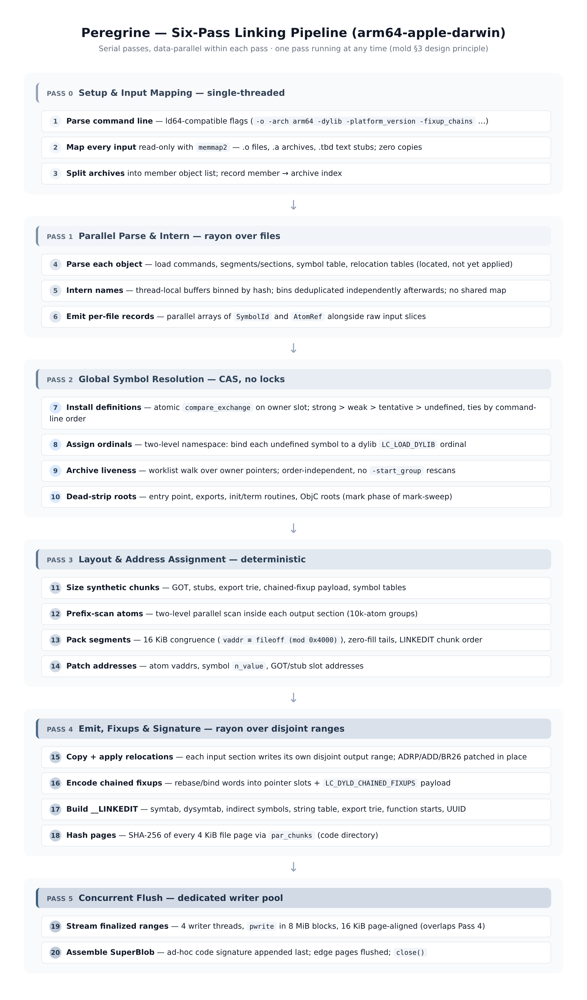
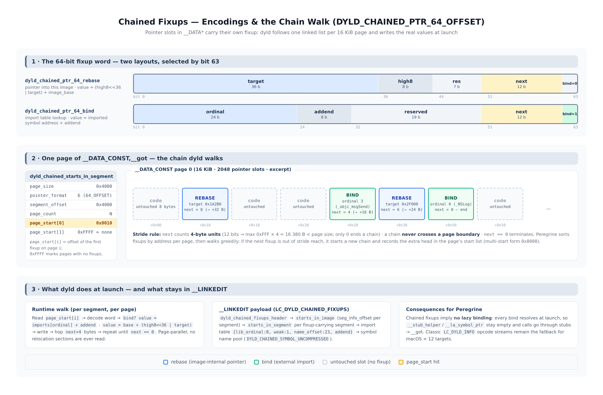
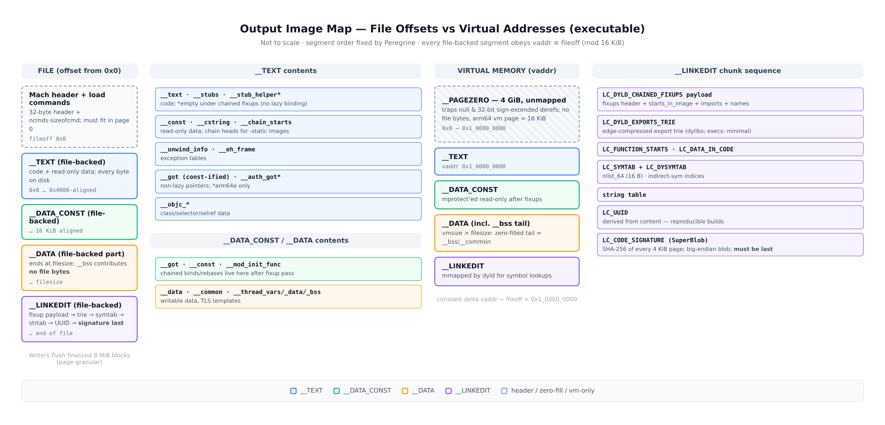
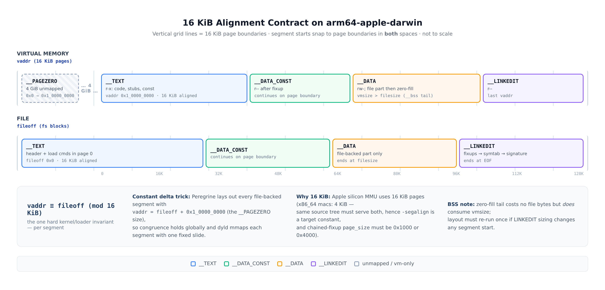

# Peregrine — Technical Design Document

**An ultra-fast Mach-O linker for arm64-apple-darwin, written in Rust, cross-linking from Linux**

| | |
|---|---|
| **Codename** | Peregrine (binary: `pgr`) |
| **Target** | arm64-apple-darwin executables, dylibs, bundles (macOS 12+ default path) |
| **Host** | Linux (primary development sandbox); macOS (deployment as an `ld` replacement) |
| **Status** | Implemented through M9 GA: tiers 2a/2b (import anchors, propagation), tier 2 (segment relayout), the GA hardening pass (shrink rung, randomized edit gate), tier 2c + the resolve's record-side wiring (v5), the resident fusion wire rung, the audited fusion rung (wire v4 — the daemon serves `-incremental-verify`), and the §7.2 output-residency rung (wire v5 — the session-resident output buffer: served images become resident state, a patched relink's reply is the changed-tile stream, the client hash-gates its replay); M10 rides the same seams at both ends — rung 1 stops Passes 1–2 short for the `-r` relocatable output (`pgr_core::link_reloc`, `pgr_emit::build_object_image`, the object contract in the verifier), rung 2 makes the fixup-encoding gate per-platform (`chained_fixups_min_minos`, the `-platform_version` surface, the verifier's declared-platform gate) — and rung 3 lands the consumer seam: `pgr_core::platform::FixupEncoding` names the encoding decision before the link runs (slice 1), `pgr --print-fixup-encoding` / `pgr_driver::fixup_encoding_report` put it on the driver surface and the verifier's `fixups_floor` gate reads the same canonical table (`pgr_format::consts::chained_fixups_floor` — one table, three readers; slice 2) — rung 4 opens the arm64e word family on both sides of the image: slice 1 the read side (`ChainWordArm64e`, the fixtures' pointer-format knob, the verifier's walk), slice 2 the unauth producer (`plan_fixups_with_format`, the `-fixup_chains_format` surface, the v6 wire tail byte), slice 3 the authenticated producer (`FixupAuth` policies, the 32-bit runtime offset, the auth bind's addend-split exception with the anchor appending) — §15 is the M10 design record; README "Status" and docs/BENCHMARKS.md carry the shipped state |
| **Date** | 2026-11-09 |
| **Companion diagrams** | `assets/pipeline.png`, `assets/output-map.png`, `assets/alignment.png`, `assets/fixup-chain.png` |

---

## Table of Contents

1. [Executive Summary and Design Goals](#1-executive-summary-and-design-goals)
2. [Prior Art Audit: mold, wild, zld, object](#2-prior-art-audit-mold-wild-zld-object)
3. [Target Platform Contract: Mach-O on arm64-apple-darwin](#3-target-platform-contract-mach-o-on-arm64-apple-darwin)
4. [System Architecture and Pipeline Overview](#4-system-architecture-and-pipeline-overview)
5. [Pipeline Pass Specifications](#5-pipeline-pass-specifications)
6. [Core Rust Data Structures and Hot Paths](#6-core-rust-data-structures-and-hot-paths)
7. [Chained Fixups Generation](#7-chained-fixups-generation)
8. [16 KiB Alignment and the Output Layout Engine](#8-16-kib-alignment-and-the-output-layout-engine)
9. [Ad-Hoc Code Signing Pass](#9-ad-hoc-code-signing-pass)
10. [Concurrency, Memory and Allocator Strategy](#10-concurrency-memory-and-allocator-strategy)
11. [Validation on Linux: the Self-Parse Verifier](#11-validation-on-linux-the-self-parse-verifier)
12. [Roadmap M0–M5](#12-roadmap-m0m5)
13. [Risk Register](#13-risk-register)
14. [References](#14-references)

---

## 1. Executive Summary and Design Goals

Peregrine is a from-scratch, massively parallel static linker that consumes arm64 Mach-O relocatable objects (`.o`), static archives (`.a`) and text-based dylib stubs (`.tbd`), and emits valid, code-signed Mach-O images for Apple Silicon. It is developed and tested on Linux and intended to run anywhere — including on macOS hosts as a drop-in `ld` replacement where command-line compatibility is required.

The design is deliberately built on **audited prior art rather than folklore**. The single most consequential finding of the audit is that the linker landscape has shifted under our feet: mold — the fastest ELF linker — has been rewritten in Rust and has **merged a full Mach-O backend** (`rui314/mold-macho` → `macho/` in mainline mold), which links "working, correctly code-signed executables, dylibs and bundles for arm64 and x86-64 macOS" ([mold-macho README](https://github.com/rui314/mold-macho)). Peregrine therefore does not need to re-derive the parallel linking playbook; it needs to *re-implement it cleanly in idiomatic Rust with a modern Mach-O feature set*, borrowing verified algorithms from the mold paper ([arXiv:2608.23228](https://arxiv.org/abs/2608.23228)) and correcting the one piece of ELF folklore that does not survive the port to macOS — `mmap`-ing the output file (see §2.1.3).

**Design goals, in priority order:**

1. **Correct, valid output.** Every emitted image must pass Peregrine's own read-side verifier (§11), `llvm-otool`/`llvm-nm` cross-inspection on Linux, and — on macOS hardware, eventually — `codesign -v` and dyld. Correctness gates ship in M0, before the fast paths.
2. **Determinism.** Identical inputs, flags and version produce bit-identical output. Every parallel phase is either commutative by construction or followed by a canonicalization sort (mold §4.11).
3. **Speed at the link step.** Serial passes, data-parallel within each pass; no `Mutex<HashMap>` anywhere in the hot path; zero-copy input parsing; allocation-light metadata. The reference point is mold's measured 2.4–16.1× over lld and up to 112× over GNU ld on ELF ([paper, §7.2](https://arxiv.org/html/2608.23228v1)); our target is to beat `ld-classic` (current Apple ld) and `ld-prime` (the new Rust ld) by ≥5× on large debug builds, and to stay within striking distance of mold's own Mach-O backend.
4. **Apple Silicon native.** 16 KiB segment page alignment, 4 GiB `__PAGEZERO`, `LC_DYLD_CHAINED_FIXUPS` as the default fixup encoding, ad-hoc code signing, and two-level namespace symbol binding are *structural* properties of the layout engine, not command-line afterthoughts.

**Explicit non-goals (v1):** arm64e (authenticated pointers) — schema supported, encoding deferred; bitcode/LTO object lowering (pass-through only); deterministic cross-run parallel *scheduling* beyond what output determinism requires.

**Headline architectural decisions** (each defended in the section noted):

- Serial pass pipeline, parallel-for within passes; rayon work-stealing as the only compute thread pool (§4, §10).
- Symbol identity = `u32` `SymbolId`; names interned to `u32` `StringId`s via *hash-binned thread-local buffers deduplicated per bin* — no shared concurrent map at all (mold §4.1; §6.1).
- Global resolution by single-word `compare_exchange` on a packed `(precedence-rank, file, symbol)` key — lock-free, deterministic, tie-broken by command-line order (§6.2).
- Metadata in arenas referenced by 32-bit indices, never 64-bit pointers (mold §6.1; §6.1 here).
- Output built in **one anonymous in-memory buffer** with disjoint-range parallel writes, flushed by a 4-thread `pwrite` pool — *not* an mmap of the output file, because on macOS a vnode that has ever had a writable shared mapping fails ad-hoc code-signature validation at exec time (mold `macho/output_file.rs`; §5, §10).
- Chained fixups (`DYLD_CHAINED_PTR_64_OFFSET`) generated in a dedicated emit sub-pass with a stride-bounded greedy chain packer per 16 KiB page (§7).

---

## 2. Prior Art Audit: mold, wild, zld, object

### 2.1 mold (rui314/mold) — and its Mach-O backend

**Status.** mold is no longer "just" a C++ ELF linker. The repository is now titled *"mold: A Modern Linker in Rust 🦀"* ([github.com/rui314/mold](https://github.com/rui314/mold)), and the separate [`rui314/mold-macho`](https://github.com/rui314/mold-macho) effort — a Rust Mach-O backend accepting ld64's command line — has been merged into the main repo under `macho/` ("*This project has been merged into the main mold repository. Development continues there.*"). The `macho/` tree contains `arm64.rs`, `x86_64.rs`, `dead_strip.rs`, `icf.rs`, `tapi.rs`, `objc.rs`, `thunks.rs`, `lto.rs`, `dwarf.rs` and a `chunks/` directory with one module per `__LINKEDIT` construct (`chained_fixups.rs`, `chain_starts.rs`, `code_signature.rs`, `export_trie.rs`, `got.rs`, `stubs.rs`, `symtab.rs`, `indirect_symtab.rs`, `function_starts.rs`, `data_in_code.rs`, `unwind_info.rs`, …) — i.e., the full load-command surface Peregrine must also cover. Its README claims: *"C, C++, Objective-C, Swift and Rust programs link and run, including real-world projects (ripgrep builds and passes its full test suite; the C++ mold tree with vendored tbb/zstd/zlib builds at -O3; the linker links itself)"*.

This changes Peregrine's positioning from "build the missing thing" to "build a competitive, clean-room Rust implementation with first-class Linux-first validation" — and gives us an existence proof for every platform claim in this document.

**The paper.** *"mold: A Massively Parallel Linker"* (Rui Ueyama, [arXiv:2608.23228v1](https://arxiv.org/html/2608.23228v1), Aug 2026) documents the architecture with per-pass parallelization details. Headline results: *"2.4–16.1× faster than the state-of-the-art lld linker, and up to 112× faster than the traditional GNU ld"*; a TensorFlow debug build (24 GiB of objects → 9.9 GiB output) links in seconds where lld takes 52 s on a 64-core machine.

#### 2.1.1 What the paper proves (borrow all of it)

| Technique | Paper ref | Reused in |
|---|---|---|
| Serial passes, parallel-for within each pass; reject task-parallel dependency-graph design (gold's model measured *negligible or negative* speedup) | §3 | §4, §5 |
| Parse *everything* upfront in parallel — including every archive member — so resolution is one parallel pass afterwards | §4.1 | Pass 0/1 |
| Interning without a shared map: *"names are binned by hash into thread-local buffers during parsing, and each bin is deduplicated independently afterwards, with no shared concurrent data structure"* | §4.1 | §6.1 |
| Symbol resolution by atomic compare-and-swap on an owner field, with a documented precedence table and command-line-order tie-break | §4.2, Table 2 | §6.2 |
| Archive inclusion via liveness walk over owner pointers — order-insensitive, no `-start-group` rescans | §4.2 | Pass 2 |
| GOT/stub-need flags set with monotonic relaxed atomic ORs, no locks | §4.4 | Pass 2/4 |
| Layout as a *two-level parallel prefix scan* over groups of ~10,000 input sections per output section | §4.7 | §5 Pass 3, §6.4 |
| Output generation: every input section writes its own disjoint region of the output, applying relocations in place | §4.10 | Pass 4 |
| Determinism: commutative operations or a canonicalizing sort after every nondeterministic step | §4.11 | §4 policy |
| `fallocate` block preallocation (copy pass 3.5× faster), `madvise(MADV_HUGEPAGE)` on the output mapping (3.1×) | §5.1, §5.2 | Linux fast paths, see §2.1.3 |
| mimalloc worth 1.3×; a hand-rolled bump allocator measured **slower** than mimalloc (1.00 s vs 0.89 s) | §5.3 | §10 allocator choice |
| Overwrite-in-place output reuse; two-process fork to hide teardown | §5.4, §5.5 | Optional, M5 |
| 32-bit arena offsets instead of pointers halve cross-reference metadata size | §6.1 | §6.1 |

#### 2.1.2 What the folklore says vs what the code does now

The popular summary of mold's design is *"two-pass linking: mmap the output file up front, then push data into it concurrently"*. The 2026 paper describes something better. There is **no second read of the input files** (everything is parsed once, eagerly, in parallel); the *"two passes"* that remain are over in-memory metadata — size/layout first, emit second — and on Linux the output is written through a shared mapping. Both halves of the folklore are now qualified:

1. **"Pre-allocate and mmap the output"** is true on Linux (with `fallocate` + `MADV_HUGEPAGE`, paper §5.1–5.2). It is **not** what mold's Mach-O backend does, for a documented, macOS-specific reason — next paragraph.
2. **"No intermediary allocations"** remains the law for section data (bytes flow input-mmap → output buffer, relocations patched in place).

#### 2.1.3 The macOS output-file trap (critical, non-obvious)

mold's `macho/output_file.rs` opens with the most valuable comment in this whole audit (quoted nearly verbatim):

> *"Unlike mold for ELF, the output is built in an anonymous buffer and written with pwrite, not through a shared mapping of the file. That is deliberate: on macOS, a vnode that has ever had a writable shared mapping fails ad-hoc code-signature validation at exec time — the binary is killed with SIGKILL even though codesign reports it valid on disk, msync changes nothing, and rename()ing a mapped-written temp file over the destination does not help because the taint follows the vnode."*

It continues: `clonefile()` of a mapped-written temp file yields a fresh vnode that executes, but every way of making the pages visible is a synchronous per-page push about half as fast as `pwrite`'s clustered writes; and LLVM's `FileOutputBuffer` falls back to in-memory buffers for executables on Darwin for the same reason. The implementation details are directly transferable:

- **4 writer threads** (`WRITERS = 4`), because *"the writers mostly sit in the kernel … four measured best on the debug clang and nushell links"*;
- **8 MiB blocks** (`BLOCK = 8 << 20`) queued on a channel so writers share the tail;
- **16 KiB page-granular writes** (`PAGE = 1 << 14`) — *"Two pwrites to different bytes of one page must not run at once: when neither covers the whole page, the kernel may zero-fill the part of a newly cached page its write doesn't cover"*; partial first/last pages are deferred to `finish()` (`edges`);
- finalized ranges are queued *while* the signature, symbol table and page hashes are still being produced on other cores — the write overlaps the last passes.

**Decision.** Peregrine uses the anonymous-buffer + `pwrite`-pool design as its *only* output path. It is mandatory on macOS hosts and harmless on Linux (where we could mmap, but one code path preserves determinism and testability). The input side keeps `memmap2` read-only mappings everywhere — that part of the folklore survives untouched.

#### 2.1.4 Chained-fixups engineering detail worth stealing

`macho/chunks/chained_fixups.rs` is the best public documentation of the semantics after Apple's own headers:

- *"The macOS linker uses [chained fixups] by default for recent deployment targets, such as macOS 12 and later; the older form is LC_DYLD_INFO's opcode streams."*
- *"An image with chained fixups binds every symbol at load time; there is no lazy binding"* — which is why mold's Mach-O tree keeps `stub_helper.rs`/`lazy_ptrs.rs` only for the legacy path.
- Fixup model: a `Vec<Fixup>` sorted by address; an import table built in *first-use order* (`imports: Vec<(SymbolId, addend)>`, `ImportOrdinals = HashMap<(SymbolId, u64), usize>`) — deterministic because the fixups are address-sorted.
- The 12-bit `next` field *"counts 4-byte strides"*; chains terminate at page boundaries; `-segalign` must be `0x1000` or `0x4000` (the code errors otherwise); an x86-64 image with an unaligned pointer falls back to classic dyld info — a case arm64 never hits because all pointer slots are 8-byte aligned.
- `macho/chunks/chain_starts.rs` implements `__TEXT,__chain_starts` — chain heads for `-static` images that have no dyld to read the `LC_DYLD_CHAINED_FIXUPS` payload.

#### 2.1.5 Code-signing engineering detail worth stealing

`macho/chunks/code_signature.rs` gives the exact ad-hoc recipe (full algorithm in §9): the signature is the last chunk; a SuperBlob with one (or two) code directories; SHA-256 page hashes over **4 KiB** pages (`page_hashes` computed with rayon `par_chunks`); `directory_size = 88 + ident.len() + 1 + nblocks * 32`; SuperBlob size `12 + 8 + Σ directories`, padded to 8; all signature structures **big-endian**; a SHA-1 second directory only for loaders that predate SHA-256 support (macOS < 10.11.4, iOS/tvOS < 11, `-static`); the UUID is derived from the page hashes (deterministic); the identifier comes from the install-name leaf / `-final_output` / output-path leaf.

### 2.2 wild (wild-linker/wild)

**Status.** wild is *"a very fast linker for Linux and WebAssembly"* — ELF only (x86-64, AArch64, riscv64gc, LoongArch64, PPC64LE, wasm32). There is no Mach-O support and no indication of plans for it, so wild contributes **architecture and testing culture**, not format handling.

**What its `DESIGN.md` documents** ([DESIGN.md](https://github.com/wild-linker/wild/blob/main/DESIGN.md)):

- Phase discipline, each phase borrowing immutably from the previous: `args` → `input_data` (*"Open input files with mmap and split archives into their separate objects"*) → `string_merging` → `symbol_db` (*"Build a hashmap from symbol names to symbol IDs"*) → `resolution` → `layout` (*"Traverse graph of relocations … Allocate addresses for sections, symbols, program segments"*) → `elf_writer` (*"Copy input sections to the output file, applying relocations as we go"*).
- Threading model: *"The thread pool is owned by the rayon library. Where possible, we use functions like rayon's par_iter … Failing that, we use par_bridge … In a couple of cases however, we have graph algorithms that don't fit neatly into rayon's model. In those cases, we spawn one rayon scoped task per thread and then do job control ourselves."* — exactly the pattern Peregrine needs for the archive-liveness worklist and the dead-strip mark phase.
- Testing: *"It … links them with Wild and compares the resulting binaries using our own custom diff tool, linker-diff. Provided that succeeds, it then executes all the linked programs."* wild's `linker-diff` — semantic diffing of two linkers' outputs rather than byte-diffing — is the right shape for Peregrine's differential testing against `ld64`/`ld-prime` fixtures and against `lld`'s Mach-O port on Linux (§11).

**Borrow:** phase-borrowing discipline; rayon usage patterns (`par_iter` / `par_bridge` / scoped tasks); a `linker-diff`-style semantic comparator; `--time` phase instrumentation.

**Discard:** everything ELF (program headers, `.dynamic`, DT_* tags, GNU property notes, the ELF TLS model), and wild's HashMap-per-name symbol DB — the hash-binned interning of mold scales better and is deterministic by construction.

### 2.3 zld (michaeleisel/zld)

**Status.** *"This project is a fork of the Apple linker, `ld`. It is a drop-in replacement"* — C/Objective-C rather than Zig as commonly believed. The README claims *"at least 40% faster"* (with the instruction to run it twice to warm caches), states it is *"only intended for debug builds"*, and credits *"Parallelizing in various places (the parsing of libraries, writing the output file, sorting, etc.)"*. The repository was **archived on Feb 15, 2023** and is read-only; the README now says *"zld is now archived, consider using lld instead"*. Two more data points: *"Without a few optimizations around hashing, it would produce byte-for-byte the same executables as the open-source one"* — proof that ld64's pipeline was serial enough to be dominated by hashing and parsing, i.e. exactly the passes a from-scratch parallel linker wins on — and documented breakage on `arm64_32`/Catalyst.

**Borrow:** the existence proof that parallelizing ld64 parsing/writing/sorting yields large wins on real app-sized links; the cautionary tale (a fork of a huge codebase dies when Apple moves on — clean-slate with a small, owned format surface is the sustainable path).

**Discard:** everything else — dead codebase, and the patch-ld64 strategy is orthogonal to a from-scratch design.

### 2.4 gimli-rs/object

**Status.** `object` provides unified read and write access to object formats. Mach-O support is gated by the `macho` cargo feature (enabled by both `read` and `write` — verified in `Cargo.toml`), and since the `mach` dependency was retired, the raw Mach-O structures are **vendored inside the crate** (`object::macho`; the writer sources `use crate::macho`) as endian-aware `#[repr(C)]` types.

**Read side** (`object::read::macho`): `MachOFile` gives segments, sections, symbols and relocations with proper endianness handling and validation; the `Segment`/`Section` traits abstract `LC_SEGMENT`/`LC_SEGMENT_64`. This is production-quality, property-tested code — ideal as an **independent second parser** inside Peregrine's verifier (§11), so that "Peregrine wrote it" and "Peregrine can read it" are validated by *different* code paths, with LLVM tools as a third opinion.

**Write side** (`src/write/macho/`): the module doc says it all — *"Provides `Encoder` for low level writing of Mach-O files. This is also used to provide Mach-O support for `write::Object`."* Auditing `encoder.rs`/`object.rs`: it writes `LC_SEGMENT_64`/`LC_SEGMENT`, `LC_SYMTAB`, `LC_DYSYMTAB` and `LC_BUILD_VERSION`. It has **no** `LC_MAIN`, `LC_UUID`, `LC_LOAD_DYLIB`, `LC_DYLD_CHAINED_FIXUPS`, `LC_DYLD_EXPORTS_TRIE`, `LC_FUNCTION_STARTS`, `LC_DATA_IN_CODE` or `LC_CODE_SIGNATURE` support; builds everything into allocating `Vec`s on a single thread; and its relocation model is generic rather than arm64-pipeline-shaped.

**Verdict (dependency decision table):**

| Stage | Use object crate? | Why |
|---|---|---|
| Input parse (hot path) | **No** | Zero-copy casts of `#[repr(C)]` structs via `bytemuck`, with our own minimal validation, beat a general-purpose reader; we need only ~10 struct types |
| Emit (hot path) | **No** | Not linker-grade: no fixups/trie/signature/UUID/MAIN; single-threaded Vec model would bottleneck Pass 4 |
| Raw struct/constants | **Partially** | `object::macho` constants (`LC_*`, `CPU_TYPE_*`, reloc enums) are battle-tested; import them or mirror in `pgr-format` with compile-time assertions |
| Verifier (cold path) | **Yes** | Independent read path + cross-check target — its strictness is a feature here |

### 2.5 Borrow / discard matrix

| Prior art | Borrow | Discard |
|---|---|---|
| mold (ELF) | Pass structure; CAS resolution + precedence table; hash-bin interning; two-level prefix-scan layout; disjoint-range emit; determinism policy; fallocate/hugepage (Linux); mimalloc; 32-bit arena offsets; two-process exit | ELF sections/program headers/dynamic tags; COMDAT groups (Mach-O has none); **output mmap** (macOS vnode taint) |
| mold-macho | `pwrite` writer pool (4 threads, 8 MiB blocks, 16 KiB pages, edge pages); chained-fixup payload layout; import-first-use ordering; `__chain_starts`; ad-hoc signature recipe; dead-strip/ICF/tapi/ObjC scope list | Its chunk-virtual dispatch — Peregrine keeps segments as flat data (`Vec<ChunkSlot>`) for layout math |
| wild | Phase-borrowing API shape; rayon `par_bridge`/scoped-task fallbacks; `linker-diff` semantic testing; `--time` instrumentation | ELF writer/symbols; hashmap-based symbol DB |
| zld | Cautionary existence proof | The codebase (archived) and the patch-ld64 strategy |
| object | Verifier read path; LC/reloc constants | Write path for linking (baseline serialization only) |
| LLVM `MachO.h` | Ground truth for `dyld_chained_*` bit layouts and format enums (§7) | — |
| ld64 behavior | Command-line surface; segment packing defaults; `-adhoc` default on arm64 | The codebase |

---
## 3. Target Platform Contract: Mach-O on arm64-apple-darwin

This section fixes the *format contract* Peregrine must satisfy. Everything here is normative for the layout engine; references go to the primary sources (LLVM's `MachO.h`, Apple's ABI documentation tradition, and observed ld64 behavior).

### 3.1 File model

A Mach-O image is a sequence of pages: at offset 0 the `mach_header_64` (32 bytes: magic `0xFEEDFACF`, cputype `CPU_TYPE_ARM64 = 0x0100000C`, cpusubtype, filetype `MH_EXECUTE`/`MH_DYLIB`/`MH_BUNDLE`/`MH_OBJECT`, ncmds, sizeofcmds, flags, reserved), immediately followed by `ncmds` load commands, all inside **page 0**. Everything else is reached through load commands; there is no section header table.

### 3.2 Load commands Peregrine emits (executable case)

| Load command | Contents | Emitted by |
|---|---|---|
| `LC_SEGMENT_64` ×5 | `__PAGEZERO` (vm only), `__TEXT`, `__DATA_CONST`, `__DATA`, `__LINKEDIT` | Layout engine (§8) |
| `LC_BUILD_VERSION` | platform `PLATFORM_MACOS`, minos, sdk | Driver from flags |
| `LC_MAIN` | `entryoff` — offset of entry from `__TEXT` vmaddr | Synthetics |
| `LC_LOAD_DYLIB` ×n | install names, in **ordinal order** — the two-level-namespace index base | Driver |
| `LC_SYMTAB` | `nlist_64[]` + string table | Linkedit pass |
| `LC_DYSYMTAB` | mostly legacy zeros; `indirectsymoff`/`nindirectsyms` for `__stubs`/`__got` slots | Linkedit pass |
| `LC_DYLD_CHAINED_FIXUPS` | `dataoff/datareloff` into `__LINKEDIT` → fixup payload (§7) | Fixups pass |
| `LC_DYLD_EXPORTS_TRIE` | export trie (dylibs: full; execs: minimal) | Linkedit pass |
| `LC_FUNCTION_STARTS` | function start table (for unwinding/profiling) | Linkedit pass |
| `LC_DATA_IN_CODE` | data-in-code entries from `S_DATA_IN_CODE` sections | Linkedit pass |
| `LC_UUID` | UUID — derived from content for reproducibility (§9) | Linkedit pass |
| `LC_CODE_SIGNATURE` | SuperBlob, **last bytes of the file** (§9) | Signing pass |

Legacy fallback: for deployment targets below macOS 12 (or `-no_fixup_chains`), `LC_DYLD_INFO(_ONLY)` opcode streams (rebase/bind/lazy-bind/weak-bind) replace chained fixups; mold keeps this path in `rebase_info.rs`/`bind_info.rs`/`lazy_bind_info.rs`, and Peregrine's roadmap defers it to M5.

### 3.3 Symbol model

- **`nlist_64`** (16 bytes): `n_strx: u32` (string-table offset), `n_type: u8`, `n_sect: u8`, `n_desc: u16`, `n_value: u64`. Defined external symbols are `N_SECT | N_EXT` with the defining section index; undefined are `N_UNDF | N_EXT` with `n_value = 0`; **tentative/common** symbols are `N_UNDF | N_EXT` with `n_value ≠ 0` (size) and alignment in `n_desc` (`GET_COMM_ALIGN`).
- **`n_desc` bits**: library ordinal (bits 0–7, two-level namespace — see below); `REFERENCE_FLAG_*` (bits 0–3 as flag overlay); `N_WEAK_REF`, `N_WEAK_DEF`, `N_SYMBOL_RESOLVER`, `N_ALT_ENTRY`, `N_COLD_FUNC`, and on arm64 `N_ARM_THUMB_DEF` (never set on arm64).
- **Two-level namespace.** macOS is two-level by default: each undefined symbol records *which dylib* it comes from via its `n_desc` library ordinal (1-based index into the `LC_LOAD_DYLIB` list). Special ordinals: `0` = this image, `0xFF = -1` = main executable, `0xFE = -2` = flat lookup, `0xFD = -3` = weak lookup. The resolver must therefore track `(dylib, name)` pairs, not just names — this is the biggest semantic difference from ELF linking and a common source of subtle bugs (risk R4).
- **Indirect symbols.** `LC_DYSYMTAB.indirectsymoff` indexes the symbol table for pointer/stub slots: every entry of `__stubs`, `__got`, `__la_symbol_ptr` gets a `u32` symbol index (with `INDIRECT_SYMBOL_LOCAL`/`ABS` sentinels where applicable) so debuggers and dyld map slot → symbol.
- **Export trie.** Dylibs must export their API through an edge-compressed prefix trie (`LC_DYLD_EXPORTS_TRIE`); node children are stored sorted by their first byte. Executables export little — modern ld64 still emits a minimal trie (typically the `__mh_execute_header` symbol) — Peregrine matches observed ld64 behavior and verifies against fixtures (M2 gate).

### 3.4 Synthetic sections and stubs (arm64)

| Section | Type | Content (arm64) |
|---|---|---|
| `__TEXT,__stubs` | `S_SYMBOL_STUBS` (12 B/slot) | `adrp x16, slot@page; ldr x16, [x16, slot@pageoff]; br x16` — jumps through the GOT |
| `__TEXT,__stub_helper` | — | Empty under chained fixups (no lazy binding); populated only in legacy mode |
| `__DATA_CONST,__got` | `S_NON_LAZY_SYMBOL_POINTERS` | 8-byte slots; become chained binds/rebases (§7) |
| `__DATA,__la_symbol_ptr` | `S_LAZY_SYMBOL_POINTERS` | Only in legacy dyld-info mode |
| `__DATA,__thread_vars` | `S_THREAD_LOCAL_VARIABLES` | TLV descriptors; accesses go through `tlv_bootstrap` |
| `__TEXT,__chain_starts` | — | Only for `-static` images (§2.1.4) |

The GOT-ness of a reference is decided by the *relocation type* in the input object (`ARM64_RELOC_GOT_LOAD_PAGE21/PAGEOFF12` demand a GOT slot; `ARM64_RELOC_PAGE21/PAGEOFF12` bind directly; `ARM64_RELOC_POINTER_TO_GOT` is a pointer whose value is a GOT address). Slot-need flags are computed in the relocation-scan phase with monotonic atomics (mold §4.4 pattern).

### 3.5 Relocation types the emit pipeline must apply

From arm64 objects (clang `-c` output):

- `ARM64_RELOC_UNSIGNED` — 64-bit absolute in data sections. **Two distinct fates:** standalone → becomes a chained fixup (rebase or bind), the slot is *not* given its final value at link time; paired with `ARM64_RELOC_SUBTRACTOR` → static `A − B + addend`, applied at link time (this is how `__SIZE_TYPE__`-style relative pointers in `__const` work).
- `ARM64_RELOC_PAGE21` / `PAGEOFF12` — ADRP / ADD-LDR-STRT-INT immediate patches.
- `ARM64_RELOC_GOT_LOAD_PAGE21` / `GOT_LOAD_PAGEOFF12` — as above but the target is the symbol's GOT slot.
- `ARM64_RELOC_BRANCH26` — B/BL immediate; range-checked at layout (±128 MiB; arm64 call sites may need veneers/thunks — mold's Mach-O tree has `thunks.rs`; Peregrine defers full range-extension batching to M5, since most app links stay within range and overflow is reported, not silently mis-linked).
- `ARM64_RELOC_SUBTRACTOR` + `UNSIGNED` pair; `ARM64_RELOC_ADDEND` (paired, carries the addend for page relocs on Mach-O).
- `ARM64_RELOC_TLV_LOAD_PAGE21/PAGEOFF12` — TLS descriptors through `__tlv_bootstrap`.
- `ARM64_RELOC_POINTER_TO_GOT`.

### 3.6 Platform invariants Peregrine hard-codes

1. **16 KiB page size** for segment layout on arm64 (4 KiB on x86_64 macOS): every segment's `vmaddr` and `fileoff` are 16 KiB aligned, and `vmaddr ≡ fileoff (mod 0x4000)`. lld's driver comment is a good citation of the hardware fact: Apple's ARM64 devices *"use a page size of 16K"*, and of the history (ld64's `-pagezero_size` handling even contains a 4K-then-16K rounding quirk that lld deliberately did not copy).
2. **`__PAGEZERO` = 4 GiB** on 64-bit images: `vmaddr 0x0 → 0x1_0000_0000` unmapped; the executable's `__TEXT` starts at `0x1_0000_0000`. `__PAGEZERO` has no file bytes.
3. **Chained fixups for macOS ≥ 12** (`-fixup_chains` is ld64's default there); pointer formats `DYLD_CHAINED_PTR_64_OFFSET = 6` (Peregrine's choice — targets are image-base-relative offsets) with `DYLD_CHAINED_PTR_64 = 2` kept for compat; payload per LLVM `MachO.h` (§7).
4. **Ad-hoc code signature is mandatory on arm64**: *"ARM64 macOS requires that a program have an ad hoc signature, otherwise the system will immediately reject it"* ([lld D96164](https://reviews.llvm.org/D96164)); Apple's own framing: *"the linker adds an ad hoc code signature to Apple silicon images"* (Apple Developer Forums). The linker embeds the signature — it is part of the file format now, not a post-processing step.
5. **Code-signature page hashing uses 4 KiB pages** regardless of the 16 KiB VM pages — the CodeDirectory's `pageSize` field is log₂(4096) = 12 (see mold `code_signature.rs` and the codesigning literature). Do not conflate the two page sizes; §9 keeps them strictly separated.
6. **`__DATA_CONST`** carries GOT + read-only-after-relocation data; dyld fixes it up read-write then re-protects read-only.
7. **UUID determinism**: Peregrine derives `LC_UUID` from content (page hashes) rather than a random source — reproducible builds for free (§9).

### 3.7 dyld's consumption model (what validity *means*)

At launch, dyld: maps segments (honoring 16 KiB congruence), reads `LC_DYLD_CHAINED_FIXUPS` payload, then for each fixup-carrying segment walks `dyld_chained_starts_in_image → dyld_chained_starts_in_segment → page_start[]` chains, rewriting each pointer slot (rebase: `base + (high8<<36 | target)`; bind: `imports[ordinal] + addend`), and finally applies import-table-driven lazy/weak semantics. The kernel independently verifies the code signature page-by-page *as pages are paged in*. "Valid output" therefore decomposes into exactly the assertions Peregrine's verifier checks (§11): load-command well-formedness, segment congruence, chain-walk closure (every chain ends; every fixup reachable exactly once), page-hash coverage, and symbol-table consistency.

---
## 4. System Architecture and Pipeline Overview

### 4.1 The shape of the system

Peregrine is a six-pass, **serial-pass / parallel-within-pass** pipeline. Passes never overlap (except the deliberate Pass 4 ↔ Pass 5 write overlap); within a pass, work is expressed as rayon `par_iter` over homogeneous arrays — atoms, symbols, fixups, pages. This is the mold paper's §3 design principle, kept because it is what makes invariants stateable: *"at any point in execution, exactly one pass is running"*.



**Crate layout (cargo workspace):**

| Crate | Contents | Threading |
|---|---|---|
| `pgr-driver` | CLI (ld64-compatible surface), option parsing, driver loop | single |
| `pgr-format` | `#[repr(C)]` Mach-O structs, bytemuck casts, LC/reloc constants, validation | pure |
| `pgr-core` | interner, symbol table, atom model, resolution, layout, fixups, linkedit | rayon |
| `pgr-emit` | output buffer, section copy + reloc apply, writer pool, code signature | rayon + writer threads |
| `pgr-verify` | read-back verifier + `linker-diff`-style comparator (§11) | single |

### 4.2 Memory model

- **Inputs**: each file is `memmap2::Mmap` (read-only) held alive for the entire link inside an `InputArena`. All cross-references into input bytes are `(file_index, byte_range)` — no pointers, so parsing is trivially `Send` and the lifetime problem ("slices borrow the arena") is contained in one structure, mirroring wild's `input_data` phase and mold's eager-parse decision.
- **Metadata**: per-pass arenas (`bumpalo`) of POD records; all inter-record references are `u32` indices (mold paper §6.1: *"Objects such as input files, symbols, and sections … refer to one another using 32-bit offsets within the arena instead of 64-bit pointers. This halves the storage required for each cross-reference"*). Arenas are reset between passes; nothing from Pass 1 survives into Pass 2 except the curated parallel tables.
- **Output**: one anonymous allocation of exactly the final size (known after Pass 3), written by disjoint ranges; flushed by the `pwrite` pool (§5 Pass 5, §10).

### 4.3 Determinism policy

Every parallel phase obeys one of two patterns (mold §4.11):

1. **Commutative by construction** — CAS-owner resolution (the key encodes precedence and tie-break, so the *winner* is schedule-independent), monotonic atomic-OR flags (GOT-need), atomic counters for import dedup.
2. **Canonicalize after** — anything schedule-dependent (bin-local `StringId`s, archive-liveness order, fixup ordering within a tie) is followed by a sort on total-ordered keys or a prefix-sum renumbering. No hash-map iteration order ever reaches the output; ahash is seeded with fixed constants, never runtime entropy.

The end-to-end test `pgr link twice → byte-identical` runs in CI at every milestone.

### 4.4 Pass table (normative summary)

| Pass | Name | Input | Output | Parallel grain |
|---|---|---|---|---|
| 0 | Setup & mapping | argv | mapped inputs, archive members, `.tbd` list | single-threaded |
| 1 | Parse & intern | mmap'd inputs | per-file symbol/section/reloc tables + global `StringId`s | file |
| 2 | Resolve | symbol tables | owner per name; ordinals; liveness; GOT-need flags | symbol / file |
| 3 | Layout | live atoms | chunk addresses, segment packing, load-command plan | output section (two-level scan) |
| 4 | Emit | everything above | bytes in the output buffer incl. fixups, linkedit, page hashes | output section / page |
| 5 | Flush | finalized ranges | file on disk, signature closed | 4 writer threads |

---

## 5. Pipeline Pass Specifications

### Pass 0 — Setup & Input Mapping (single-threaded, target: < 10 ms for 1 000 inputs)

Responsibilities: parse argv into an ld64-compatible `Options` (flags actually used by real builds: `-o -arch -platform_version -dylib -install_name -rpath -L -l -framework -filelist -order_file -segalign -fixup_chains/-no_fixup_chains -adhoc/-no_adhoc -dead_strip -headerpad …`); `open` + `mmap` every input; walk archives (`!.` member index or streaming scan) into member descriptors; parse `.tbd` files (tapi v3/v4 JSON) into "virtual dylibs" providing exported names and install names. An archive member gets `(archive_file_index, member_offset)` identity; direct `.o` files get sequential file indices in command-line order — this order *is* the deterministic tie-break for resolution.

Failure modes surfaced early (cheap before parallelism): missing file, non-Mach-O magic, fat binaries (`FAT_MAGIC` — slice the arm64 slice, record the offset), unsupported cputype.

### Pass 1 — Parallel Parse & Intern (rayon over files)

Per file, producing per-file arenas (never shared, never locked):

1. Load commands → segments/sections with `(segment_name, section_name, addr, size, p2align, flags, offset)`.
2. Symbol table → `Vec<LocalSymbol>`: `{ name_bytes: Range<u32>, n_type, n_sect, n_desc, n_value, relocs_referencing: AtomicU32 }`. Undefined/tentative distinction decoded once here.
3. Relocation tables: `scattered` on arm64 is rejected (not generated by modern clang); non-scattered relocs are decoded into `Vec<Reloc>` with `(kind, offset, symbol_or_section, addend-pairing)` — *located here, applied in Pass 4*.
4. Name interning, mold §4.1 style. Phase A (inside the same rayon loop): each file pushes `(hash64(name_bytes), file_index, sym_index)` into thread-local bins (`hash64 = ahash(fixed seed)`, bin = `hash64 >> (64 - BIN_BITS)`). Phase B: **per bin, one thread** sorts by `(hash, len, bytes)`, walks runs of equal names, assigns a block of global `StringId`s, and patches each ref to its global id. Phase C: prefix-sum the per-bin unique counts into the final contiguous `StringId` space; write back a per-file *remap table* so `LocalSymbol.name → StringId` resolution stays O(1) forever. There is no shared map at any point — no contention, no resizing, no nondeterministic iteration (contrast: dashmap/`lazy_static` interner designs; also mold §4.3's finding that even oneTBB's concurrent map lost to a bespoke one).

**Why per-bin and not one global `DashMap`?** Three reasons: (a) mold measured general concurrent maps losing badly on this exact workload (§4.3); (b) DashMap iteration order is scheduling-dependent — a canonicalizing sort would be needed anyway, so the sort might as well *be* the dedup; (c) phase-B work is embarrassingly parallel across bins and touches memory exactly once.

### Pass 2 — Global Symbol Resolution (CAS; rayon over symbols)

1. **Definitions install.** For each defined symbol, one CAS on a packed key (§6.2). Mach-O precedence (adapting mold's Table 2, validated against ld64 semantics):
   - rank 1: strong `N_SECT|N_EXT` in a command-line `.o`
   - rank 2: weak definition (`N_WEAK_DEF`) in a command-line `.o`
   - rank 3: strong definition in an archive member
   - rank 4: weak definition in an archive member
   - rank 5: tentative/common (`N_UNDF` with `n_value ≠ 0`) — ld64 semantics: a real definition beats a common; two commons coalesce to max size/align (handled in a commutative merge on the winner's record)
   - rank 6: dylib export (from `.tbd`/dylib symbol tables)
   - rank 7: undefined
   Ties within a rank: lower file index wins (command-line order) — encoded in the key, so the CAS alone decides. Duplicate strongs = hard error; duplicate dylib exports across different dylibs = per two-level rules, *not* an error unless the reference is ambiguous — Peregrine errors only on flat-namespace ambiguity.
2. **Two-level ordinals.** For each undefined name: find the dylib that provides it (in `LC_LOAD_DYLIB` order); assign its dylib ordinal. `-flat_namespace` downgrades every bind to ordinal `0xFE` and enables rank-6 ambiguity (supported, warned).
3. **Archive liveness.** Worklist: command-line objects are live; for each live file, for each undefined symbol, follow the owner link to (possibly) an archive member → mark live → repeat. Implemented as mold's parallel-for-with-feeder or wild's one-task-per-thread handoff; termination is monotone (live set only grows), so the result is order-independent.
4. **Dead-strip roots & GOT-need flags.** Roots: entry point, exported symbols (dylibs), `__mod_init_func`/`__mod_term_func`, TLV descriptors, ObjC roots, `-u` forced symbols. Mark phase = mold §4.5 feeder pattern over relocation edges (only under `-dead_strip`; otherwise all live atoms participate). GOT-need flags: monotonic `fetch_or` on the referenced symbol's flag word (mold §4.4) — no locks, commutative.

### Pass 3 — Layout & Address Assignment (rayon two-level scan)

1. **Synthetic sizing** (single-threaded, cheap): GOT slots (8 B each), stubs (12 B/slot), stub-free lazy section = 0 under chained fixups, export trie (built in Pass 4 but *sized* here by the same walk — trie building is deterministic), chained-fixup payload (upper bound: `fixups_estimate = Σ pointer-slot relocs`, refined below), symbol/string tables (exact counts from Pass 2), `LC_FUNCTION_STARTS`, `LC_DATA_IN_CODE`, UUID, signature (§9 gives the exact formula as a function of the signature's own file offset — resolved in step 3's fixed point).
2. **Atom placement inside output sections.** Output sections are keyed by `(segment, section_name)` with a fixed canonical order inside each segment (`__TEXT`: `__text, __stubs, __const, __cstring, __unwind_info, …`; `__DATA_CONST`: `__got, __const, …`; `__DATA`: `__data, __bss, …`). Live input sections are bucketed into ISD-style groups of ~10 000 atoms per output section; then the mold §4.7 three-step scan: (a) parallel per-group size/align accumulation, (b) serial scan over groups (hundreds, not millions) assigning group bases, (c) parallel per-atom offset assignment. Each input section keeps its own alignment; padding bytes are zero-filled by the buffer's initial state.
3. **Segment packing (16 KiB) and the load-command fixed point.** Segments consume their sections in canonical order with per-segment page-aligned starts (§8 for the exact packing rules, `vaddr = fileoff + 0x1_0000_0000` constant-delta scheme). `__LINKEDIT` chunk order is fixed (§8 diagram); the signature's size is a function of the offset it lands at (`nblocks = ceil(sig_off / 4096)`), so the packer computes sig_off, sig_size, file_end, and verifies `header + load commands ≤ 16 KiB` (bumping `-headerpad` handling if not). If any `__LINKEDIT` size estimate changed *because* of an address change (only the fixup payload can, via multi-start overflow), one re-run of step 2–3 re-packs — the loop provably converges because payload size bounds are monotone (mold's `finish_chain_starts` does the same "did it still fit?" re-check).
4. **Address patching.** Parallel over files: set each `n_value`, GOT slot address, stub target, `entryoff`.

### Pass 4 — Emit, Fixups & Signature (rayon over disjoint ranges)

The output buffer is allocated exactly once (`Vec<u8>` with capacity = file size, mimalloc-backed; §10). Then, in parallel over output sections:

- **Copy + apply.** `copy_from_slice` from the input mmap into the section's disjoint output range, then apply relocations *in place* — ADRP/ADD/LDR/BR26 immediate patching, SUBTRACTOR pairs, `POINTER_TO_GOT`, TLV. `ARM64_RELOC_UNSIGNED` standalone slots are **skipped here** — they will be overwritten with chain encodings by the fixups sub-pass (§7); the slot bytes are pre-zeroed. Rationale (mold §4.10): *"each input section copies its data to the output buffer and applies its relocations in place. This is naturally parallelizable because each input section writes to a disjoint region of the output."*
- **Chain encoding** (§7): per fixup-carrying output section, walk its fixups page by page, encode `dyld_chained_ptr_64_rebase/bind` words into the slots, emit `page_start[]` tables and the import table into the fixup payload chunk.
- **`__LINKEDIT` builders**: symtab (sorted: locals, globals, undefs in the ld64-compatible order), dysymtab, string table, export trie, function starts, data-in-code, UUID.
- **Page hashes**: SHA-256 over 4 KiB file pages, `par_chunks(4096)` — independent, perfectly parallel (§9).

As each section finishes, its file range is **queued to Pass 5** — emit and flush overlap (mold-macho's design).

### Pass 5 — Concurrent Flush (4 writer threads)

Exactly mold-macho's `OutputFile`: an mpsc channel of `(offset, len)` ranges; 4 threads `pwrite` 8 MiB blocks; page-granular trimming (16 KiB) with partial edge pages held back until `finish()`; after the last range (the signature) is queued, `close()` joins writers and writes the edges. On macOS, the destination file is created fresh (the old file is removed first — a fresh vnode avoids stale-signature state per the §2.1.3 comment); on Linux the same sequence is harmless. If a writer errors, the channel closes and `finish()` reports the first `io::Error` — no partial file is ever renamed into place.

---
## 6. Core Rust Data Structures and Hot Paths

### 6.1 Identity types and the string interner

All identities are `u32`s. This is a deliberate, measured trade (mold §6.1): halving every cross-reference doubles the metadata that fits in cache, and no realistic link exceeds 2³² symbols/atoms/files. Index types are newtypes so the compiler separates file/section/symbol/string spaces.

```rust
// pgr-core/src/ids.rs
#[derive(Clone, Copy, PartialEq, Eq, Hash, PartialOrd, Ord)]
pub struct FileId(pub u32);        // command-line order == deterministic tie-break
#[derive(Clone, Copy, PartialEq, Eq, Hash)]
pub struct StringId(pub u32);      // interned name; 0 is reserved for "<anon>"
#[derive(Clone, Copy, PartialEq, Eq, Hash)]
pub struct SymbolId(pub u32);      // index into the global symbol table
#[derive(Clone, Copy, PartialEq, Eq)]
pub struct AtomId(pub u32);        // input section (file-local identity packed inside)

/// Interner over mmap'd input bytes. No heap strings are ever created:
/// a StringId resolves to (FileId, Range<u32>) and dereferences into the
/// InputArena's mmaps. Dedup happened in Pass 1; lookups are therefore
/// O(1) via the remap tables and require NO hash lookup at all.
pub struct Interner {
    /// Per-file: local symbol index -> global StringId (written in Pass 1 phase C).
    per_file: Vec<Box<[StringId]>>,
    /// Global name -> (file, byte range) for canonical bytes (== first occurrence).
    canon: Vec<(FileId, Range<u32>)>,
}

impl Interner {
    /// Hot path: canonical bytes for a name — one index load, one slice.
    #[inline]
    pub fn bytes<'a>(&self, arena: &'a InputArena, id: StringId) -> &'a [u8] {
        let (f, r) = &self.canon[id.0 as usize];
        arena.file(*f).bytes(&r.clone())
    }
}
```

**Hot path sketch — Pass 1, phase B (per-bin dedup, one thread per bin):**

```rust
/// One hash bin: all (hash, file, sym) refs whose hash shares the top BIN_BITS bits.
pub fn dedup_bin(bin: &mut Vec<NameRef>, arena: &InputArena, strings: &mut Vec<(FileId, Range<u32>)>) {
    // Total-ordered sort: equal names become adjacent; ties are impossible on equal bytes.
    bin.sort_unstable_by_key(|n| (n.hash, n.len(), arena.file(n.file).bytes(n.range).as_ptr() as usize));
    let mut i = 0;
    while i < bin.len() {
        let bytes = arena.file(bin[i].file).bytes(bin[i].range);
        let id = StringId((strings.len()) as u32);
        strings.push((bin[i].file, bin[i].range.clone()));
        while i < bin.len() && arena.file(bin[i].file).bytes(bin[i].range) == bytes {
            bin[i].global = id;            // patch ref in place: local -> global id
            i += 1;
        }
    }
}
```

The `(hash, …)` sort key means the memcmp only ever runs between same-hash candidates; the inner scan is cache-warm. This is mold §4.1 transcribed into Rust with one addition: because bins are numbered deterministically and phase C renumbers by bin order, the final `StringId` space is independent of scheduling.

### 6.2 Symbol table: structure-of-arrays with atomic owner slots

```rust
// pgr-core/src/symbols.rs

/// Packed resolution key. Lower wins. Encodes precedence + tie-break so a
/// single CAS decides everything (no second read, no re-compare).
///   bits 63..60 : rank (0 = strongest, 7 = weakest)      — §5 Pass 2 table
///   bits 59..32 : FileId (command-line order)
///   bits 31..0  : local symbol index within that file
pub type ResolveKey = u64;

pub const KEY_EMPTY: ResolveKey = u64::MAX;

#[repr(transparent)]
pub struct OwnerSlot(AtomicU64);

pub struct SymbolTable {
    pub names:    Vec<StringId>,          // SoA: cold fields packed together
    pub owners:   Vec<OwnerSlot>,         // the ONLY hot atomics in the linker
    pub extra:    Vec<SymbolExtra>,       // written by winners only, read after the rayon join
    pub flags:    Vec<AtomicU32>,         // GOT-need / stub-need / dead-strip marks: monotonic OR
}

#[derive(Clone, Copy, Default)]
pub struct SymbolExtra {
    pub def_file: FileId,
    pub def_sym:  u32,            // local symbol index in def_file
    pub kind:     SymKind,        // Defined{sect, weak} | Tentative{size,align} | Undefined | DylibExport
    pub ordinal:  u16,            // two-level namespace ordinal for binds
    pub got_slot: u32,            // assigned in Pass 3 if flags said "needs GOT"
}
```

**Hot path sketch — lock-free definition install:**

```rust
impl SymbolTable {
    /// One CAS per symbol per definition. Contended only on duplicate
    /// definitions (templates, headers) — and even then the CAS is a single
    /// cache line, no locks, no allocation, no waiting: losers return
    /// immediately. Monotonicity (keys only decrease) makes Relaxed
    /// sufficient for the read; the rayon join between Pass 1 and Pass 2
    /// gives the happens-before for the winner's `SymbolExtra` write.
    #[inline]
    pub fn install(&self, id: SymbolId, key: ResolveKey) -> bool {
        let slot = &self.owners[id.0 as usize].0;
        let mut cur = slot.load(Ordering::Relaxed);
        loop {
            if cur <= key { return false; }             // an equal-or-better def already won
            match slot.compare_exchange_weak(cur, key, Ordering::Relaxed, Ordering::Relaxed) {
                Ok(_)   => return true,                  // we own this symbol now
                Err(c)  => cur = c,                      // lost race; retry once re-reading
            }
        }
    }
}
```

Why this beats the obvious alternatives:

- **`Mutex<HashMap<Name, Def>>`** — the classic mistake: one lock serializes the entire resolve phase; at 16+ cores the link *regresses* as threads pile on the lock. Eliminated by construction.
- **`DashMap<String, ...>`** — per-shard locks still contend on hot names (think `_objc_msgSend` referenced by 400 000 call sites), and iteration order is nondeterministic, forcing a canonicalizing sort anyway. The hash-binned interner (§6.1) replaces it *and* makes the sort free.
- **Two-phase local-maps-then-merge** (the "split-phase" idea in the brief) — viable, but mold's CAS-owner is strictly better here: it resolves *and* records the winner in one atomic word, and archive liveness then walks owner links directly (§5 Pass 2). mold's own validation of the approach (whole-Gentoo build, §4.2) is the strongest available evidence.

**GOT-need flag (mold §4.4 pattern):**

```rust
const NEEDS_GOT: u32 = 1 << 0;
const NEEDS_STUB: u32 = 1 << 1;

#[inline]
pub fn mark_got(flags: &[AtomicU32], id: SymbolId) {
    flags[id.0 as usize].fetch_or(NEEDS_GOT, Ordering::Relaxed); // monotonic ⇒ commutative ⇒ lock-free
}
```

### 6.3 Atom and input-file model

```rust
// pgr-core/src/input.rs
pub struct InputArena { files: Vec<InputFile>, }   // owns the Mmaps for the whole link

pub struct InputFile {
    pub id: FileId,
    pub mmap: memmap2::Mmap,                 // read-only; alive until the link ends
    pub kind: FileKind,                      // Object | ArchiveMember{archive: FileId, off: u64} | TextStub
    pub sections: Vec<SectionRec>,           // parsed in Pass 1
    pub symbols: Box<[LocalSymbol]>,
    pub relocs:  Vec<Reloc>,                 // decoded, unapplied
    pub name_ids: Box<[StringId]>,           // local sym -> global StringId
}

pub struct SectionRec {
    pub seg:  [u8; 16],                      // "__TEXT\0…"
    pub sect: [u8; 16],                      // "__text\0…"
    pub addr: u64, pub size: u64,
    pub p2align: u32,
    pub flags: u32,
    pub data: Range<u64>,                    // byte range into self.mmap — zero-copy
    pub reloc_start: u32, pub reloc_count: u32,
}
```

Raw structures come from `pgr-format` — hand-written, little-endian-only (arm64 macOS is always LE), validated once at parse:

```rust
// pgr-format/src/nlist.rs
#[derive(Clone, Copy, bytemuck::Pod, bytemuck::Zeroable)]
#[repr(C)]
pub struct Nlist64 {
    pub n_strx:  u32,
    pub n_type:  u8,
    pub n_sect:  u8,
    pub n_desc:  u16,
    pub n_value: u64,
}
const _: () = assert!(core::mem::size_of::<Nlist64>() == 16);

impl Nlist64 {
    pub fn is_weak_def(&self)  -> bool { self.n_desc & N_WEAK_DEF != 0 }
    pub fn is_external(&self)  -> bool { self.n_type & N_EXT != 0 }
    pub fn is_defined(&self)   -> bool { self.n_type & N_TYPE == N_SECT }
    pub fn is_tentative(&self) -> bool {
        self.n_type & N_TYPE == N_UNDF && self.n_value != 0
    }
    pub fn lib_ordinal(&self) -> u16 { self.n_desc & 0xFF }   // two-level namespace
}
```

A parse is therefore: map → `bytes[..32]` cast to `MachHeader64` (validate magic/cputype) → walk load commands with a checked cursor → for `LC_SEGMENT_64` cast the trailing `Section64` array (`bytemuck::cast_slice`, size-checked) → cast the symbol table (`Nlist64` slice) → record relocation table ranges. **No allocation per field, no per-field endian helper calls in the hot loop, one validation pass per file.**

### 6.4 Layout engine types

```rust
// pgr-core/src/layout.rs
pub struct Layout {
    pub segments: [SegmentLayout; 4],     // TEXT, DATA_CONST, DATA, LINKEDIT (PAGEZERO is constant)
    pub sections: Vec<ChunkSlot>,         // flat, file-order; indexable by OutputSectionId
    pub header:   HeaderPlan,             // ncmds, sizeofcmds, headerpad check
}

pub struct SegmentLayout {
    pub name: SegName,
    pub vmaddr: u64, pub vmsize: u64,
    pub fileoff: u64, pub filesize: u64,  // filesize < vmsize ⇒ zero-fill tail (__bss)
    pub initprot: Prot, pub maxprot: Prot,
}

#[derive(Clone, Copy)]
pub struct ChunkSlot {
    pub os: OutputSectionId,
    pub seg: SegId,
    pub file_range: Range<u64>,           // zero-length for pure-vm sections
    pub vm_range:  Range<u64>,
    pub p2align: u32,
}
```

**Hot path sketch — the two-level prefix scan (mold §4.7):**

```rust
/// Assign output offsets to every atom of one output section.
/// G = atoms split into groups of ~10_000 (mold's constant).
fn assign_offsets(section: &mut OutputSection) {
    // (a) parallel: per-group total size + max alignment
    section.groups.par_iter_mut().for_each(|g| g.accumulate());
    // (b) serial over ~hundreds of groups: pad each group's base to its alignment
    let mut cursor = section.base_offset;
    for g in &mut section.groups {
        cursor = align_to(cursor, g.max_align);
        g.base = cursor;
        cursor += g.size;
    }
    section.size = cursor - section.base_offset;
    // (c) parallel: per-atom offsets inside each group (embarrassingly parallel)
    section.groups.par_iter_mut().for_each(|g| g.place_atoms());
}
```

### 6.5 Fixup record and output buffer

```rust
// pgr-core/src/fixups.rs
#[derive(Clone, Copy, PartialEq)]
pub enum FixupKind {
    /// image-internal pointer: value = base + (high8<<36 | target)
    Rebase { target_vaddr: u64 },
    /// external import: value = imports[ordinal].addr + addend
    Bind { sym: SymbolId, addend: i64, weak: bool },
}

#[derive(Clone, Copy)]
pub struct Fixup {
    pub addr: u64,          // output vaddr of the 8-byte pointer slot (8-aligned)
    pub kind: FixupKind,
    pub lib:  u16,          // two-level ordinal source (for bind ordering)
}

/// output buffer: one allocation, disjoint-range parallel writes
pub struct OutputBuffer {
    buf: Vec<u8>,                     // mimalloc-backed, capacity == final file size
    queued: crossbeam::channel::Sender<(usize, usize)>,   // to Pass 5 writers
}

impl OutputBuffer {
    /// Emits disjoint &mut slices for parallel section writes (mold-macho's
    /// split_ranges pattern): sections are non-overlapping by construction,
    /// so the borrows never alias — proven by the sorted-range assert.
    pub fn disjoint_ranges(&mut self, ranges: &[Range<u64>]) -> Vec<&mut [u8]> { /* … */ }

    /// Called the moment a section's bytes are final: hands the (page-aligned)
    /// range to the writer pool while this thread continues with the next section.
    #[inline]
    pub fn queue_flush(&self, off: usize, len: usize) { /* page-trim + 8 MiB chop + send */ }
}
```

The writer pool itself (Pass 5) is a faithful port of mold-macho's `OutputFile` semantics — 4 threads, 8 MiB blocks, 16 KiB page trimming, edge-page bookkeeping — because those constants were measured against the exact kernel behavior we will encounter on macOS (§2.1.3); re-deriving them would be re-running mold's performance work for free, and worse.

---
## 7. Chained Fixups Generation

This is the pass where a Mach-O linker most differs from its ELF cousins, and where correctness bugs are immediately fatal (dyld kills the image). The specification below follows LLVM's `MachO.h` structs verbatim (bit-exact ground truth), cross-checked against mold's `chained_fixups.rs` and the dyld walk description in [xpnsec's Mach-O loader write-up](https://blog.xpnsec.com/building-a-mach-o-memory-loader-part-1/).



### 7.1 Why chains exist

Traditional Mach-O tells dyld *where* the fixups are via relocation-style tables (`LC_DYLD_INFO` opcode streams). Chained fixups instead embed the fixup *in the pointer slot itself*: instead of the pointer's (unknown-yet) value, the slot holds a 64-bit word encoding "what to write" plus "where the next fixup in this page is". dyld walks one linked list per page and never reads a separate table. Benefits: 16-byte-per-fixup metadata collapses to zero extra file size, page-local walking parallelizes at load time, and dyld can `mprotect` `__DATA_CONST` far more efficiently.

Consequence ld64 accepted and mold documents: **"An image with chained fixups binds every symbol at load time; there is no lazy binding."** `__stub_helper` and `__la_symbol_ptr` stay empty; calls go through `__stubs` → `__got`. Peregrine inherits this.

### 7.2 The payload (all offsets are relative to the `LC_DYLD_CHAINED_FIXUPS` blob)

```
dyld_chained_fixups_header {          // 28 bytes
  fixups_version: u32 = 0,
  starts_offset:  u32,                // → dyld_chained_starts_in_image
  imports_offset: u32,                // → import table
  symbols_offset: u32,                // → symbol name pool
  imports_count:  u32,
  imports_format: u32 = DYLD_CHAINED_IMPORT_ADDEND (2),
  symbols_format: u32 = DYLD_CHAINED_SYMBOL_UNCOMPRESSED (0),
}
dyld_chained_starts_in_image { u32 seg_count; u32 seg_info_offset[seg_count]; }   // per segment
dyld_chained_starts_in_segment {      // one per fixup-carrying segment
  u32 size; u16 page_size /*0x4000*/; u16 pointer_format /*6 = 64_OFFSET*/;
  u64 segment_offset;                 // vm offset from __TEXT
  u32 max_valid_pointer /*0 for 64-bit*/;
  u16 page_count; u16 page_start[page_count];   // 0xFFFF = no fixups on this page
}
dyld_chained_import_addend { u32 lib_ordinal:8; u32 weak_import:1; u32 name_offset:23; i32 addend; }
```

The slot encodings (bit-exact, from `llvm/BinaryFormat/MachO.h`):

| Field | `dyld_chained_ptr_64_rebase` | `dyld_chained_ptr_64_bind` |
|---|---|---|
| payload | `target: 36` + `high8: 8` (⇒ 44-bit offset, image-base-relative under `64_OFFSET`) | `ordinal: 24` + `addend: 8` (0–255) |
| reserved | `7 bits` | `19 bits` |
| `next` | `12 bits` — distance to next fixup **in 4-byte units** | same |
| `bind` | bit 63 = 0 | bit 63 = 1 |

Two format choices locked here: Peregrine emits **`DYLD_CHAINED_PTR_64_OFFSET (6)`**, so `target` is an offset from the image base and dyld computes `value = base + (high8<<36 | target)` — base-relative targets are exactly what the resolver already has (vaddrs), and this is the format modern ld64 emits for executables. And the **`page_size` field is the segment page size (16 KiB on arm64)** — the `0x1000 | 0x4000` restriction mold enforces (`"chained fixups need a -segalign of 0x1000 or 0x4000"`).

### 7.3 The classification pass

Input: every live `ARM64_RELOC_UNSIGNED` (and pointer-shaped section data such as `__got` slots built synthetically). For each pointer slot at output vaddr `A` referencing symbol `S`:

- **Internal** (`S` defined in this image, i.e. `owner` is a live atom): `Rebase { target_vaddr = value_of(S) + addend }`. Final slot word: `(target & 0xF_FFFF_FFFF) | ((target >> 36) << 36) | (next << 51)` — `high8` = bits 36–43 of the target, which is why the encoding supports images up to 16 TiB with the 36+8 split (64 GiB per 36-bit field, extended by 8 high bits).
- **External** (`S` undefined → dylib import): `Bind { ordinal = import_table.add(S, addend, weak, lib_ordinal) }`. The import table is built in **first-use order over address-sorted fixups** (mold's model), which is deterministic by construction; `name_offset` indexes the shared name pool, `lib_ordinal` the 8-bit two-level ordinal (with `0 = this image`, `0xFF/0xFE/0xFD` for the special cases).
- **Paired SUBTRACTOR** slots never reach here — they are static and applied in Pass 4.
- **Weak binds** (`weak_import: 1`) preserve `N_WEAK_REF` semantics; dyld's coalescing then decides at runtime.

### 7.4 Chain packing (the stride-bounded greedy linker)

Constraints, all hard: slots are 8-byte aligned; `next` counts 4-byte units with 12 bits ⇒ max forward distance `0xFFF × 4 = 16 380` bytes (mold's constant: `MAX_CHAIN_STRIDE = 0xfff * 4`; only `next = 0` is reserved); `next = 0` terminates a chain; **a chain never crosses a page boundary**; a page may host multiple chains (the `page_start[]` multi-start form: entry `0x8000 | idx` indexes an overflow pool terminated by `0x8000 | LAST`).

```rust
pub const MAX_STRIDE: u32 = 0xFFF;                 // 12-bit next, 4-byte units; only 0 ends a chain
const MAX_STRIDE_BYTES: u64 = MAX_STRIDE as u64 * 4;   // 0xFFF * 4 = 16 380 < 16 KiB page

/// One page's fixups, sorted by page_off. Returns the page's chain heads.
fn pack_page(fx: &mut [Fixup], page_off: impl Fn(&Fixup) -> u32) -> Vec<u16> {
    debug_assert!(fx.is_sorted_by_key(|f| page_off(f)));
    let mut heads = Vec::new();
    let mut i = 0;
    while i < fx.len() {
        heads.push(page_off(&fx[i]) as u16);        // new chain head
        let mut j = i;
        while j + 1 < fx.len() {
            let gap = (page_off(&fx[j + 1]) - page_off(&fx[j])) as u64;
            if gap < 4 || gap > MAX_STRIDE_BYTES { break; }   // must start a fresh chain
            j += 1;
        }
        for k in i..j { fx[k].next = ((page_off(&fx[k + 1]) - page_off(&fx[k])) / 4) as u32; }
        fx[j].next = 0;                              // terminate
        i = j + 1;
    }
    heads
}
```

Because heads are discovered in ascending address order and the multi-start overflow list is deterministic, the whole payload is schedule-independent (determinism policy §4.3). Sizing: `starts_in_segment.size = 28 + page_count·2 + overflow·2`, and page_count itself depends only on the segment's fixup span — known before packing, so the Pass 3 estimate is exact except for the rare multi-start overflow, whose growth triggers the single bounded layout re-run (§5 Pass 3, step 3).

Parallelism: segments are independent; within a segment, pages are independent once the per-section fixup list is address-sorted (a single global sort of ≤ a few million records, rayon-friendly). Encoding touches each output page exactly once, in Pass 4's disjoint-range regime.

### 7.5 Static images and the verifier's chain walk

For `-static` links there is no dyld; the chain heads move into `__TEXT,__chain_starts` (mold's `chain_starts.rs`): pointer format, chain count, then each head as an image offset — a format Peregrine mirrors for its own loader test-kit. Independent of that, `pgr-verify` *simulates dyld*: walk every `page_start`, decode every word, compute the values, and check closure — every chain terminates, no slot is visited twice, every rebase target lands in a mapped segment, every ordinal is inside `imports_count` (§11).

---

## 8. 16 KiB Alignment and the Output Layout Engine





### 8.1 The packing rules

1. **Page constant.** `PAGE = 0x4000` on arm64 (`0x1000` on x86_64 — same source tree, target constant; also the chained-fixups `page_size`).
2. **Segment starts** in both address spaces are page-aligned: `vmaddr % PAGE == 0 && fileoff % PAGE == 0`.
3. **The congruence invariant** — the one rule the kernel/dyld actually enforce per segment: `vmaddr ≡ fileoff (mod PAGE)`. It exists so the kernel can mmap a file range at a matching VM offset without double-mapping a partial page.
4. **Constant delta (Peregrine's scheme, matching observed ld64 output).** Every file-backed segment gets `vmaddr = fileoff + 0x1_0000_0000` (the `__PAGEZERO` size). This makes rule 3 hold globally by induction — each segment's start is the previous one's page-aligned end in *both* spaces, and the two ends differ by the same 4 GiB constant — and gives dyld a single slide for the whole image.
5. **Zero-fill tails.** `__DATA` may end with `__bss`/`__common`: `vmsize > filesize`, the tail has no file bytes and is zero-filled by the kernel. Layout keeps zero-fill sections last inside the segment; their `saddr` arithmetic still respects each section's alignment.
6. **`__PAGEZERO`** is vm-only: `vmaddr 0`, `vmsize 0x1_0000_0000`, `filesize 0`, `fileoff 0`, prots 0.
7. **Header budget.** Header + all load commands must fit in page 0 (they sit at the front of `__TEXT`, fileoff 0). Typical command set ≈ 1.5–3 KiB; Peregrine computes `sizeofcmds` exactly and errors *before writing* if it would cross the page (with `-headerpad` honored for signature-install-time re-signing, which never grows commands).

### 8.2 `__LINKEDIT` chunk sequence (fixed order)

`chained fixups payload → export trie → function starts → data-in-code → symtab → dysymtab → string table → UUID → code signature (last)`. Rationale: ld64-compatible ordering keeps `otool`-based diffing and third-party tooling happy; the signature must be last because its `codeLimit` covers every byte before it (§9). Each chunk's file offset is 8-byte aligned (signature 16-byte).

### 8.3 Interaction with the filesystem (Pass 5 revisited)

The same 16 KiB constant governs the *writer*: mold-macho flushes whole 16 KiB pages because concurrent partial-page `pwrite`s on the same page can race the kernel's page-cache zero-fill. Peregrine therefore: (a) chunks queued ranges to page boundaries, (b) tracks partial edge pages in a small `Mutex<Vec<(off,len)>>` — the only mutex in the pipeline, taken once per section flush (hundreds of times), never in a hot loop — and (c) writes edges in `finish()` after all writers join. On Linux, Peregrine additionally uses `fallocate` on the output file before flushing (paper §5.2: copy pass 3.5× faster; the syscall costs ~5 ms for 2.5 GiB).

### 8.4 Determinism of layout

All ordering inputs to packing are total-ordered: canonical output-section order (§5 Pass 3), atom order within groups (input order within a file, file order across files; `-order_file` applies a stable sort by the order file's rank), synthetic chunk sizes computed from sorted inputs. Nothing in the packing reads a hash table iteration order or a thread completion order.

---

## 9. Ad-Hoc Code Signing Pass

**Why the linker signs.** On Apple silicon, unsigned code is killed at exec: *"ARM64 macOS requires that a program have an ad hoc signature, otherwise the system will immediately reject it"* ([LLVM D96164](https://reviews.llvm.org/D96164)). Since macOS 11-ish era, the linker embeds an ad-hoc signature itself — *"the linker adds an ad hoc code signature to Apple silicon images"* (Apple Developer Forums) — making the signature part of the file format. An ad-hoc signature has no identity/certificate: it is a **CodeDirectory of page hashes**, verifiable locally (`codesign -v`, and by the kernel paging code in). Distribution re-signs with a Developer ID; that tooling (`codesign --force --sign -` or real identity) expects a structurally valid SuperBlob to replace.

**Structure** (all big-endian — the only big-endian structures in the file):

```
SuperBlob (CSMAGIC_EMBEDDED_SIGNATURE = 0xFADE0CC0) {
  u32 magic; u32 length;
  u32 count = 1..2;
  BlobIndex { u32 type = CSSLOT_CODEDIRECTORY(0); u32 offset; }   // + CSSLOT_ALTERNATE_CODEDIRECTORY for SHA-1
  [CodeDirectory]…                    // concatenated after the index
}
CodeDirectory v0x20400 {
  u32 magic = CSMAGIC_CODEDIRECTORY(0xFADE0C02); u32 length; u32 version = 0x20400;
  u32 flags = CS_ADHOC(2); u32 hashOffset; u32 identOffset;
  u32 nSpecialSlots = 0 (ad-hoc); u32 nCodeSlots;
  u32 codeLimit = byte offset of the signature (everything before it is signed);
  u8  hashSize = 32 (SHA-256); u8 hashType = CS_HASHTYPE_SHA256(2);
  u8  pageSize = 12 (log2(4096) — the CODE page size, NOT the 16 KiB VM page);
  u8  spare2; u32 scatterOffset(0); u32 teamOffset(0); u32 spare3; u64 codeLimit64;
  u64 execSegBase = 0; u64 execSegLimit = __TEXT vmsize;
  u64 execSegFlags = MH_EXECUTABLE? CS_EXECSEG_MAIN_BINARY : 0;
  … identifier (NUL-terminated) … … page hashes (nCodeSlots × 32 B) …
}
```

mold's size arithmetic matches this exactly (`directory_size = 88 + ident.len() + 1 + nblocks·hash_size`; superblob `12 + 8 + Σ dirs`, padded to 8) — a useful independent cross-check of the constant sizes.

**Algorithm (Pass 4 tail):**

1. Layout places the signature last: `sig_off = align_to(prev_linkedit_end, 16)`; `nblocks = ceil(sig_off / 4096)`; directory/superblob sizes follow deterministically (identifier = install-name leaf / `-final_output` / output-path leaf, mold's rule). No fixed-point iteration: pages *before* the signature are what get hashed (`codeLimit = sig_off`).
2. `page_hashes`: SHA-256 over every 4 KiB page of `buf[0..sig_off]` via rayon `par_chunks(4096)` — perfectly parallel, independent, ~pure kernel work (mold hashes 2.5 GiB in 23 ms with BLAKE3; SHA-256 at ~2 GB/s/core is fine for our sizes).
3. Assemble the SuperBlob big-endian into the tail; the UUID chunk (earlier in `__LINKEDIT`) is derived **from the page hashes** (first 16 bytes of SHA-256 over the directory bytes, mold's rule) — reproducible builds get a stable UUID.
4. A SHA-1 alternate directory is emitted only for loaders that predate SHA-256 support (macOS < 10.11.4, iOS/tvOS < 11, `-static`) — off by default for our macOS 12+ target, flag-gated.
5. The signature's file range is the last range queued to Pass 5; `close()` waits for it, then writes the edge pages.

**Determinism check:** everything above is a pure function of content — no timestamps, no randomness. `codesign -d -v` on a macOS host would report `Linker-signed` (the flag Apple's tooling sets for linker-embedded ad-hoc signatures); on Linux, `pgr-verify` recomputes all hashes and compares (§11).

---
## 10. Concurrency, Memory and Allocator Strategy

### 10.1 Thread architecture

| Pool | Count | Runs | Why not rayon |
|---|---|---|---|
| rayon (work-stealing) | `available_parallelism` | all pass-parallel work | — (this *is* the rayon use case: homogeneous, short, CPU-bound tasks) |
| writer threads | 4 | Pass 5 `pwrite` loop | dedicated I/O threads overlap with Pass 4 on rayon cores; a rayon task would steal CPU from the hashing that feeds them |
| main | 1 | Pass 0, serial scan steps, joins | — |

This mirrors wild (rayon everywhere, scoped tasks for the graph worklist) and mold-macho (4 writer threads measured best). No async runtime anywhere — linkers are CPU-shape problems, not IO-shape problems.

### 10.2 Synchronization inventory (the whole linker)

1. **`OwnerSlot: AtomicU64` per symbol** — one CAS per definition (§6.2). The only *contented* atomic.
2. **`AtomicU32` flag words per symbol** — monotonic `fetch_or`, never contended in a bad way (commutative).
3. **rayon joins** between passes — the global happens-before edges; winner-side `SymbolExtra` writes need no extra fences.
4. **`Mutex<Vec<(off, len)>>`** for writer edge pages — taken once per section flush (hundreds), never in a hot loop.
5. **`mpsc`/crossbeam channel** Pass 4 → Pass 5 — bounded (backpressure keeps memory flat).

Nothing else. No `RwLock`, no `Mutex<HashMap>`, no `OnceCell` in hot paths. This inventory is small enough to review in one sitting — which is the point.

### 10.3 False-sharing and cache discipline

- The resolve hot loop touches only `owners` (one 8-byte atomic per symbol, sequentially indexed) — one stream, hardware-prefetchable.
- Per-thread accumulators in Pass 1 live in thread-local `Vec`s (heap, huge pages on Linux) — no shared cacheline ping-pong by construction.
- SoA tables keep hot fields (`owners`, `flags`) cold fields (`names`, `extra`) separated (§6.2), so the CAS pass streams 8 B/symbol instead of 32 B/symbol.
- `madvise(MADV_HUGEPAGE)` on the input mmaps and (Linux experiments) on the output allocation — paper §5.1 measured 3.1× on the copy pass; on Linux we take it, on macOS the `pwrite` path sidesteps page-fault costs entirely.

### 10.4 Allocator

`mimalloc` as the global allocator (`mimalloc` crate, secure mode off). Paper §5.3: glibc malloc → mimalloc is worth 1.3× (1.15 s → 0.89 s on Firefox debug); jemalloc 1.03 s, tcmalloc 1.09 s. Notably, mold tried a hand-rolled bump allocator and it was **slower** (1.00 s) — so Peregrine does not roll its own global allocator; it uses `bumpalo` arenas only for pass-scoped metadata where freeing in bulk is semantically convenient (§4.2), which is a different job.

### 10.5 Memory budget (1 GiB output, debug-scale link)

| Region | Estimate |
|---|---|
| Input mmaps | file-backed, shared — not RSS beyond touched pages |
| Pass 1 arenas (symbols, sections, relocs) | ≈ 1.5× output metadata; freed at pass end |
| Symbol table (SoA, 32-bit ids) | ≈ 48 B × n_syms + 16 B × n_defs |
| Output buffer | exactly file size (single allocation) |
| Page hashes | 32 B × ceil(sig_off/4096) ≈ 8 MiB for 1 GiB |
| Peak | ≈ 2.2–2.5× output size — comparable to mold's ratio |

---

## 11. Validation on Linux: the Self-Parse Verifier

**The constraint.** No dyld, no AMFI, no `codesign` on Linux. We cannot *run* the output; we can — and must — prove it would load. (Runtime validation on macOS runners is the eventual endgame and is explicitly out of the v1 CI loop; everything below is designed to make that handover boring.)

**The three independent opinions.** For every test image, `pgr-verify` computes its answer three ways and diffs:

1. **`pgr-format` reader** — the same raw-struct crate Pass 1 uses (dogfooding; a bug here breaks both sides, which is why opinions 2 and 3 exist).
2. **`object::read::macho`** — the gimli crate parses the image completely independently (segments, sections, symbols, relocations). Any disagreement between (1) and (2) is a Peregrine bug by definition.
3. **LLVM tools on Linux** (`llvm-otool -l`, `llvm-nm`, `llvm-objdump -d`) — scripted smoke checks for load commands and disassembly; these are the same tools maintainers will reach for manually.

**Verifier assertions (normative):**

- **Structural**: magic/cputype/filetype; `ncmds`/`sizeofcmds` match the byte stream exactly; every load command parses; no load command overlaps another; commands + header ≤ 16 KiB.
- **Segment contract**: all five segments present in canonical order; `vmaddr/fileoff` 16 KiB aligned; `vmaddr ≡ fileoff (mod 0x4000)`; constant delta `0x1_0000_0000` for all file-backed segments; `__PAGEZERO` vmsize = 4 GiB, prots 0; `__DATA` vmsize ≥ filesize with the zero-fill tail accounted.
- **Chained-fixup closure (the dyld simulation)** — walk `LC_DYLD_CHAINED_FIXUPS`: header offsets land inside the blob; `starts_in_image.seg_info_offset` covers exactly the fixup-carrying segments; per segment, every `page_start` is either `0xFFFF` or a valid chain; walking each chain terminates (`next` never runs past the page), visits each fixup exactly once (no two chains share a slot; hash the visited slot set), every rebase target `high8<<36 | target` lands inside a mapped segment, every bind ordinal < `imports_count`, every `name_offset` dereferences to a NUL-terminated string; then **recompute**: applying the simulated walk to a shadow buffer must produce exactly the pointer values Peregrine intended (rebase value = base + target44; bind value = expected import address + addend).
- **Signature**: superblob parses; `codeLimit == signature offset`; recompute SHA-256 over `buf[0..codeLimit]` in 4 KiB pages and byte-compare with the embedded hashes; UUID equals its derivation from the hashes; directory sizes match the formula (`88 + ident + 1 + nblocks·32`).
- **Symbol table consistency**: every `n_sect` points at a real section; every undefined `n_strx` name is claimed by some dylib ordinal; dysymtab indirect symbols index valid slots; symtab is in ld64's canonical order.
- **Determinism**: link the same corpus twice in separate processes → byte-identical (CI-level, every PR).
- **No residual data**: pages not covered by any chunk are zero (gap scan) — padding is never garbage.

**Fixtures & differential testing.**

- A committed corpus of `.o`/`.a`/`.tbd` inputs (tiny hello-world through a ~100 MB synthetic debug monster with 10⁶ symbols, 10⁶ relocs, ObjC-ish data) — all buildable on Linux.
- **Reference goldens**: `lld`'s Mach-O port runs on Linux (`ld64.lld`), so CI links every corpus case with lld and runs the `linker-diff`-style comparator (borrowed concept from wild, §2.2): semantic comparison of segment maps, symbol tables, and (critically) *the dyld-simulated fixup results* — two linkers need not byte-match, but they must agree on every value dyld will compute.
- **ld64/ld-prime goldens** (produced on macOS, committed, size-bounded) serve as the behavioral spec for corner cases (ordinal assignment, trie shape, indirect symbol order). Where ld64 output is available, `pgr-verify` replays *its* chained fixups through the same simulator — eating our own dogfood for fixture validation.
- **Fuzzing**: `cargo-fuzz` targets for the parsers (`pgr-format` cursor walking, fixup payload reader, `.tbd` reader) with corpus seeded by the fixtures. A linker is a hostile-input parser; its crash is a build crash.

**Instrumentation.** `--time` prints a per-pass table (wild's pattern): parse, intern, resolve, layout, emit/fixups, hashes, flush — with thread-seconds vs wall-seconds so Amdahl regressions are visible in CI benchmarks.

---

## 12. Roadmap M0–M5

| Milestone | Scope | Acceptance gate |
|---|---|---|
| **M0 — Skeleton & verifier first** | Workspace; `pgr-format` raw structs + cursor; `pgr-verify` v1 (structural + segment contract assertions); CI (Linux) with rustfmt/clippy/asan | Verifier round-trips lld-produced arm64 fixtures: all assertions green on goldens *not produced by us* |
| **M1 — Static hello-world** | Passes 0–5 minimal: direct `.o` inputs only, `-static` semantics; `LC_MAIN`, `LC_SYMTAB`, minimal `LC_DYSYMTAB`, `__chain_starts`; ad-hoc signature; chained fixups for the few `__DATA` pointers (or none: pure static) | `pgr-verify` full pass incl. chain-walk simulation & signature hash recompute; `llvm-otool -l` diff vs ld64 golden is semantically clean; deterministic double-link byte-equal |
| **M2 — Dynamic executable** | `.tbd` parsing; `LC_LOAD_DYLIB` ordinals; two-level resolution; `__got`/`__stubs` synthesis; full chained fixups (rebase+bind); `LC_DYLD_EXPORTS_TRIE` (minimal); indirect symbols | Links `printf("hi\n")` against libSystem stubs; verifier dyld-simulation matches lld's fixup values slot-for-slot; `-flat_namespace` fallback works |
| **M3 — Dylibs & bundles** | `-dylib` output: full export trie, install names, `MH_DYLIB` semantics; umbrella-style multi-dylib fixture; re-export trie edge cases | A dylib built by Peregrine + a main executable against it pass verifier pair-wise checks; trie diff vs ld64 golden clean |
| **M4 — The speed pass** | Hash-bin interner wired end-to-end; two-level prefix-scan layout; disjoint-range emit + writer pool; mimalloc; `--time` instrumentation; benchmark harness (hyperfine vs `ld64.lld` and any ld64 goldens) | ≥5× median vs `ld64.lld` on the 100 MB corpus at 16 threads; no pass > 15% single-threaded wall time except flush; peak RSS ≤ 3× output |
| **M5 — Ecosystem hardening** | `-dead_strip` (feeder GC), ICF (color-refinement, mold §4.6 algorithm), thunk/veneer batching for `BR26` overflow, `LC_DYLD_INFO` legacy fallback, ObjC selector/class stub handling, LTO object pass-through, two-process exit | Real-world corpus (ripgrep-like C/Rust fixtures) links & verifies; differential tests vs goldens stay green; determinism property survives ICF |

Deliberately *not* milestones: arm64e, `-order_file` full semantics (rank-based subset only), bitcode lowering, iOS/tvOS platform targets beyond flag plumbing.

---

## 13. Risk Register

| # | Risk | Likelihood | Impact | Mitigation |
|---|---|---|---|---|
| R1 | macOS output-file vnode taint if anyone "optimizes" Pass 5 into mmap | Low (design forbids) | **Fatal on macOS hosts** | The `pwrite` pool is the only output path; a lint-level comment + verifier check that no `MmapMut` type appears in `pgr-emit` |
| R2 | arm64e (`DYLD_CHAINED_PTR_ARM64E*`, auth rebase/bind) requested later | High | Medium | Schema/enum space reserved; `FixupKind` is open; M5 gate includes an arm64e spike |
| R3 | ObjC selector/class stubs (`__objc_stubs`, selref fixups) subtler than plain got binds | High (M5) | Medium | Treat as M5 scope with dedicated fixtures; mold-macho's `objc.rs`/`objc_stubs.rs` is the behavior spec |
| R4 | Two-level namespace ordinal bugs (wrong dylib picked, special ordinals) | Medium | High (runtime bind failures) | Verifier assertion: every undefined symbol's ordinal resolves to a `LC_LOAD_DYLIB` that actually exports it (checked against `.tbd` exports) |
| R5 | Chained-fixup stride/multi-start edge cases (dense pages, >0x7FFF chains) | Medium | High (image killed) | Property test: generate adversarial fixup layouts (worst-case stride 16 380 B, multi-start overflow), assert dyld-simulation closure; mold's `finish_chain_starts` re-check pattern for the layout loop |
| R6 | Header/load-command page overflow on large command sets (many `-framework`) | Low | Medium | Exact `sizeofcmds` computed in Pass 3; hard error with actionable message; `-headerpad` honored |
| R7 | Determinism regressions as parallel features land | Medium | Medium | Byte-equal double-link in CI at every PR; fixed ahash seeds; canonicalizing sorts owned by the pass that introduces nondeterminism |
| R8 | `object` crate read-side disagreements are actually `object` bugs | Low | Low | Verifier reports diffs verbosely; escalation path: minimal repro upstream (gimli is active) |
| R9 | Benchmark validity without macOS hardware access | Medium | Medium | `ld64.lld` on Linux as primary speed baseline; committed ld64 goldens as behavioral baseline; macOS-runner benchmarks as a stretch CI job |
| R10 | `.tbd`/tapi version drift (v3/v4/v5 quirks) | Medium | Medium | Parser fuzzed against committed real-world tbds; unknown-version hard error, not guess |

---

## 14. References

**Repositories & sources (all accessed 2026-11-05):**

1. mold repository — "A Modern Linker in Rust": https://github.com/rui314/mold (macho backend merged under `macho/`; latest commit Oct 22, 2026)
2. Ueyama, R. — *mold: A Massively Parallel Linker* (ASPLOS, Aug 2026): https://arxiv.org/abs/2608.23228 / https://arxiv.org/html/2608.23228v1
3. mold-macho README (archived after merge): https://github.com/rui314/mold-macho
4. mold `macho/output_file.rs` (anonymous buffer + pwrite pool; macOS vnode/signature taint comment): https://github.com/rui314/mold/blob/main/macho/output_file.rs
5. mold `macho/chunks/chained_fixups.rs`, `chain_starts.rs`, `code_signature.rs`: https://github.com/rui314/mold/tree/main/macho/chunks
6. wild repository: https://github.com/wild-linker/wild — `DESIGN.md`: https://github.com/wild-linker/wild/blob/main/DESIGN.md
7. zld repository (archived Feb 15, 2023): https://github.com/michaeleisel/zld
8. object crate: https://github.com/gimli-rs/object — Mach-O writer: `src/write/macho/{mod,encoder,object}.rs`; feature gates in `Cargo.toml`
9. LLVM `llvm/include/llvm/BinaryFormat/MachO.h` — `dyld_chained_fixups_header`, `dyld_chained_starts_in_{image,segment}`, `dyld_chained_ptr_64_{rebase,bind}`, pointer-format enums: https://github.com/llvm/llvm-project/blob/main/llvm/include/llvm/BinaryFormat/MachO.h
10. lld `MachO/Driver.cpp` — 16 KiB page commentary on Apple ARM64 (`-pagezero_size` behavior): https://github.com/llvm/llvm-project/blob/main/lld/MachO/Driver.cpp
11. LLVM review D96164 — "[lld-macho] add code signature for native arm64": "ARM64 macOS requires that a program have an ad hoc signature, otherwise the system will immediately reject it." https://reviews.llvm.org/D96164
12. Apple Developer Forums (linker announcement): "To make things easier for open source projects, the linker adds an ad hoc code signature to Apple silicon images." https://developer.apple.com/forums/
13. xpnsec — *Building a Custom Mach-O Memory Loader for macOS, Part 1* (chain-walk semantics, `page_start`/`next·4` stride): https://blog.xpnsec.com/building-a-mach-o-memory-loader-part-1
14. Mazurek, K. — *Code Signing* (ad-hoc requirement on arm64, page hashing, CDHash): https://karol-mazurek.medium.com/snake-apple-ii-code-signing-f0a9967b7f02
15. Zig's vendored macOS SDK headers (`mach-o/fixup-chains.h` lineage) and kubkon's Zig Mach-O signing work: https://github.com/ziglang/zig/issues/7103
16. Apple — *OS X ABI Mach-O File Format Reference* (segment/symbol/stub structures; `LC_SEGMENT_64`, `LC_SYMTAB`, `LC_DYSYMTAB` field semantics)

**Normative-adjacent tools used in validation design:** `llvm-otool`, `llvm-nm`, `llvm-objdump` (Linux cross-inspection), `ld64.lld` (LLVM Mach-O port as the Linux-runnable reference linker), `cargo-fuzz`, `hyperfine`.

---

## 15. Addendum — M10 design record (the platform breadth rungs and the encoding seam)

*Recorded 2026-11-10 with rung 3 slice 2; the body above is the M0–M9
design record and stays as written.*

### 15.1 Rung 1 — the `-r` relocatable output

Passes 1–2 stop short of the segment layout: `pgr_core::link_reloc`
runs the archive-pull fixpoint, interning and resolution, then refuses
the Pass-3 contract the way an assembler would — undefined externals
stay open (the object is itself a link input), duplicates still
refuse. `pgr_emit::build_object_image` assembles the `MH_OBJECT`:
sections merged at their declared alignments, relocation entries
preserved and re-pointed at the output symbol table (`ADDEND`/
`SUBTRACTOR` pairs re-emitted in decode order), the symtab grouped
locals / winner-backed globals / open undefineds with its
`LC_DYSYMTAB` subranges. The verifier carries the object contract
(`check_object_contract`: no fixups, no signature, every relocation
entry bounds-checked), the two-step self-consumption link (`pgr -r`,
then link the output again) is a test gate, and the design invariant
holds: the linker can eat its own output because the output is exactly
the input shape Pass 0 parses.

### 15.2 Rung 2 — the platform plumbing

`-platform_version` accepts the five linked platforms (`macos`, `ios`,
`tvos`, `watchos`, `visionos`); unknown names refuse with the surface
in the hint (miette help text), and `sdk < minos` refuses at parse
time (`OptsError::VersionOrder`). The chained-fixups gate goes
per-platform: dyld learned chained fixups at macOS 12.0, iOS 15.0,
tvOS 15.0, watchOS 8.0 and visionOS 1.0 — below the floor the M6
classic `LC_DYLD_INFO_ONLY` opcode streams encode the *same* fixups
(TDD §3.6 invariant 3: the encoding flips, never the fixups). The
verifier's build-version gate checks the *declared* platform, and
`pgr_format::PLATFORM_VISIONOS` (11) crosschecks against the vendored
headers' `PLATFORM_XROS`.

### 15.3 Rung 3 — the encoding decision as a consumer seam

The design problem: the encoding decision was only observable by
running Pass 3, and any tool that wanted it before the link had to
re-derive the floor table — exactly the duplication drift the house
forbids. The design answer is one table with named readers:

1. **The canonical table** lives beside the `PLATFORM_*` constants it
   reads (`pgr_format::consts::chained_fixups_floor`) — the platform
   constants module is the one home both dependents already share, so
   the verifier gets its reader with *no new dependency edge*.
2. **The layout reader** (`pgr_core::layout::chained_fixups_min_minos`)
   delegates to it and keeps its documented path (the README names the
   function; consumers do not break).
3. **The library consumer seam** (slice 1):
   `pgr_core::platform::FixupEncoding::for_target(platform, minos)`
   names the decision as a typed value, with a `tracing::debug!` event
   on every decision (platform, minos, floor, encoding — inert until a
   subscriber installs, the house convention).
4. **The driver surface** (slice 2):
   `pgr --print-fixup-encoding <platform> <min> <sdk>` and the
   same-named library seam `pgr_driver::fixup_encoding_report` answer
   the build system's before-the-link question. The refusals are
   exactly the `-platform_version` surface's (the platform name table
   is shared, `pub(crate) platform_const`), the SDK-order rule
   applies, the below-floor answer carries a miette advisory
   (`BelowFloorAdvisory` — the fix, not just the verdict), and the
   query rides an `encoding_query` span. Exit status is honest: an
   advisory is a plan (exit 0, stderr advisory); a refusal is an
   option error (exit 2, rendered diagnostic).
5. **The verifier reader** (slice 2): the build-version gate grows the
   `fixups_floor` issue code — an image carrying
   `LC_DYLD_CHAINED_FIXUPS` while its declared `minos` sits below the
   platform's floor cannot load on that target's dyld, so the gate
   refuses with the fix in the message (raise the target or relink
   with `-no_fixup_chains`). Above the floor the classic streams are a
   producer choice (`-no_fixup_chains`) and stay silent; below-floor
   images without chained words are the classic path working as
   designed and stay silent; unknown platforms stay with the
   unknown-platform error.

Supporting pieces: `ImageBuilder::set_build_version` pins the fixture
builder's `LC_BUILD_VERSION` payload (the rung-2 matrix had to
repatch bytes post-build, which invalidated the signature hashes and
forced `skip_hash_recompute` — born-at-version images verify with the
hash recompute on), the `encoding_query` example walks the full
loop (query → link the at-floor row → strict-verify), and the
verifier's first bench (`verify_platform_floor`) pins the strict pass
on below-floor and at-floor shapes.

### 15.4 Rung 4, slice 1 — the arm64e read side

The M10 row's first unshipped target is arm64e: authenticated rebase/bind
words under `DYLD_CHAINED_PTR_ARM64E` (pointer format 1). Before this
slice the read side refused the format outright (`pointer format 1
unsupported`), so no tool in the tree could inspect an arm64e image —
the same shape rung 3 slice 1 faced with the encoding decision. The
slice names the word family in the format layer and teaches the read
side to walk it; the Pass-3 producer encoding and the driver surface
are the rung's next slice.

1. **The codec** (`pgr_format::fixups::ChainWordArm64e`): the family
   discriminates on two top bits — `bind` (bit 62) and `auth` (bit 63) —
   rebase (00), auth rebase (01), bind (10), auth bind (11). The bind
   bit is *not* the 64 family's bit 63: reading a format-1 word with
   `ChainWord64` misclassifies every word. Unauth rebases carry a
   43-bit target plus a high-8 byte (a VM address under format 1; dyld
   composes the image offset as `(high8 << 56) | (target − preferred
   load address)`), auth rebases a 32-bit runtime offset (VM offset
   from the image base), binds a 16-bit ordinal and a signed 19-bit
   inline addend (±256 KiB — dyld's own write-side embeddable limit,
   `bindMaxEmbeddableAddend`), auth words a diversity/addrDiv/key PAC
   triple. `chain_stride(pointer_format)` names the stride the `next`
   field counts — 8 bytes for arm64e, 4 for the 64 family — and the
   encoder set mirrors the 64 family's (`encode_arm64e_*`, range
   checked, typed refusals). The word's `zero` region is deliberately
   not gated: dyld's legacy 27-bit-addend encoding overlaps it, so a
   zero-bit refusal would false-positive on words dyld accepts.
2. **The fixture builder** (`pgr_fixtures::PointerFormatKind`): the
   `set_pointer_format` knob emits the format-1 payload — unauth
   `SlotKind::Rebase` targets are synthesized as VM addresses
   (`target + delta`), `SlotKind::AuthRebase`/`AuthBind` carry the PAC
   fields, strides count 8-byte units, and the auth shapes refuse under
   the 64_OFFSET format (unauth rebases and plain binds stay legal
   arm64e words, so nothing else refuses).
3. **The verifier**: the dyld chain-walk simulation accepts format 1 —
   strides advance 8-byte units, unauth rebase targets translate the
   way dyld reads them and refuse below the image base, auth rebase
   offsets are base-relative, bind ordinals bound-check on both bind
   shapes, the `__chain_starts` mirror gate accepts the format, and the
   pre-pass slot counter strides the same way. The walk names its
   contract (format, stride, pages) on the tracing seam — inert until a
   subscriber installs, the house convention. The pair gate stays
   64_OFFSET-scoped this slice. miette help-text rides the rung's next
   slice deliberately: this slice adds no user-facing refusal — every
   new refusal is a verifier/library message a consumer handles
   programmatically, and the below-floor advisory already renders
   miette on the driver surface.

Supporting pieces: the `arm64e` strict-pass bench (auth shapes plus a
64_OFFSET control), the `arm64e_walk` consumer example (`PGR_TRACING=1`
watches the spans), and the read-side gate matrix in
`tests/m10_arm64e.rs`.

### 15.5 Rung 4, slice 2 — the Pass-3 producer

Slice 1's named next step: the producer half. Pass 3 now plans either
word family — [`FixupPointerFormat`] (`pgr_core::fixups`) chooses the
encoding, and the seam is invisible on the default: planning with
`Offset64` explicitly is byte-identical to the M2 planner (the §7.2
lock stays the lock; the family is a named consumer choice, not a
behavior change).

1. **The planner seam** (`plan_fixups_with_format`): the M2/M9 planner
   entries (`plan_fixups`, `plan_fixups_with_imports`) delegate with the
   default family. `Arm64e` swaps three things and nothing else: the
   unauth rebase word carries the **VM address** (format-1 semantics —
   dyld subtracts the preferred load address walking back; the verifier's
   `(vmaddr − base)` walk from slice 1 is the contract), `next` counts
   **8-byte strides** with 11 bits (`pack_page_strided` parameterizes the
   packer's stride window), and the payload's per-segment records plus
   the `__chain_starts` mirror declare **pointer format 1**. The import
   table stays `DYLD_CHAINED_IMPORT_ADDEND` in both families — its
   format is a separate payload field a loader reads independently of
   the word family — and the M2 addend split rule (0..=255 inline) holds
   in both, so the M9 import anchor cannot diverge per format.
2. **The refusals name their field**: a rebase target whose bits 43..56
   have no home in the arm64e word (43-bit target + high8 covering
   56..64) refuses instead of silently truncating; a bind surface that
   outgrows the arm64e word's 16-bit ordinal refuses at plan time. The
   planner names its family on the tracing span (inert until a
   subscriber installs, the house convention).
3. **The driver surface**: `-fixup_chains_format <offset64|arm64e>` (both
   ld64 spellings) shapes `LinkConfig::chain_word_format`; the
   combinations that cannot carry the requested family refuse with the
   fix in the message (the classic opcode path has no chain words, the
   resident session's reuse gates and wire ride Offset64 shapes this
   slice — the wire's v6 tail byte mirrors the family faithfully so it
   can never silently drop one, and `-r` objects carry no fixups at
   all). The miette help-text debt slice 1 deferred lands here: the
   flag refusals render through the `OptsError` derive like the
   `-platform_version` surface.

Supporting pieces: the producer word-shape gates
(`crates/pgr-core/tests/m10_arm64e_producer.rs`), the driver flag + e2e
verify-strict gates (`crates/pgr-driver/tests/m10_arm64e.rs`), the
`arm64e` planner bench (both families over the same slot corpus), and
the `arm64e_producer` consumer example (the same slots planned twice,
decoded side by side).

### 15.6 Rung 4, slice 3 — the authenticated producer

The M10 row's remaining arm64e target: **auth rebase/bind words**. The
read side has walked them since slice 1 (`dynamic.rs` branches on
`is_auth()`) and the format layer has carried the range-checked auth
encoders since the family landed — with no producer caller. Slice 3
closes that seam: the same Pass-3 planner takes an authentication
policy (`plan_fixups_with_auth`), the family's last word shapes become
producible, and the words the fixtures faked are the words the pipeline
now plans.

1. **The policy seam** (`pgr_core::fixups::FixupAuth`): one entry per
   signed slot, naming it by output vaddr and carrying the PAC triple
   (`diversity`/`addrDiv`/`key` — `fixup-chains.h`'s authenticated-word
   fields). An **auth rebase** swaps the unauth shape: the word carries
   the **32-bit runtime offset** (`target − image base`, what dyld adds
   to the preferred load address) instead of the VM address, plus the
   triple; a target below the base or beyond the 32-bit field refuses
   with the slot named. An **auth bind** carries the ordinal with the
   triple and **no inline addend** — the word has no addend field, so
   the full addend travels in the `DYLD_CHAINED_IMPORT_ADDEND` entry:
   the M2 split's one named exception, and the signed bind is a distinct
   dedup key beside its unauth self. The M9 anchor treats the signed
   key like any new key: it appends without renumbering (§7.3 step 5).
2. **The refusals keep naming their cause**: a policy under the
   64_OFFSET family refuses outright (that word has no auth
   discriminator to set — the fixtures' own refusal, now the planner's),
   as does an entry that names no fixup slot or names one twice, and an
   empty policy plans byte-identically to the slice-2 planner (the
   §7.2 lock extends to the auth seam). The declared `pointer_format`
   and the `__chain_starts` mirror do not move — authentication changes
   words, not the family. The planner's auth seam rides the same
   tracing span convention (inert until a subscriber installs), and the
   consumer-side refusal renders as miette help text in the
   `fixup_chains_auth` example — the fix, not just the verdict.
3. **The scope stays in Pass 3**: emit consumes the plan's words
   verbatim (auth words ride the same tiles), the verifier reads them
   (slice 1), the driver surface is untouched this slice (no CLI flag —
   the resident session's reuse gates still plan Offset64 shapes, the
   v6 wire mirrors the family when they move), and the fixture builder
   already speaks the shapes (slice 1), so the gates compare the
   planner's words against the read side's expectations directly.

Supporting pieces: the auth word-shape gates
(`crates/pgr-core/tests/m10_arm64e_auth.rs` — rebase/bind shapes, the
split beside the unauth bind, the byte-identity lock, the refusals, the
anchor), the `arm64e_auth` bench variant (the same corpus, every slot
signed), and the `fixup_chains_auth` consumer example (the refusal
rendered, then the unauth and signed plans decoded side by side).

---

*End of design document. Next step: M0 — build the verifier before the linker.*
